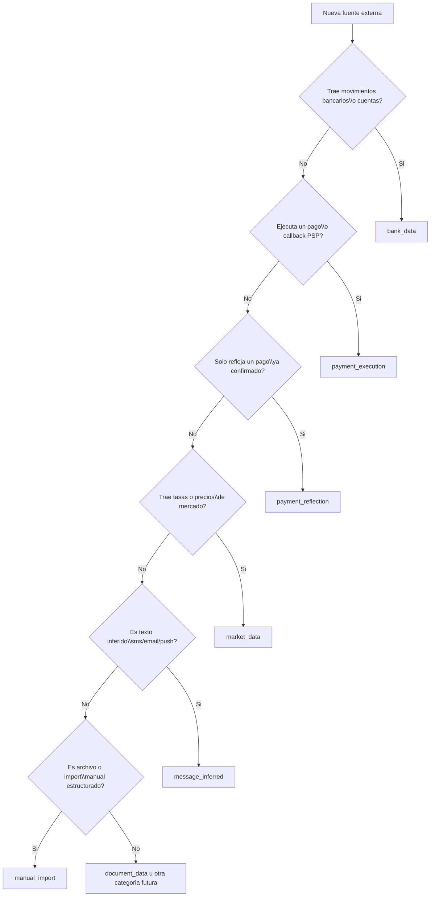

# Catalogo De Fuentes E Integraciones

## Objetivo

Este documento ordena las integraciones externas de Vexxo antes de bajar a
matrices campo por campo por proveedor.

Su trabajo no es describir payloads exactos de cada API.

Su trabajo es responder primero estas preguntas:

- que tipo de dato trae cada fuente
- que bounded context es dueno de esa fuente
- que contrato canonico debe usar
- donde se persiste primero
- que termina impactando ledger y que no
- que requiere consentimiento, idempotencia, reconciliacion u observabilidad

## Regla principal

No se clasifican primero por proveedor.

Se clasifican primero por tipo de fuente.

Esto evita errores de arquitectura como:

- modelar `transactions` alrededor de un agregador concreto
- meter callbacks PSP dentro del ledger
- meter tasas FX dentro de `finance.transactions`
- tratar mensajes inferidos como si fueran movimientos bancarios canonicos

## Taxonomia canonica de fuentes

Las fuentes externas de Vexxo deben clasificarse asi:

1. `bank_data`
2. `payment_execution`
3. `payment_reflection`
4. `market_data`
5. `message_inferred`
6. `manual_import`
7. `document_data`

No todas existen igual de maduras hoy, pero esta es la taxonomia correcta para
ordenar el sistema.

## Tabla resumen

| source_type | que trae | bounded context dueno | contrato canonico | destino principal |
|---|---|---|---|---|
| `bank_data` | cuentas, balances, movimientos bancarios, metadata de consentimiento | `finance.accounts` + `finance.transactions` | `open_banking.normalized_payload` | accounts + transactions |
| `payment_execution` | intent, autorizacion, captura, settlement, callbacks PSP, wallet metadata | `payments.payment_intents` | `payment_execution.normalized_payload` | payments |
| `payment_reflection` | reflejo contable final de un pago ya confirmado | `finance.transactions` | `payment_reflection.normalized_payload` | transactions |
| `market_data` | tasas FX, precios, curvas, indicadores de mercado | `finance.fx` o futuro `market_data` | `fx_rate.normalized_payload` / `market_quote.normalized_payload` | fx + analytics |
| `message_inferred` | sms, email, push, texto parseado | `finance.transactions` | `message_inferred.normalized_payload` | transactions |
| `manual_import` | CSV, XLSX, extractos procesados, lotes manuales | `finance.transactions` | `manual_import.normalized_payload` | transactions |
| `document_data` | OCR, PDFs, facturas, soportes | `documents` y consumidores derivados | `document_extraction.normalized_payload` | documents + downstream contexts |

## 1. `bank_data`

### Que es

Fuente orientada a:

- cuentas externas
- balances
- movimientos bancarios
- metadata de conexion o consentimiento

### Ejemplos de proveedores

- `Belvo`
- `Salt Edge`
- `Plaid`
- `TrueLayer`
- APIs bancarias directas cuando expongan movimientos/cuentas

### Nota sobre Bancolombia

`Bancolombia` no debe clasificarse como una sola cosa.

Depende de la API concreta que tengas:

- si trae cuentas o movimientos: `bank_data`
- si ejecuta pagos: `payment_execution`
- si trae tasas: `market_data`

### Bounded contexts duenos

- `finance.accounts`
  - ownership operativo de la cuenta
  - provider linkage
  - sync status
  - consentimiento operativo
- `finance.transactions`
  - intake de movimientos
  - dedupe
  - reconciliacion
  - materializacion del ledger

### Contrato canonico

- [open_banking.normalized_payload](finance/transactions/RAIL_NORMALIZATION_CONTRACTS.md)

### Persistencia inicial

- cuentas y linkage en `finance.accounts`
- filas de intake en `TransactionIntakeBatch` y `TransactionIntakeReceipt`
- detalle rico en `TransactionExternalDetails`

### Riesgos operativos

- duplicados por cursor o replay
- cambios retroactivos del proveedor
- movimientos `pending` vs `booked`
- consentimiento vencido o revocado
- drift entre balance bancario y ledger local

### Requisitos

- idempotencia fuerte
- trazabilidad por `provider_account_id`
- reconciliacion formal
- observabilidad de sync
- relacion con `identity.consents`

## 2. `payment_execution`

### Que es

Fuente orientada a ejecucion del rail de pago, no al ledger final.

Incluye:

- creacion de intent
- autorizacion
- captura
- settlement
- callbacks
- risk/fraud metadata
- reversals, refunds, disputes

### Ejemplos de proveedores

- `Wompi`
- PSPs y gateways equivalentes
- billeteras cuando entran por PSP/gateway
- APIs bancarias directas de pagos o transferencias

### Bounded context dueno

- `payments.payment_intents`

### Contrato canonico

- `payment_execution.normalized_payload`

Este contrato no pertenece a `finance.transactions`.

### Persistencia inicial

- `PaymentIntent`
- receipts de callback
- settlement records
- casos operativos

### Riesgos operativos

- callbacks duplicados o fuera de orden
- settlement tardio
- estado `requires_action`
- fraude, rechazo, reversal, dispute
- divergencia entre estado del PSP y reflejo del ledger

### Requisitos

- validacion de firmas/webhooks
- idempotencia por callback
- state machine estricta
- observabilidad por rail/proveedor
- contrato separado del ledger

## 3. `payment_reflection`

### Que es

Es el paso por el cual un pago externo ya confirmado se convierte en hecho
contable del ledger.

No es el rail.

Es el reflejo contable del rail.

### Ejemplos de origen

- `PaymentIntent` que pasa a `succeeded` o `settled`
- payout o transferencia ya ejecutada y aprobada como movimiento contable

### Bounded context dueno

- `finance.transactions`

### Contrato canonico

- [payment_reflection.normalized_payload](finance/transactions/RAIL_NORMALIZATION_CONTRACTS.md)

### Persistencia inicial

- `Transaction`
- `TransactionExternalDetails`

### Requisitos

- referencia clara al `payment_intent_id`
- no duplicar metadata rica del PSP en ledger
- reflejar solo lo necesario para consulta contable y soporte

## 4. `market_data`

### Que es

Datos de mercado y referencia, no hechos contables del usuario.

Incluye:

- tasas FX
- precios de mercado
- curvas
- indicadores

### Ejemplos de proveedores

- APIs de tasa de cambio
- proveedores de cotizaciones
- feeds financieros de mercado

### Bounded context dueno

- `finance.fx`
- a futuro podria existir un contexto `market_data`

### Contratos canonicos sugeridos

- `fx_rate.normalized_payload`
- `market_quote.normalized_payload`

### Persistencia inicial

- snapshots en `finance.fx`
- proyecciones o analitica en BigQuery segun necesidad

### Riesgos operativos

- stale data
- timezone/corte de mercado
- fuente oficial vs fuente referencial
- inconsistencia entre tasa usada en reporting y tasa usada en settlement

### Requisitos

- timestamp de observacion
- proveedor
- moneda base / moneda cotizada
- nivel de confianza y freshness

## 5. `message_inferred`

### Que es

Texto inferido desde:

- sms
- email
- push notification
- mensajes transformados por bridge interno

### Bounded context dueno

- `finance.transactions`

### Contrato canonico

- [message_inferred.normalized_payload](finance/transactions/RAIL_NORMALIZATION_CONTRACTS.md)

### Persistencia inicial

- intake interno de `transactions`
- `Transaction` en estado `pending`
- `TransactionExternalDetails` con metadata de inferencia

### Riesgos operativos

- parser ambiguo
- monto ausente
- merchant parcial
- falsos positivos
- duplicados con open banking posterior

### Requisitos

- `needs_user_confirmation`
- `inference_status`
- `confidence_score`
- parser versionado
- reconciliacion futura con movimiento bancario real si aparece despues

## 6. `manual_import`

### Que es

Carga manual estructurada de:

- CSV
- XLSX
- export de banco
- extractos procesados

### Bounded context dueno

- `finance.transactions`

### Contrato canonico sugerido

- `manual_import.normalized_payload`

### Persistencia inicial

- intake batch/receipt igual que otras fuentes

### Requisitos

- fingerprint por fila
- origen del archivo
- trazabilidad del usuario/operador
- validacion previa de columnas

## 7. `document_data`

### Que es

Informacion extraida desde:

- PDF
- OCR
- factura
- comprobante
- extracto no estructurado

### Bounded context dueno

- `documents`
- downstream hacia `transactions`, `payments` o `support` segun caso

### Requisitos

- no escribir ledger directo desde OCR
- dejar evidencia documental separada
- derivar despues a intake o soporte

## Clasificacion inicial de tus proveedores mencionados

Esta tabla no fija mapping de campos.

Solo ordena ownership y destino.

| proveedor o fuente | categoria primaria | categoria secundaria posible | bounded context principal | nota |
|---|---|---|---|---|
| `Wompi` | `payment_execution` | `payment_reflection` | `payments.payment_intents` | el reflejo final pasa despues a `transactions` |
| `Bancolombia` | depende de la API | `bank_data`, `payment_execution` o `market_data` | depende del producto contratado | no debe modelarse como un solo tipo fijo |
| `Belvo` | `bank_data` | ninguna relevante para este catalogo | `finance.accounts` + `finance.transactions` | agregacion bancaria/open finance |
| `Salt Edge` | `bank_data` | ninguna relevante para este catalogo | `finance.accounts` + `finance.transactions` | agregacion bancaria/open finance |
| `API de tasas FX` | `market_data` | ninguna | `finance.fx` | no debe escribir ledger |
| `SMS banco/comercio` | `message_inferred` | ninguna | `finance.transactions` | requiere confirmacion o alta confianza |
| `Email banco/comercio` | `message_inferred` | ninguna | `finance.transactions` | requiere confirmacion o alta confianza |

## Flujo de decision

## Matriz canonica que viene despues

Solo despues de clasificar una fuente en este catalogo se crea la matriz
detallada por proveedor.

La plantilla correcta es:

| provider | source_type | canonical_contract | owner_context | writes_to | requires_consent | confidence_default | ingestion_mode | notes |
|---|---|---|---|---|---|---|---|---|

Ejemplo:

| Belvo | bank_data | open_banking.normalized_payload | accounts + transactions | accounts, intake receipts, transactions | yes | high | pull/webhook | requiere relacion clara cuenta externa -> cuenta interna |
| Wompi | payment_execution | payment_execution.normalized_payload | payments | payment_intents | maybe | high | webhook/worker | ledger solo via reflection posterior |
| PaymentIntent settled | payment_reflection | payment_reflection.normalized_payload | transactions | transactions | no | high | internal event | debe incluir `payment_intent_id` |
| SMS Banco X | message_inferred | message_inferred.normalized_payload | transactions | transactions | no | medium | internal bridge | `pending + confirmed=false` |
| FX Provider X | market_data | fx_rate.normalized_payload | fx | exchange rates | no | high | scheduled job | no toca ledger |

## Orden recomendado de trabajo

1. clasificar cada proveedor en este catalogo
2. confirmar bounded context duenio
3. cerrar el contrato canonico por categoria
4. definir matriz de mapeo por proveedor
5. crear adapters o bridges
6. agregar observabilidad y reglas de confianza

## Lo que no se debe mezclar

- `Belvo` no debe modelarse como PSP
- `Wompi` no debe modelarse como feed bancario
- `FX` no debe crear `Transaction`
- `SMS` no debe tratarse como open banking
- `payment_execution` no debe vivir en `transactions`
- `payment_reflection` no debe reemplazar `payments`

## Documentos relacionados

- [README.md](README.md)
- [finance/transactions/RAIL_NORMALIZATION_CONTRACTS.md](finance/transactions/RAIL_NORMALIZATION_CONTRACTS.md)
- [finance/transactions/README.md](finance/transactions/README.md)
- [payments/payment_intents/README.md](payments/payment_intents/README.md)
- [finance/fx/README.md](finance/fx/README.md)
- [integrations_stub/README.md](integrations_stub/README.md)

## Ubicacion canonica de matrices por proveedor

La siguiente capa documental vive en:

- [integrations/README.md](/D:/Vexxo_Backend_API/integrations/README.md)
- [integrations/provider_mappings/README.md](/D:/Vexxo_Backend_API/integrations/provider_mappings/README.md)

Ahi deben vivir matrices concretas como:

- `belvo.md`
- `salt_edge.md`
- `bancolombia_accounts.md`
- `wompi.md`
- `fx_provider.md`
- `sms_bank_template.md`

