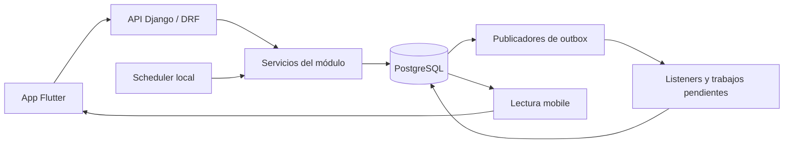

# Vexxo Backend API

Vexxo es una aplicación de finanzas personales para entender el dinero del día
a día, organizar compromisos y manejar gastos con otras personas. Este
repositorio contiene el backend: las reglas financieras, el control de acceso,
la persistencia y los servicios que consume la app Flutter.

Cuando alguien registra un gasto, acepta una invitación o cambia un presupuesto,
la responsabilidad de este backend es que la operación quede bien registrada,
respete los permisos y pueda consultarse después, incluso si el teléfono pierde
la conexión o repite la solicitud. Esa continuidad es el centro del proyecto.

El desarrollo actual se hace en local con Docker Compose y PostgreSQL. Hay
código preparado para servicios de Google Cloud, pero el despliegue cloud está
aplazado. Para trabajar en el producto hoy, empieza por el entorno local.

## Cómo está construido

Es un monolito modular con Python, Django y Django REST Framework. Los módulos
comparten aplicación y base de datos, pero cada uno es responsable de sus
reglas y de los datos que administra. La separación busca que podamos cambiar
un flujo sin tener que reinterpretar todo el sistema.

La distinción más importante está entre **cuentas, movimientos y pagos**:

- `finance.accounts` administra las cuentas y quién puede usarlas. Su balance
  operativo se puede reconstruir.
- `finance.transactions` conserva el registro contable de los movimientos.
  Aquí se decide qué está confirmado y qué afecta el saldo.
- `payments` administra intenciones de pago, ejecución con proveedores y
  conciliación. Una respuesta del proveedor o un registro de settlement no
  equivalen, por sí solos, a un movimiento confirmado en el ledger.

Flutter captura la intención de la persona y muestra el resultado. Puede
preparar borradores y sugerir categorías; la validación de permisos y la
decisión contable corresponden al backend.



Algunas acciones necesitan producir efectos después de guardar los datos:
actualizar una proyección, crear una notificación o solicitar un procesamiento.
Para esos casos usamos **outboxes**: registros persistentes de eventos que
pertenecen a cada módulo. Los publicadores los entregan a los listeners y los
workers procesan los trabajos que requieren ejecución aparte. Si algo falla,
el estado queda disponible para investigar y reintentar.

La operación de estas piezas se coordina en `tasks`; las reglas financieras
siguen en el módulo propietario. PostgreSQL sostiene el estado y el trabajo
durable del entorno local. El stack actual no necesita Celery, Redis ni
RabbitMQ. El [flujo del backend](docs/BACKEND_CURRENT_FLOW.md) explica las
secuencias con más detalle.

## Por dónde entrar al código

Si vas a trabajar en una funcionalidad, empieza por su README y sigue desde
allí el servicio y la vista que la exponen. No todos los directorios representan
una funcionalidad terminada; algunos reservan responsabilidades futuras.

| Si necesitas trabajar en… | Empieza aquí |
| --- | --- |
| Registro, login, perfil y onboarding | [identity.users](identity/users/README.md) |
| Sesiones, dispositivos y permisos | [identity](identity/README.md) |
| Cuentas, acceso compartido y sincronización | [finance.accounts](finance/accounts/README.md) |
| Registro manual, importación, voz y conciliación de movimientos | [finance.transactions](finance/transactions/README.md) |
| Presupuestos y deudas | [finance.budgets](finance/budgets/README.md) · [finance.debts](finance/debts/README.md) |
| Metas, aportes y colaboración sobre objetivos | [planning](planning/README.md) |
| Contactos, invitaciones y gastos compartidos | [contacts](contacts/README.md) · [social](social/README.md) |
| Pagos externos y compromisos programados | [payments](payments/README.md) |
| Conexiones y consentimiento bancario | [integrations.open_banking](integrations/open_banking/README.md) |
| Comprobantes, almacenamiento privado y OCR | [documents](documents/README.md) |
| Alertas, inbox y señales de actualización | [alerts](alerts/README.md) · [notifications](notifications/README.md) · [realtime](realtime/README.md) |
| Cierres mensuales y exportaciones | [reports](reports/README.md) |
| Respuestas agregadas y sincronización de Flutter | [api.mobile](api/mobile/README.md) |
| Seguridad, auditoría y operación | [security](security/README.md) · [observability](observability/README.md) · [admin_tools](admin_tools/README.md) |
| Eventos, publicadores, workers y scheduler | [common](common/README.md) · [tasks](tasks/README.md) |

Las rutas públicas se montan en [api/v1/routers.py](api/v1/routers.py), bajo
`/api/`. La configuración del proyecto está en [backend](backend/README.md).
Los adapters y simulaciones de proveedores se explican en
[integrations](integrations/README.md) e
[integrations_stub](integrations_stub/README.md).

## Ponerlo en marcha

Necesitas Docker Desktop con contenedores Linux y PowerShell. La imagen del
backend instala las dependencias del proyecto; no hace falta preparar Python
en el host para usar este recorrido.

Desde la raíz del repositorio:

```powershell
# Crear la configuración local solo si todavía no existe.
if (-not (Test-Path .env.local)) {
    Copy-Item .env.local.example .env.local
}

# Construir y levantar API, base de datos y procesos de fondo.
.\scripts\run_stack.ps1 local up full -Build
```

El script levanta PostgreSQL, ejecuta las migraciones y arranca los servicios
del conjunto elegido. `full` incluye publicadores, workers, scheduler y
ClamAV. Para trabajar únicamente sobre API y base de datos puedes usar `core`;
para un flujo concreto existen conjuntos como `auth`, `accounts`,
`transactions` o `documents`. La lista y el comportamiento de cada comando
están en [scripts/README.md](scripts/README.md).

Con los puertos por defecto:

| Servicio | Dirección |
| --- | --- |
| API | `http://127.0.0.1:8000/api/` |
| Comprobación de proceso | `http://127.0.0.1:8000/healthz/` |
| Comprobación de disponibilidad | `http://127.0.0.1:8000/readyz/` |
| Administración Django | `http://127.0.0.1:8000/admin/` |
| PostgreSQL desde el host | `127.0.0.1:54329` |

Dentro de Docker, la base se alcanza como `db:5432`. Usa la base y las
credenciales de `.env.local` para conectarte desde pgAdmin; pgAdmin es un
cliente del PostgreSQL de Docker, no una segunda base de desarrollo.

Los valores del archivo de ejemplo sirven como punto de partida. Las funciones
que requieren llaves o credenciales necesitan configuración adicional. Antes
de activar cifrado o proveedores, revisa el
[procedimiento de gestión de llaves](docs/KEY_MANAGEMENT_RUNBOOK.md).
Los secretos y los archivos de `.runtime/` permanecen fuera de Git.

Para el trabajo habitual:

```powershell
.\scripts\run_stack.ps1 local status full
.\scripts\run_stack.ps1 local logs transactions -Follow
.\scripts\run_stack.ps1 local check core
.\scripts\run_stack.ps1 local test core
.\scripts\run_stack.ps1 local down
```

`test` descubre los módulos de prueba del proyecto cuando no recibe etiquetas
específicas. `down` detiene el stack sin eliminar el volumen de PostgreSQL.
Si falla el arranque, sigue el [diagnóstico local](docs/LOCAL_DEVELOPMENT.md)
antes de cambiar settings o instalar servicios adicionales.

## Trabajar con la app Flutter

El frontend vive en otro repositorio. En el emulador Android, la URL del
backend local es `http://10.0.2.2:8000`; desde el propio equipo es
`http://127.0.0.1:8000`. Para un teléfono físico hay que usar la IP LAN del
equipo y añadirla a `VEXXO_LOCAL_ALLOWED_HOSTS`.

La app dispone de dos entradas de lectura agregada: `/api/mobile/sync-state/`
permite comparar versiones y `/api/mobile/bootstrap/` devuelve las secciones
que necesitan actualizarse. Esto evita que cada pantalla tenga que reconstruir
el estado financiero consultando muchos endpoints por separado.

Para una escritura, importa tanto el resultado como el reintento. El registro
manual admite `Idempotency-Key`: si se repite la misma operación con la misma
clave y cuerpo, devuelve el resultado existente. Reutilizar la clave con otro
cuerpo produce un conflicto. El contrato completo está en
[transacciones](finance/transactions/README.md).

Un borrador local, una mutación pendiente de envío y un movimiento confirmado
son estados distintos. La pantalla debe distinguirlos. Lo mismo aplica a los
datos importados y a las sugerencias de IA: preparar información para revisión
no confirma una operación financiera.

Al cerrar una funcionalidad, comprueba el recorrido con ambos repositorios:
acción en la pantalla, petición real, permisos, persistencia y lectura
actualizada. Las pruebas con respuestas simuladas son útiles, pero no detectan
por sí solas una ruta ausente o un contrato que cambió en el otro proyecto.
La [colección Postman](postman/Vexxo_local.postman_collection.md) ayuda a
inspeccionar la API durante esa integración.

## Qué está construido y qué falta cerrar

El backend contiene implementación para identidad y sesiones, cuentas,
movimientos, presupuestos, deudas, metas, colaboración, documentos, reportes
y procesamiento de fondo. Eso no significa que todos esos recorridos estén
cerrados en mobile o listos para producción.

Open Banking tiene `local_mock` y pagos dispone de `local_fake` para desarrollar
sin ejecutar operaciones reales. Los proveedores externos requieren sus
credenciales y validaciones. El OCR de la app puede preparar un borrador local;
el procesamiento y almacenamiento de Documents tienen su propio contrato.
La conexión entre esas piezas debe comprobarse en el flujo que se vaya a
entregar.

La prioridad de desarrollo es completar recorridos: entrar a la app, registrar
y consultar un movimiento, entender los compromisos y resolver un gasto
compartido. Antes de crear otro módulo, revisa si la responsabilidad ya vive en
uno existente. La [evaluación modular](docs/MODULE_PRODUCT_ROADMAP.md) distingue
implementaciones, capacidades parciales y estructuras reservadas. El
[análisis de producto e integración](docs/PRODUCT_AND_ENGINEERING_ASSESSMENT_2026.md)
recoge los bloqueos identificados; léelo como una evaluación fechada, no como
un estado de ejecución actualizado automáticamente.

## Cómo hacemos cambios

Una modificación financiera necesita una regla clara y un lugar donde vivir.
Las vistas validan la entrada y exponen la respuesta; los servicios coordinan
el caso de uso. Los modelos y las restricciones de base de datos protegen la
consistencia. Los eventos comunican lo ocurrido a los consumidores que lo
necesitan.

Al revisar un cambio, prestamos especial atención a cuatro cosas:

- **Acceso:** ser dueño de una cuenta, pertenecer a un grupo y poder registrar
  movimientos son permisos que hay que comprobar en la operación concreta.
- **Consistencia:** si cambia estado financiero y se registra un evento,
  la frontera transaccional debe impedir que quede guardada solo una parte.
- **Reintentos:** una respuesta perdida o un worker repetido no deben duplicar
  un movimiento, un aporte o una liquidación.
- **Trazabilidad:** el error debe poder investigarse sin registrar tokens,
  llaves ni contenido financiero innecesario en los logs.

Prueba el flujo modificado, sus permisos y sus casos de error. Para validar
migraciones y comportamiento SQL, usa PostgreSQL. Un check de imports o una
prueba con mocks no cubren esas garantías. Las pruebas de rendimiento tienen
sus propios escenarios y resultados en [tests/load](tests/load/README.md).

La documentación se actualiza junto al cambio: el README del módulo explica
el detalle y este documento solo cambia si afecta la visión general o la forma
de trabajar. Evita convertirlo en una lista de entregas. La
[convención documental](CONVENCION_DOCUMENTAL.md) desarrolla este criterio.

## Documentación para profundizar

| Tema | Documento |
| --- | --- |
| Entorno y resolución de problemas | [Desarrollo local](docs/LOCAL_DEVELOPMENT.md) |
| Topología y ejecución de fondo | [Arquitectura local](docs/ARCHITECTURE_LOCAL_FIRST.md) |
| Secuencias de los flujos principales | [Flujo del backend](docs/BACKEND_CURRENT_FLOW.md) |
| Proveedores y colaboración | [Arquitectura de integraciones](docs/PROVIDER_AND_COLLABORATION_ARCHITECTURE.md) |
| Privacidad, retención y datos sensibles | [Política de datos](docs/DATA_SECURITY_POLICY.md) |
| Cifrado, rotación y recuperación | [Gestión de llaves](docs/KEY_MANAGEMENT_RUNBOOK.md) |
| Sesiones, MFA y evidencia de dispositivos | [Seguridad de identidad](docs/IDENTITY_SECURITY_ASSURANCE.md) |
| Consentimiento bancario y revocación | [Open Finance](docs/OPEN_FINANCE_CONSENT_AND_REVOCATION.md) |
| Evidencia estructural por módulo | [Inventario documental](docs/BACKEND_DOCUMENTATION_AUDIT.md) |

Si acabas de entrar al equipo, levanta el entorno, registra un movimiento de
prueba y sigue su recorrido desde la URL hasta el servicio, el registro y su
lectura en la API. Ese ejercicio da más contexto para trabajar en Vexxo que
recorrer todas las carpetas antes de tocar un flujo.
