# Vexxo Backend API

## Que es

Este repositorio contiene el backend principal de Vexxo, una app financiera
personal mobile-first.

Su trabajo no es solo guardar CRUDs. El backend:

- entiende la realidad financiera del usuario
- aplica politicas de producto, riesgo y operacion
- orquesta eventos de dominio
- integra proveedores externos
- materializa ledger, proyecciones y experiencia realtime

La idea de negocio es simple:

- observar dinero
- interpretarlo
- ayudar a decidir
- ejecutar acciones financieras con seguridad operativa

## Como usar este README

Este README no intenta reemplazar la documentacion de cada modulo. Su trabajo
es servir como documento de onboarding tecnico:

- explicar el mapa general del backend
- dejar claras las decisiones estructurales mas importantes
- mostrar como se conectan los contextos entre si
- dirigir rapidamente al README correcto cuando hace falta mas detalle

La forma recomendada de leerlo es:

1. entender el core del negocio
2. entender la arquitectura logica y cloud
3. entender como se relacionan los modulos
4. profundizar en el README especifico del contexto que te interese

## Indice de arquitectura

Puedes entrar al backend desde cuatro puertas distintas, segun la pregunta que
tengas:

### 1. Negocio

Si quieres entender que resuelve Vexxo y donde vive cada responsabilidad:

- [Core del negocio](#core-del-negocio)
- [Glosario corto](#glosario-corto)
- [Arquitectura logica](#arquitectura-logica)

### 2. Dominio

Si quieres entender bounded contexts, aggregates y tablas principales:

- [Diagramas detallados por modulo](#5-diagramas-detallados-por-modulo)
- [identity.users](identity/users/README.md)
- [identity.sessions](identity/sessions/README.md)
- [identity.devices](identity/devices/README.md)
- [identity.consents](identity/consents/README.md)
- [identity.permissions](identity/permissions/README.md)
- [identity.eventing](identity/eventing/README.md)
- [finance.accounts](finance/accounts/README.md)
- [finance.transactions](finance/transactions/README.md)
- [payments.payment_intents](payments/payment_intents/README.md)
- [alerts.alerts](alerts/alerts/README.md)
- [notifications](notifications/README.md)
- [realtime.consumers](realtime/consumers/README.md)
- [common](common/README.md)

### 3. Flujos

Si quieres seguir que pasa paso a paso cuando alguien usa el producto:

- [Diagramas de secuencia de flujos criticos](#6-diagramas-de-secuencia-de-flujos-criticos)
- [register](identity/users/README.md#secuencia-critica-register)
- [create account](finance/accounts/README.md#secuencia-critica-create-account)
- [manual transaction](finance/transactions/README.md#secuencias-criticas)
- [payment confirmed](payments/payment_intents/README.md#secuencia-critica-payment-confirmed)
- [external transaction intake](finance/transactions/README.md#secuencias-criticas)

### 4. Cloud

Si quieres entender despliegue, eventing e integraciones:

- [Encaje con GCP](#encaje-con-gcp)
- [Diagramas de despliegue e interaccion cloud](#7-diagramas-de-despliegue-e-interaccion-cloud)
- [common cloud/eventing](common/README.md#vista-cloud)
- [integrations_stub](integrations_stub/README.md)
- [Auditoria de eventing y cloud readiness](AUDITORIA_EVENTING_CLOUD.md)

### 5. Documentacion

Si quieres entender que README es canonico, cual es derivado y que estructura
debemos mantener:

- [Convencion documental](CONVENCION_DOCUMENTAL.md)

## Core del negocio

Vexxo no se modela como un simple tracker.

Los bounded contexts principales responden a estas preguntas:

- `identity`: quien es el usuario, que plan tiene, que puede hacer
- `finance.accounts`: donde vive el dinero y quien puede operar cada cuenta
- `finance.transactions`: cual es el ledger real, su intake externo canonico,
  su reconciliacion formal y sus efectos contables
- `payments`: como se ejecutan pagos externos sin contaminar el ledger
- `alerts`: que debe llamar la atencion del usuario y como se enriquece con IA
- `notifications` y `realtime`: como se entrega feedback util a mobile/web

### Vista visual del core

Los siguientes diagramas muestran el estado actual del modelo backend ya
implementado. No intentan representar cada tabla auxiliar, sino la estructura
canonica del negocio segun DDD: aggregates, relaciones entre bounded contexts y
modelos de lectura derivados.

#### 1. Mapa DDD del core

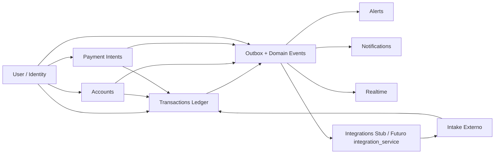

Lectura:

- `identity` define usuario, plan y ownership
- `accounts` define la superficie financiera operativa
- `transactions` es el ledger canonico
- `payments` ejecuta afuera y luego materializa en ledger
- integraciones externas entran por intake, no por escritura directa al ledger
- outbox y eventos desacoplan side effects y servicios futuros

#### 2. Modelo de clases del dominio financiero central

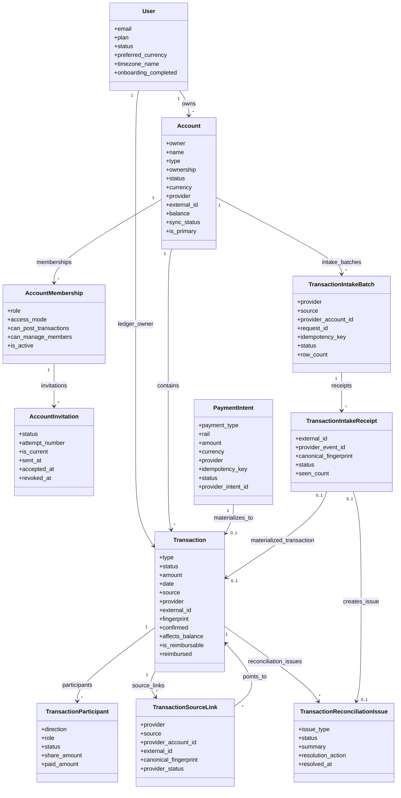

Lectura:

- `User` es el root de identidad y plan
- `Account` es el aggregate operativo donde vive el dinero
- `Transaction` es el hecho contable final
- `PaymentIntent` no es ledger; puede materializar una `Transaction`
- `TransactionIntake*` y `TransactionSourceLink` separan ingreso externo de
  escritura contable
- `TransactionReconciliationIssue` formaliza correcciones y reversos tardios

#### 3. Capa de eventos, proyecciones y experiencia

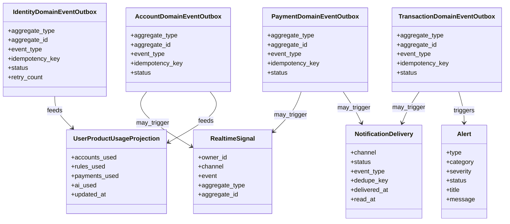

Lectura:

- los bounded contexts publican por outbox, no desde el request path fuerte
- `UserProductUsageProjection` es una proyeccion de producto, no una tabla
  transaccional
- `Alert`, `NotificationDelivery` y `RealtimeSignal` son capas de experiencia
  derivadas del core

#### 4. Vista corta de arquitectura backend

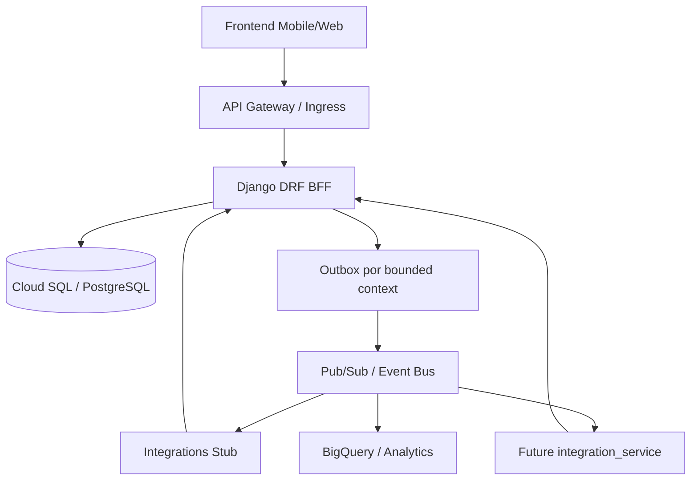

Lectura:

- el backend canonico sigue siendo el dueño de Cloud SQL
- integraciones no escriben ledger directo
- outbox y bus separan API, dominio y consumidores cloud

#### 5. Diagramas detallados por modulo

Esta segunda tanda hace zoom sobre los modelos y relaciones que hoy estan
implementados. No reemplaza los README de cada bounded context; sirve para
entender rapido el shape real del backend y como se reparten responsabilidades
entre aggregates, read models y outboxes.

##### 5.1 Identity

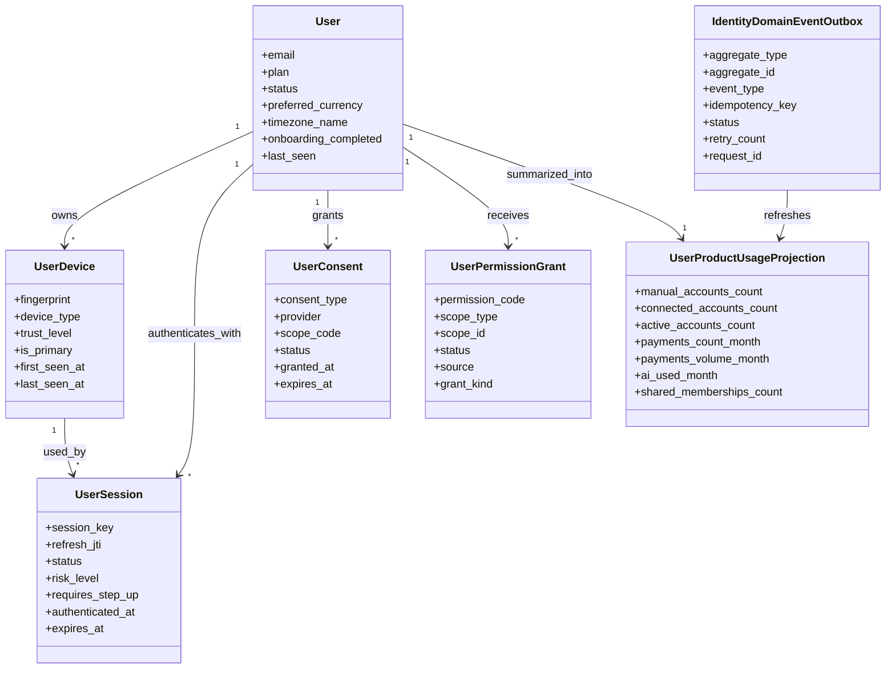

Lectura:

- `User` concentra identidad, plan y configuracion base
- `UserDevice` y `UserSession` separan hardware conocido de ocurrencias de acceso
- `UserConsent` y `UserPermissionGrant` soportan gobierno de datos y
  capabilities
- `UserProductUsageProjection` es el read model operativo que evita hacer
  `count()` complejos en caliente

##### 5.2 Accounts

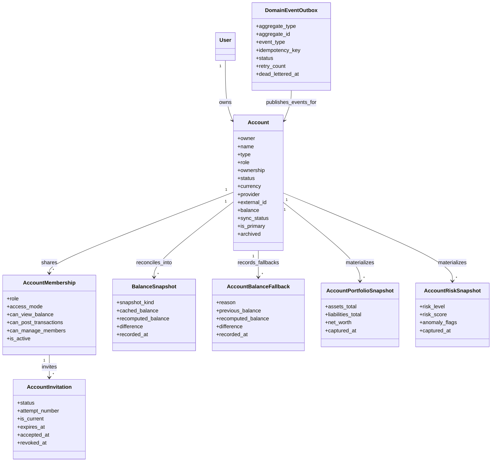

Lectura:

- `Account` es la superficie operativa donde vive el dinero observado
- membresias e invitaciones separan sharing efectivo de onboarding de acceso
- snapshots y fallbacks soportan conciliacion, inteligencia y soporte
- el outbox de `accounts` es hoy el patron mas maduro del sistema

##### 5.3 Transactions

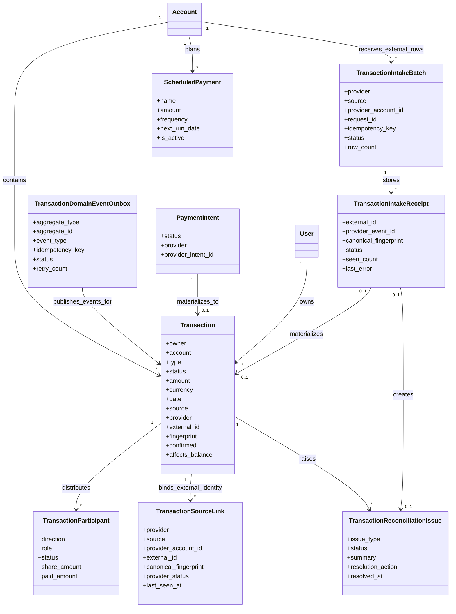

Lectura:

- el ledger sigue en `Transaction`, no en `PaymentIntent`
- el intake externo ya no escribe al ledger directo; entra por batch/receipt
- `TransactionSourceLink` e `Issue` formalizan dedupe, correcciones y reversos
- el write path manual sigue conviviendo con signals, pero el camino nuevo ya
  existe para intake y reconciliacion

##### 5.4 Payments

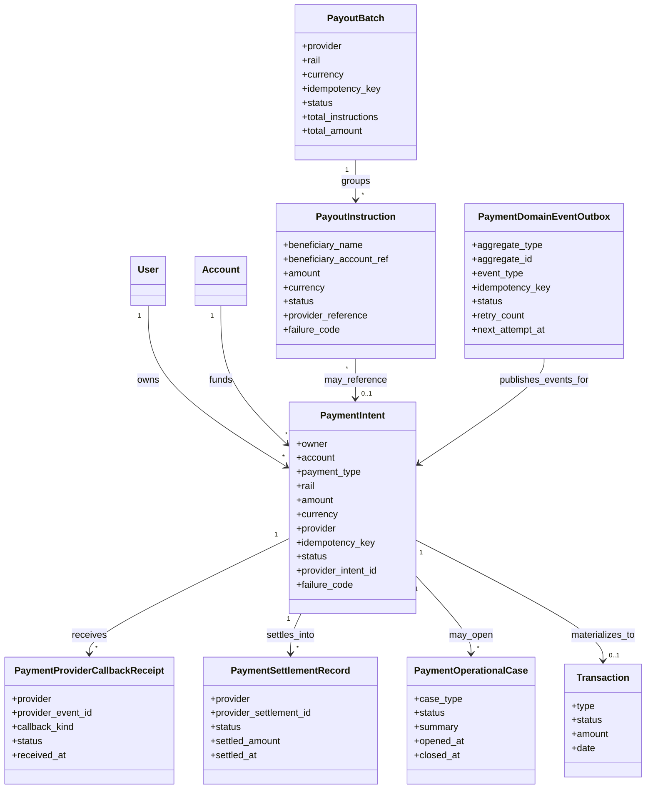

Lectura:

- `payments` representa ejecucion operativa externa, no verdad contable final
- callbacks, settlement y casos operativos quedan persistidos fuera del ledger
- los payouts comparten lenguaje del dominio de pagos, no del ledger

##### 5.5 Experience y eventing

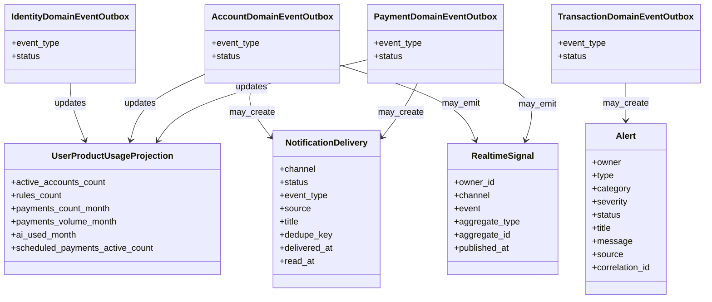

Lectura:

- esta capa no es el core transaccional; es la traduccion visible del dominio
- `Alert` es pieza de negocio; `NotificationDelivery` es entrega durable;
  `RealtimeSignal` es feedback liviano
- `UserProductUsageProjection` conecta producto, limites y experiencia sin
  recalculo caliente sobre OLTP

#### 6. Diagramas de secuencia de flujos criticos

Estos diagramas muestran el camino operativo real de las acciones que hoy mas
importan en Vexxo. La idea no es representar cada helper interno, sino dejar
claro que bounded context es dueno del dato, donde vive el outbox y cuando
aparecen side effects o integraciones.

##### 6.1 Register

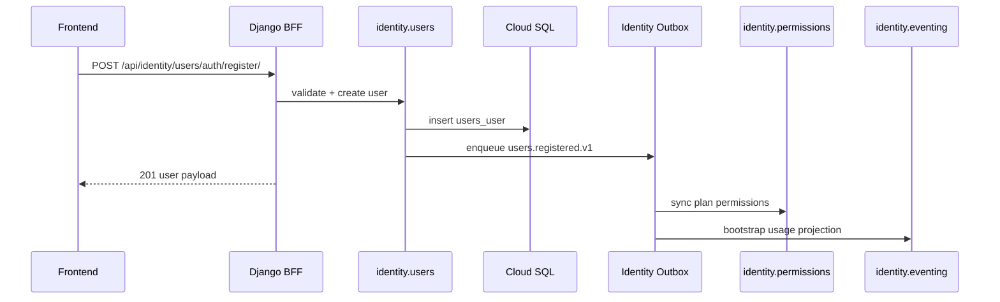

##### 6.2 Create account

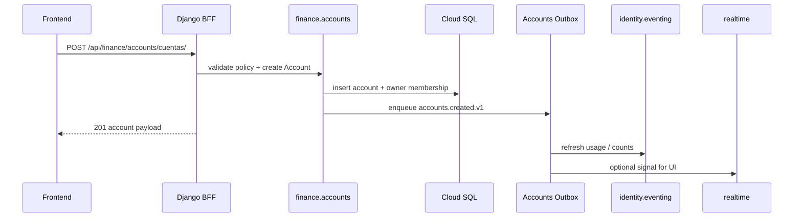

##### 6.3 Manual transaction

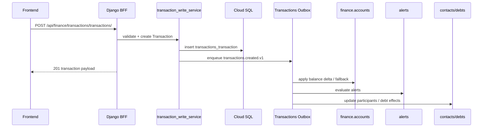

##### 6.4 Payment confirmed

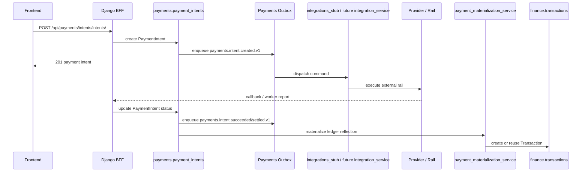

##### 6.5 External transaction intake

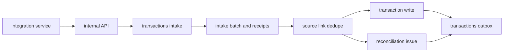

#### 7. Diagramas de despliegue e interaccion cloud

Esta capa separa dos cosas:

- como esta armado hoy el backend para convivir con local, Cloud Run y GCP
- cual es la topologia objetivo cuando `integration_service` salga del stub y
  opere como consumidor cloud real

##### 7.1 Despliegue cloud objetivo

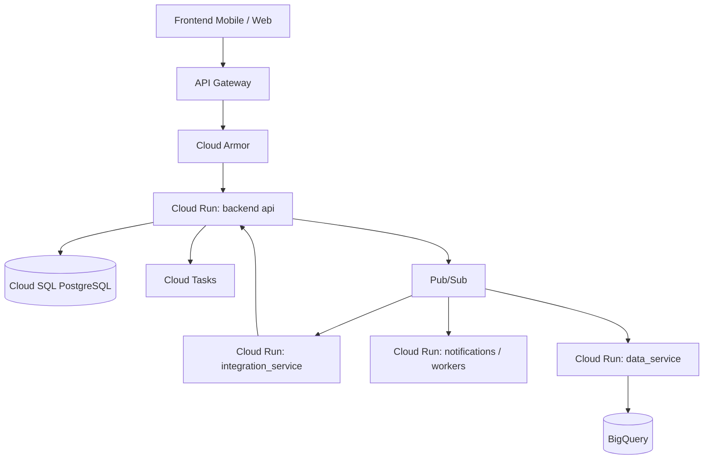

Lectura:

- `backend api` sigue siendo duenio de Cloud SQL y del write canonico
- `integration_service` consume eventos y devuelve resultados al backend
- `Pub/Sub` distribuye trabajo entre consumidores cloud sin volver al request
  sincrono
- `BigQuery` recibe analitica y lecturas de datos, no ownership transaccional

##### 7.2 Interaccion cloud del backend canonico

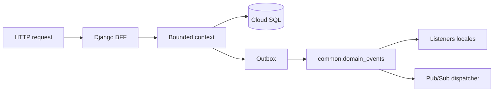

Lectura:

- el request web escribe dominio y termina rapido
- los side effects fuertes no salen del request path; se encolan en outbox
- `common.domain_events` coordina listeners locales y dispatchers externos

##### 7.3 Estado actual vs estado objetivo de integraciones

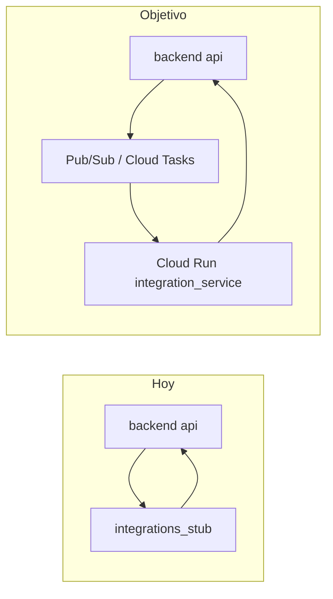

Lectura:

- hoy el stub permite diseñar la frontera sin sacar aun el servicio del repo
- el objetivo no es que `integration_service` escriba directo a SQL
- el objetivo si es que consuma eventos/tasks y reporte resultados por
  callbacks o endpoints internos del backend

##### 7.4 Camino cloud de intake externo

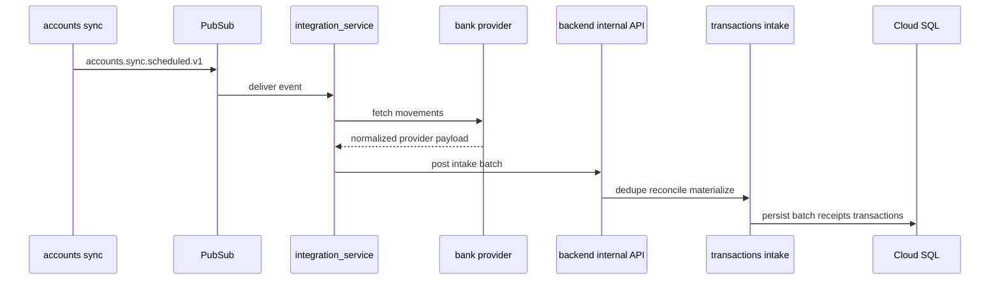

Lectura:

- open banking no debe escribir `transactions` directo desde afuera
- `integration_service` integra y normaliza
- el backend canonico decide dedupe, reconciliacion y escritura final

## Glosario corto

Antes de entrar al detalle, estos terminos aparecen una y otra vez:

- `ledger`
  la verdad contable final del sistema.
- `outbox`
  persistencia local de eventos antes de publicarlos.
- `projection`
  modelo de lectura optimizado para consultas o UX.
- `snapshot`
  fotografia persistida de un estado o agregado en un momento dado.
- `callback`
  respuesta asincrona de un proveedor o worker hacia el backend.
- `rail`
  canal externo por el que realmente se ejecuta un pago o movimiento.
- `BFF`
  backend for frontend usado por mobile/web.

## Arquitectura logica

Patrones principales del proyecto:

- BFF/API para mobile y web
- bounded contexts por dominio
- eventos de dominio con outbox
- workers y callbacks para procesos asincronos
- read models para lecturas operativas y UX
- separacion entre ejecucion externa y reflejo contable

Reglas estructurales importantes:

- pagar no es lo mismo que registrar una transaccion
- `Account.balance` es cache operativo, no ledger canonico
- la publicacion confiable usa outbox; la UX puede usar senales realtime livianas
- los requests web deben terminar rapido; el trabajo pesado se mueve a workers,
  callbacks o consumidores del bus
- las fuentes externas no deben escribir ledger directo; pasan por intake
  canonico y luego por bounded contexts duenos del dato
- cuando se endurezca cloud/eventing, la prioridad es homogeneizar publicacion,
  retry, idempotencia y trazabilidad entre bounded contexts antes de agregar mas
  transporte o mas servicios
- cada correccion sobre cloud/eventing debe cerrar brechas reales entre
  bounded contexts y no esconder deuda con mas glue local, mas threads o mas
  stubs

## Encaje con GCP

El backend esta pensado para una topologia cloud-first en GCP.

### Edge, API y seguridad

- API Gateway como entrada B2C
- Cloud Armor para WAF y DDoS
- Identity Platform o Firebase Auth para auth externa
- Cloud IAM para permisos de servicios
- Secret Manager para tokens, secretos y credenciales
- Cloud KMS para cifrado de material sensible

### Compute

- Cloud Run para:
  - `api` Django/DRF
  - `integrations_service`
  - `alerts_service`
  - `notifications_service`
  - `data_service`
  - `llm_gateway`
  - workers operativos
- Artifact Registry para imagenes
- Vertex AI o GKE/GPU cuando el serving de modelos lo exija

### Event-driven y jobs

- Pub/Sub como backbone de eventos externos
- Cloud Tasks para retries e idempotencia HTTP
- Cloud Scheduler para cron jobs
- Workflows cuando haga falta orquestacion multi-step

### Data

- Cloud SQL PostgreSQL para OLTP
- Cloud Storage para documentos, exports y artefactos
- BigQuery para analytics, datasets y exploracion
- Datastream y Dataflow para CDC y pipelines
- Dataplex/Data Catalog si se endurece gobierno de datos o B2B

### Observabilidad

- Cloud Logging
- Cloud Monitoring
- Cloud Trace
- Error Reporting
- OpenTelemetry si se profundiza tracing distribuido

### IA

- Gemini via `llm_gateway`
- Document AI si OCR pasa a ser core
- BigQuery ML para analitica y features

## Estructura fisica del backend

El repositorio mezcla bounded contexts de negocio, infraestructura compartida y
carpetas operativas de soporte.

### Carpetas raiz mas importantes

- `api/`
  BFF HTTP para mobile/web. Aqui vive la capa que expone endpoints, routers y
  versionado hacia clientes.
- `backend/`
  configuracion global de Django, settings, arranque y ensamblaje del proyecto.
- `common/`
  infraestructura compartida del monolito modular: eventos, helpers, piezas
  comunes y adaptadores transversales.
- `identity/`
  usuario, plan, permisos, consentimientos, sesiones, dispositivos e identidades
  externas.
- `finance/`
  cuentas, ledger, deudas, categorias, vendors, FX y otros contextos
  financieros.
- `payments/`
  ejecucion externa de pagos, payout/dispersions, contratos por proveedor y
  scheduling de pagos.
- `alerts/`
  alertas, reglas y enriquecimiento con IA.
- `notifications/`
  inbox durable y piezas de entrega de notificaciones.
- `realtime/`
  señales livianas para polling y futura capa realtime viva.
- `reports/`
  reporting agregado, summaries y contextos reservados para snapshots y exports.
- `planning/`
  metas y contextos futuros de planning mas avanzado.
- `documents/`
  bloque documental pensado para storage, metadata, OCR y vinculos contables.
- `contacts/`
  contactos financieros reutilizables del usuario.
- `social/`
  contextos de colaboracion social; hoy `teams` es el mas concreto.
- `support/`
  auditoria funcional y piezas de soporte operativo.
- `integrations_stub/`
  fronteras temporales de integracion mientras ciertos servicios aun no se
  separan en microservicios o workers externos.

### Carpetas de soporte y operacion

- `observability/`
  configuracion o piezas relacionadas con logging, metricas o salud operativa.
- `security/`
  piezas transversales de seguridad del proyecto.
- `tasks/`
  scripts o entrypoints para trabajos de fondo si aplica.
- `scripts/`
  comandos de soporte, bootstrap o automatizacion local.
- `tests/`
  pruebas transversales o de integracion a nivel repositorio.
- `admin_tools/`
  herramientas internas de operacion y administracion.
- `docs/`
  documentacion adicional no canónica del dominio.
- `logs/`, `media/`, `staticfiles/`
  artefactos locales del entorno de ejecucion.

## Scripts locales vs despliegue en GCP

El directorio `scripts/` puede contener wrappers utiles para desarrollo local,
pero esos archivos no definen el flujo de despliegue cloud.

### Scripts locales

Wrappers locales no versionados como:

- `scripts/run_manage_vexxo_app.cmd`
- `scripts/migrate_vexxo_app.cmd`
- `scripts/test_transactions_vexxo_app.cmd`

existen para:

- correr `manage.py` contra PostgreSQL local
- validar migraciones rapidamente en Windows
- ejecutar pruebas locales sin tocar el `.env` cloud

Estos wrappers:

- son tooling de desarrollo local
- no deben quedar versionados en el repo
- no son artefactos de produccion
- no deben ejecutarse en Cloud Run ni en pipelines de despliegue

### Staging y produccion

En entornos cloud el flujo correcto no usa esos `.cmd`.

Lo esperado es ejecutar directamente comandos Django dentro del contexto del
contenedor, job o pipeline correspondiente, por ejemplo:

- `python manage.py migrate --noinput`
- `python manage.py check`
- la suite de tests en CI antes del deploy

La configuracion de produccion debe venir de:

- variables de entorno del servicio
- Secret Manager
- configuracion del pipeline o job
- conexion a Cloud SQL segun `backend.settings`

### Regla operativa

Si el objetivo es:

- desarrollo local o debugging en Windows
  usa los wrappers de `scripts/`
- staging o produccion en GCP
  usa `manage.py` directo dentro del flujo de despliegue

La razon es simple: los `.cmd` encapsulan un entorno local concreto
(`127.0.0.1`, PostgreSQL local, variables por sesion) y no representan la
topologia real de produccion.

## Mapa funcional por dominio

El sistema esta organizado para que cada bloque responda a una responsabilidad
de negocio clara.

### `identity`

Define quien es el usuario, bajo que plan opera y que puede hacer.

Incluye:

- `users`: plan, capabilities, usage projection y politica de producto
- `permissions`: grants efectivos y entitlements derivados
- `consents`: permisos legales u operativos para integraciones
- `devices` y `sessions`: seguridad operacional del acceso
- `social_identities`: vinculacion con identidades externas
- `eventing`: outbox y read models propios del contexto

Su rol en el sistema es transversal: casi todos los modulos consultan plan,
ownership o permisos resueltos por identidad.

### `finance`

Es el corazon financiero interno del usuario.

Incluye:

- `accounts`: cuentas, sharing, sync, balances cacheados y politica de acceso
- `transactions`: ledger canonico y participantes
- `debts`: deudas y cuotas
- `categories`, `vendors`, `fx`: catalogos y datos auxiliares del ledger
- `budgets`, `investments`, `limits`: contextos hoy menos maduros o reservados

La idea clave es que `transactions` representa verdad contable, mientras que
`accounts` aporta vistas operativas y relaciones de colaboracion.

### `payments`

Separa ejecucion financiera externa del ledger interno.

Incluye:

- `payment_intents`: intentos de pago, callbacks, pricing, payout, settlement,
  adapters y contratos por proveedor
- `scheduled_payments`: planificacion y recurrencia
- otros submodulos como `calendar` o `reminders`, que preparan la capa de
  programacion de pagos

`payments` no reemplaza al ledger. Cuando un pago externo se confirma, su
reflejo final se materializa en `finance.transactions`.

### `alerts`

Se encarga de detectar o expresar cosas que merecen atencion del usuario.

Incluye:

- `alerts`: alerta visible y enriquecimiento
- `rules`: automatizacion configurable por usuario
- `triggers`, `listeners`, `ai_stub`: contextos reservados para evolucion

Es el puente entre datos financieros y explicacion accionable.

### `notifications` y `realtime`

Resuelven como se entrega feedback sin mezclarlo con el core transaccional.

- `notifications.deliveries`: inbox durable
- `notifications.listeners`: transforma eventos del dominio en mensajes
- `notifications.preferences` y `templates`: contexto reservado para control y
  contenido de entrega
- `realtime.consumers`: persiste `RealtimeSignal` para polling o gateways
  futuros

La regla general es:

- inbox durable para historial y soporte
- realtime liviano para UX interactiva

### `reports` y `planning`

Sostienen interpretacion, resumen y futuro del dinero.

- `reports.reports`: agregaciones simples sobre el ledger
- `reports.summaries`: resumenes reservados o en evolucion
- `reports.exports`, `monthly_reports`, `snapshots`: contextos preparados para
  reporting persistido
- `planning.goals`: metas financieras
- `planning.milestones`, `projections`, `shared_goals`: capa futura de planning
  mas rica

### `documents`, `contacts` y `social`

Son bloques complementarios al core financiero.

- `documents`: documentos, metadata, OCR y storage, hoy mayormente reservados
- `contacts`: contactos financieros reutilizables y balance neto por contraparte
- `social`: colaboracion general; hoy `teams` es la pieza mas concreta

### `support`, `common`, `integrations_stub`

Resuelven soporte transversal.

- `support.audit`: auditoria funcional
- `common`: eventos, helpers y piezas de infraestructura transversal
- `integrations_stub`: adapters temporales y workers aun no extraidos

## Ruta recomendada de onboarding

Dependiendo del objetivo, no todo el mundo deberia leer el repo en el mismo
orden.

### Si vienes por producto o dominio

1. `identity.users`
2. `finance.accounts`
3. `finance.transactions`
4. `payments`
5. `alerts`
6. `notifications`

### Si vienes por backend/API

1. `backend`
2. `api`
3. `common`
4. `identity`
5. `finance`
6. `payments`

### Si vienes por cloud, async o integraciones

1. `backend.settings`
2. `common`
3. `tasks`
4. `integrations_stub`
5. `payments.payment_intents`
6. `finance.accounts`

### Si vienes por soporte u operacion

1. `support.audit`
2. `notifications.deliveries`
3. `realtime.consumers`
4. `finance.accounts` snapshots/intelligence
5. `payments.payment_intents`

## Como se relacionan entre si

El valor del sistema no esta en cada modulo aislado, sino en la forma en que
se conectan.

### Relacion estructural principal

- `identity.users` define plan y capabilities
- `identity.permissions` traduce eso en grants operativos
- `finance.accounts`, `payments`, `alerts.rules` y `contacts` aplican guards
  usando ese contexto
- `common.domain_events` y los outbox de cada contexto desacoplan fan-out y
  trabajo asincrono
- `notifications`, `realtime` y ciertos read models consumen esos eventos para
  UX y soporte

### Flujo tipico de dinero dentro de Vexxo

1. el usuario se autentica y entra con su contexto de plan/capabilities
2. consulta cuentas y balances operativos desde `finance.accounts`
3. registra o recibe movimientos en `finance.transactions`
4. `accounts` actualiza vistas operativas y emite eventos
5. alertas, notificaciones, realtime y proyecciones reaccionan
6. si el usuario ejecuta un pago externo, eso nace en `payments`
7. cuando el rail externo confirma el pago, el reflejo final se materializa en
   `finance.transactions`

### Flujo de politica de producto

1. `identity.users` resuelve plan y usage projection
2. un modulo operativo intenta ejecutar una accion:
   - conectar cuenta
   - crear regla
   - iniciar pago
   - agregar contacto
3. el guard local consulta capacidades y uso
4. si procede, se persiste el cambio
5. los eventos emitidos actualizan proyecciones o UX

### Flujo de integracion externa

1. el BFF recibe la solicitud del usuario
2. el bounded context correspondiente persiste su estado local y encola evento
3. el outbox publica a consumidores o workers
4. un servicio externo, adapter o callback devuelve resultado
5. el contexto aplica la respuesta y vuelve a emitir eventos
6. el sistema actualiza ledger, inbox, realtime o soporte segun corresponda

## Proyecciones materializadas y snapshots

El proyecto hoy no usa vistas materializadas SQL explicitas dentro del repo.
Lo que si usa de forma fuerte es el mismo patron a nivel aplicacion:

- proyecciones materializadas
- snapshots persistidos
- feeds tecnicos materializados

La razon es simple: mobile necesita respuestas rapidas y estables, y el backend
no debe recalcular agregados costosos o hacer demasiadas consultas OLTP en cada
request.

### `identity.eventing.UserProductUsageProjection`

Es la proyeccion materializada de uso de producto por usuario.

Que guarda:

- cuentas manuales y conectadas
- reglas activas
- uso de IA del periodo
- volumen y conteo de pagos y payouts
- otros contadores operativos usados por plan y guards

Donde se actualiza:

- `identity.users.services.product_usage_projection_service`
- listeners de `identity.users.event_handlers`

Donde se consume:

- `identity.users.services.product_access_service`
- serializers de usuario
- dashboard de identidad
- guards de producto en varios modulos

Que resuelve:

- evita `count()` y `aggregate()` en vivo para cada request mobile
- permite calcular limites de plan de forma barata
- sostiene UX de capabilities y usage
- deja trazabilidad de actualizacion por evento

### `finance.accounts.AccountPortfolioSnapshot` y `AccountRiskSnapshot`

Son snapshots materializados de inteligencia de cuentas.

Que guardan:

- fotografia de portfolio del usuario
- estado o segmentacion de riesgo
- señales derivadas para dashboard y health operativo

Donde se actualizan:

- `finance.accounts.services.intelligence_service`
- flujo de dispatch y worker de inteligencia

Donde se consumen:

- `finance.accounts.views.intelligence_views`
- `identity.users.views.dashboard`
- servicios de health y projection status

Que resuelven:

- evitar recalcular portfolio y riesgo en cada request
- servir dashboard y overview rapidamente
- desacoplar trabajo pesado a workers o pipelines

### `finance.accounts.BalanceSnapshot`

Es un snapshot operativo de reconciliacion, no un simple artefacto decorativo.

Que guarda:

- balance cacheado
- balance recomputado desde ledger
- drift
- consistencia del resultado
- metadata de origen del chequeo

Donde se actualiza:

- `finance.accounts.services.reconcile_service`

Donde se consume:

- `finance.accounts.views.snapshot_views`
- comandos de reconciliacion y cleanup
- politica de retencion de snapshots

Que resuelve:

- detectar drift entre cache y ledger
- apoyar soporte y observabilidad
- dejar evidencia operativa
- habilitar reparacion o recheck controlado

### `realtime.consumers.RealtimeSignal`

Es una materializacion tecnica de feedback liviano.

Que guarda:

- evento
- aggregate relacionado
- payload minimo
- owner
- estado de publicacion

Donde se actualiza:

- servicios realtime de `accounts`
- servicios realtime de `payments.payment_intents`

Donde se consume:

- `realtime.consumers.views`
- polling tecnico
- futura capa SSE o gateway WebSocket

Que resuelve:

- feedback rapido sin depender del bus de dominio fuerte
- polling liviano para mobile/web
- una base comun para realtime futuro

### `notifications.deliveries.NotificationDelivery`

Es la materializacion durable del inbox de notificaciones.

Que guarda:

- owner
- canal
- titulo y mensaje
- payload
- estado de entrega/lectura
- dedupe key

Donde se actualiza:

- `notifications.deliveries.services`
- `notifications.listeners.event_handlers`

Donde se consume:

- `notifications.deliveries.views`

Que resuelve:

- convertir eventos de dominio en inbox consultable
- separar comunicacion durable de alertas y realtime
- soportar soporte, lectura posterior e historial

### Contextos reservados relacionados

Hay modulos cuyo nombre sugiere futuras proyecciones o snapshots, pero hoy no
son la fuente operativa principal:

- `planning.projections`
- `reports.snapshots`

Es importante distinguir entre:

- contexto reservado para evolucion futura
- proyeccion materializada efectivamente usada hoy

### Regla general del proyecto

Cuando un dato:

- es costoso de recalcular
- se consulta mucho desde mobile
- depende de varios contextos
- o debe existir para soporte y observabilidad

el sistema tiende a materializarlo en una tabla o modelo de lectura dedicado, en
lugar de reconstruirlo siempre desde cero.

## Outbox, workers, callbacks y capas de entrega

Una parte importante de la arquitectura de Vexxo es que el request web no debe
hacer todo el trabajo de forma sincronica. El patron general es:

1. recibir una intencion del usuario o del sistema
2. persistir estado local
3. encolar o publicar trabajo de forma confiable
4. ejecutar fuera del request path
5. recibir resultado o callback
6. materializar efectos finales
7. actualizar UX, soporte o proyecciones

## Outbox

El outbox es la via fuerte de publicacion confiable.

Hoy se usa especialmente en contextos como:

- `finance.accounts`
- `identity.eventing`
- `payments.payment_intents`

Que hace:

- guarda primero el evento junto al cambio local
- evita depender de side effects inline dentro del request
- permite retries y trazabilidad
- desacopla dominio de transportes externos

Que resuelve:

- consistencia entre cambio local y evento emitido
- menor latencia del request web
- soporte operativo cuando una publicacion falla

La idea es que:

- el request persiste
- el worker publica
- los consumidores reaccionan despues

no que el request espere toda la cadena externa.

### Comportamiento local

En desarrollo local, Vexxo puede habilitar:

- `DOMAIN_EVENTS_LOCAL_AUTOPUBLISH_ENABLED=true`

Con esa bandera:

- el cambio sigue persistiendo primero en outbox
- despues del commit, el backend autopublica el evento al bus local
- listeners de `notifications`, `realtime`, `identity` o modulos internos
  pueden reaccionar sin correr workers aparte

Esto no elimina ni reemplaza la topologia cloud:

- Pub/Sub sigue siendo la salida externa opcional
- Cloud Run workers y management commands siguen siendo el camino de produccion
- local solo gana una via rapida para probar side effects end-to-end

## Workers y trabajo fuera del request path

Los workers son la extension natural del outbox y de la arquitectura cloud.

Hoy aparecen de varias formas:

- management commands operativos
- dispatch services por bounded context
- callbacks internos protegidos
- futuros handlers en Cloud Tasks o consumidores Pub/Sub

Que tipo de trabajo se mueve aqui:

- sync bancario
- inteligencia de cuentas
- publicacion de outbox
- ejecucion de pagos y payouts
- reconciliacion
- enriquecimiento con IA
- snapshots y cierres periodicos

Que resuelve:

- requests mas cortos y predecibles
- mejor tolerancia a fallos
- mejor uso de infraestructura cloud
- posibilidad de retry e idempotencia

## Callbacks

Los callbacks son la forma en que el sistema recibe confirmacion o resultado de
trabajo externo o asincrono.

Ejemplos claros hoy:

- callbacks de proveedores o workers en `payments.payment_intents`
- callbacks internos de inteligencia en `finance.accounts`
- teardown o handlers internos en identidad cuando aplica

Que hace un callback bien disenado:

- autentica el origen
- valida contrato
- resuelve a que entidad interna afecta
- aplica transicion de estado
- deja evidencia operativa
- vuelve a emitir eventos si corresponde

Que resuelve:

- cerrar el ciclo asincrono sin perder trazabilidad
- desacoplar ejecucion externa de la persistencia local
- permitir idempotencia frente a reintentos del proveedor o del worker

## Capas de entrega

El backend distingue varias capas de entrega porque no todo feedback necesita la
misma semantica.

### 1. Capa fuerte de dominio

Usa outbox y eventos de dominio.

Sirve para:

- consistencia operativa
- integraciones
- consumidores internos
- pipelines y proyecciones

Ejemplos:

- `accounts.*`
- `payments.*`
- `identity.*`

### 2. Capa durable de usuario

Usa `NotificationDelivery`.

Sirve para:

- inbox
- historial consultable
- soporte
- lectura posterior por el usuario

### 3. Capa liviana de UX

Usa `RealtimeSignal`.

Sirve para:

- polling tecnico
- feedback rapido en mobile/web
- futura capa SSE o WebSocket gateway

No reemplaza consistencia de dominio ni inbox durable.

## Flujo tipico end-to-end

### Caso 1: cambio financiero interno

1. el usuario hace una accion en `accounts` o `transactions`
2. el modulo persiste el cambio
3. se crea evento en outbox
4. un worker publica
5. listeners o consumidores actualizan:
   - proyecciones
   - notificaciones
   - realtime
   - soporte/auditoria

### Caso 2: pago externo

1. el usuario crea `PaymentIntent`
2. el modulo persiste intent y outbox
3. un worker o integrador despacha al rail externo
4. el proveedor responde por callback
5. `payments` valida contrato, aplica estado y registra receipts/settlement
6. si corresponde, se materializa `Transaction`
7. UX y proyecciones se actualizan via eventos y señales

### Caso 3: proceso pesado de inteligencia

1. el usuario abre dashboard o una accion dispara refresh
2. se encola trabajo de inteligencia
3. el worker recalcula snapshots
4. el sistema registra resultado
5. mobile consume snapshots materializados en vez de recalcular en caliente

## Por que esta separacion importa

Si todo se hiciera inline en el request:

- aumentaria la latencia
- habria mas varianza
- seria mas fragil frente a fallos externos
- mobile sufriria mas timeouts o respuestas inconsistentes

La separacion entre request, outbox, worker, callback y capas de entrega
permite que Vexxo se comporte mas como una plataforma financiera robusta y no
como un CRUD grande con side effects acoplados.

## Seguridad, idempotencia y limites operativos

Estas tres preocupaciones atraviesan casi todo el backend y explican muchas de
las decisiones de arquitectura del proyecto.

## Seguridad

La seguridad en Vexxo no vive en un solo modulo. Se reparte entre varias capas.

### Seguridad de acceso e identidad

Principalmente en:

- `identity.users`
- `identity.sessions`
- `identity.devices`
- `identity.permissions`
- `identity.consents`
- `backend.settings`

Que resuelve:

- autenticacion del usuario
- sesiones activas y revocacion
- dispositivos confiables o sospechosos
- step-up en rutas sensibles
- separacion entre plan, capability y permiso efectivo

### Seguridad de borde y plataforma

Pensada para convivir con:

- API Gateway
- Cloud Armor
- IAM
- Secret Manager
- Cloud KMS

La idea es que el backend no dependa solo de controles de aplicacion; tambien
se apoya en la infraestructura cloud para proteger entrada, secretos y material
sensible.

### Seguridad operativa

Aparece de forma especial en:

- `payments`
- `support.audit`
- `notifications`
- `realtime`
- `security`

Casos tipicos:

- validacion de callbacks autenticados
- masking de PII
- soporte auditado
- separacion entre API publica e interfaces internas

## Idempotencia

La idempotencia es critica porque el sistema opera con:

- retries
- workers
- callbacks
- eventos
- integradores externos

Si una accion puede llegar dos veces, el backend debe poder reconocerlo y no
duplicar efectos.

### Donde se ve hoy

- `payments.payment_intents`
  evita duplicar intents, callbacks y transiciones del rail.
- `finance.accounts`
  protege lifecycle de outbox, sync e invitaciones.
- `identity.eventing`
  guarda checkpoints de eventos aplicados a `UserProductUsageProjection`.
- `notifications.deliveries`
  usa `dedupe_key` para no duplicar inbox.

### Que resuelve

- no duplicar cobros o payouts
- no publicar eventos incompatibles varias veces
- no inflar contadores de uso
- soportar retries seguros de workers y proveedores

### Principio general

Cada vez que una operacion sale del request path y puede reintentarse, deberia
tener al menos uno de estos mecanismos:

- clave idempotente
- estado monotono
- dedupe por evento
- callback receipt
- constraint persistente

## Limites operativos

Los limites operativos no son solo una decision comercial. En Vexxo tambien son
una herramienta de proteccion del sistema.

### Tipos de limite que conviven

#### 1. Limites de producto o plan

Suelen venir de:

- `identity.users.domain.plan_matrix`
- `identity.users.services.product_access_service`
- guards de `accounts`, `payments`, `alerts.rules`, `contacts`, etc.

Ejemplos:

- cuentas conectadas
- reglas activas
- uso de IA
- pagos o payouts segun plan

#### 2. Limites operativos internos

Suelen vivir cerca del dominio que ejecuta la operacion, por ejemplo en
`payments.payment_intents`.

No significan “haz upgrade”. Significan:

- proteger conciliacion
- reducir riesgo de fraude
- limitar impacto de errores o reversos
- cuidar salud del proveedor y del rail
- proteger soporte operativo

#### 3. Limites de seguridad o acceso

Ejemplos:

- maximo de sesiones
- step-up por ruta sensible
- controles de dispositivos sospechosos

## Por que importan tanto

En un backend financiero no basta con que algo “funcione”.

Tambien importa que:

- se pueda reconciliar
- no duplique efectos
- deje evidencia
- falle de forma controlada
- pueda soportarse operativamente

Por eso Vexxo separa:

- limite comercial
- limite de seguridad
- limite operativo interno

## Regla de diseno transversal

Cuando una capacidad toca dinero, identidad o proveedores externos, el diseño
debe responder bien estas preguntas:

1. quien puede hacer esto
2. cuantas veces puede intentarse sin duplicar efectos
3. que limite aplica y por que
4. como se audita
5. como se revierte o repara
6. como se integra con workers, callbacks y observabilidad

Si un flujo no responde bien esas preguntas, todavia no esta lo
suficientemente endurecido para operar como parte del core de Vexxo.

## Que hace cada bloque de cara al cliente

Visto desde producto, los modulos cumplen funciones diferentes:

- `identity`
  hace que el usuario exista, pueda entrar y tenga una experiencia coherente con
  su plan.
- `finance.accounts`
  le dice al usuario donde vive su dinero y con quien lo comparte.
- `finance.transactions`
  representa el historial financiero real que sostiene reportes y balances.
- `payments`
  permite ejecutar pagos externos sin ensuciar la verdad contable.
- `alerts`
  convierte datos en atencion y decisiones.
- `notifications` y `realtime`
  hacen que el usuario reciba feedback entendible y a tiempo.
- `reports` y `planning`
  ayudan a resumir el pasado y preparar decisiones futuras.
- `contacts`, `social`, `documents`
  enriquecen el contexto humano y operativo alrededor del dinero.

## Preguntas que este documento debe ayudarte a responder

Si el README raiz esta cumpliendo bien su trabajo, despues de leerlo deberias
salir con claridad sobre:

1. donde vive la verdad financiera del usuario
2. donde se ejecuta un pago externo y donde se refleja contablemente
3. por que existen snapshots, projections, inbox durable y realtime
4. como se mueve el trabajo desde request hacia workers y callbacks
5. donde mirar si un problema es de identidad, cuentas, pagos, alertas o UX
6. que partes del repo son core hoy y cuales siguen reservadas para evolucion

## Principios de modelado del backend

Estos principios explican por que el proyecto esta organizado asi:

- un contexto de negocio no debe absorber responsabilidades de otro
- el ledger no debe mezclarse con ejecucion externa de PSPs
- los requests web deben ser cortos y predecibles
- la consistencia operativa fuerte viaja por outbox y consumidores
- la experiencia del cliente puede usar señales livianas adicionales
- los README especificos deben reflejar el estado actual real, no un roadmap
  inventado

## Mapa de documentacion canonica

La documentacion ya no vive en un documento gigante mezclado. Cada modulo debe
documentar su estado actual, flujos, casos de uso y relaciones.

Documentos principales:

- [Flujo de dtos.md](/c:/Users/Alamb/Documents/Vexxo_Backend_API/Flujo%20de%20dtos.md)
  Estructura de datos, tablas, dependencias, endpoints y ciclo de vida del
  dato dentro de Vexxo.
- [Auditoria_eventos_locales.md](/c:/Users/Alamb/Documents/Vexxo_Backend_API/Auditoria_eventos_locales.md)
  Matriz exacta de consumo local de eventos, listeners y side effects visibles
  e internos.
  - [AUDITORIA_EVENTING_CLOUD.md](/c:/Users/Alamb/Documents/Vexxo_Backend_API/AUDITORIA_EVENTING_CLOUD.md)
    Estado actual de homogeneidad del eventing, cloud-readiness y deuda
    pendiente despues de la ultima pasada de endurecimiento.
  - [CONVENCION_DOCUMENTAL.md](/c:/Users/Alamb/Documents/Vexxo_Backend_API/CONVENCION_DOCUMENTAL.md)
    Convencion de README, mapa canonico y reglas para evitar redundancia
    documental.
- [backend/README.md](/c:/Users/Alamb/Documents/Vexxo_Backend_API/backend/README.md)
  Configuracion global de Django, settings, URLs y entrypoints del proyecto.
- [common/README.md](/c:/Users/Alamb/Documents/Vexxo_Backend_API/common/README.md)
  Infraestructura transversal, bus de eventos y encaje con Pub/Sub.
- [api/README.md](/c:/Users/Alamb/Documents/Vexxo_Backend_API/api/README.md)
  Superficie HTTP, versionado y rol del BFF.
- [api/v1/README.md](/c:/Users/Alamb/Documents/Vexxo_Backend_API/api/v1/README.md)
  Capa versionada principal de routers y endpoints HTTP.
- [api/throttling/README.md](/c:/Users/Alamb/Documents/Vexxo_Backend_API/api/throttling/README.md)
  Frontera tecnica para rate limiting y proteccion de consumo.
- [finance/accounts/README.md](/c:/Users/Alamb/Documents/Vexxo_Backend_API/finance/accounts/README.md)
  Dominio de cuentas, sharing, balances, outbox, sync e inteligencia derivada.
- [identity/users/README.md](/c:/Users/Alamb/Documents/Vexxo_Backend_API/identity/users/README.md)
  Usuario, planes, capabilities, usage projection y politica de producto.
- [identity/eventing/README.md](/c:/Users/Alamb/Documents/Vexxo_Backend_API/identity/eventing/README.md)
  Outbox y read models de identidad.
- [identity/permissions/README.md](/c:/Users/Alamb/Documents/Vexxo_Backend_API/identity/permissions/README.md)
  Entitlements, grants efectivos y resolucion de permisos.
- [identity/consents/README.md](/c:/Users/Alamb/Documents/Vexxo_Backend_API/identity/consents/README.md)
  Consentimientos legales, operativos y teardown de integraciones.
- [identity/devices/README.md](/c:/Users/Alamb/Documents/Vexxo_Backend_API/identity/devices/README.md)
  Registro, confianza y revocacion de dispositivos.
- [identity/sessions/README.md](/c:/Users/Alamb/Documents/Vexxo_Backend_API/identity/sessions/README.md)
  Operacion de sesiones y controles de seguridad del usuario.
- [identity/social_identities/README.md](/c:/Users/Alamb/Documents/Vexxo_Backend_API/identity/social_identities/README.md)
  Identidades sociales vinculadas y handoffs de autenticacion externa.
- [alerts/alerts/README.md](/c:/Users/Alamb/Documents/Vexxo_Backend_API/alerts/alerts/README.md)
  Alertas, enriquecimiento y frontera con IA.
- [alerts/rules/README.md](/c:/Users/Alamb/Documents/Vexxo_Backend_API/alerts/rules/README.md)
  Reglas de alerta y gating de automatizacion por plan.
- [alerts/triggers/README.md](/c:/Users/Alamb/Documents/Vexxo_Backend_API/alerts/triggers/README.md)
  Contexto reservado para disparadores de alertas.
- [alerts/listeners/README.md](/c:/Users/Alamb/Documents/Vexxo_Backend_API/alerts/listeners/README.md)
  Contexto reservado para listeners especializados de alertas.
- [alerts/ai_stub/README.md](/c:/Users/Alamb/Documents/Vexxo_Backend_API/alerts/ai_stub/README.md)
  Frontera temporal o placeholder para integracion IA stub.
- [notifications/README.md](/c:/Users/Alamb/Documents/Vexxo_Backend_API/notifications/README.md)
  Inbox persistente y listeners de entrega.
- [notifications/deliveries/README.md](/c:/Users/Alamb/Documents/Vexxo_Backend_API/notifications/deliveries/README.md)
  Materializacion durable del inbox de usuario.
- [notifications/preferences/README.md](/c:/Users/Alamb/Documents/Vexxo_Backend_API/notifications/preferences/README.md)
  Preferencias de entrega y control por canal del usuario.
- [notifications/templates/README.md](/c:/Users/Alamb/Documents/Vexxo_Backend_API/notifications/templates/README.md)
  Contexto reservado para plantillas de notificacion.
- [notifications/listeners/README.md](/c:/Users/Alamb/Documents/Vexxo_Backend_API/notifications/listeners/README.md)
  Listeners que convierten eventos de dominio en inbox durable.
- [realtime/README.md](/c:/Users/Alamb/Documents/Vexxo_Backend_API/realtime/README.md)
  Senales livianas para polling y futura capa realtime viva.
- [realtime/consumers/README.md](/c:/Users/Alamb/Documents/Vexxo_Backend_API/realtime/consumers/README.md)
  Persistencia y API de `RealtimeSignal`.
- [payments/README.md](/c:/Users/Alamb/Documents/Vexxo_Backend_API/payments/README.md)
  Vision general de pagos, scheduling y relacion con ledger.
- [payments/payment_intents/README.md](/c:/Users/Alamb/Documents/Vexxo_Backend_API/payments/payment_intents/README.md)
  Intents, callbacks, settlement, contratos por proveedor y payout.
- [payments/scheduled_payments/README.md](/c:/Users/Alamb/Documents/Vexxo_Backend_API/payments/scheduled_payments/README.md)
  Planificacion recurrente o programada.
- [payments/reminders/README.md](/c:/Users/Alamb/Documents/Vexxo_Backend_API/payments/reminders/README.md)
  Contexto reservado para recordatorios de pago.
- [payments/calendar/README.md](/c:/Users/Alamb/Documents/Vexxo_Backend_API/payments/calendar/README.md)
  Contexto reservado para organizacion temporal o calendario de pagos.
- [finance/transactions/README.md](/c:/Users/Alamb/Documents/Vexxo_Backend_API/finance/transactions/README.md)
  Ledger, materializacion contable y relacion con pagos externos.
- [finance/categories/README.md](/c:/Users/Alamb/Documents/Vexxo_Backend_API/finance/categories/README.md)
  Catalogo de categorias y semantica de gasto/ingreso.
- [finance/vendors/README.md](/c:/Users/Alamb/Documents/Vexxo_Backend_API/finance/vendors/README.md)
  Contrapartes y comercios reutilizables en ledger y pagos.
- [finance/debts/README.md](/c:/Users/Alamb/Documents/Vexxo_Backend_API/finance/debts/README.md)
  Deudas y cuotas como obligaciones financieras.
- [finance/fx/README.md](/c:/Users/Alamb/Documents/Vexxo_Backend_API/finance/fx/README.md)
  Snapshots de tasas de cambio y soporte multicurrency.
- [finance/budgets/README.md](/c:/Users/Alamb/Documents/Vexxo_Backend_API/finance/budgets/README.md)
  Contexto reservado para presupuestos y control de gasto futuro.
- [finance/investments/README.md](/c:/Users/Alamb/Documents/Vexxo_Backend_API/finance/investments/README.md)
  Contexto reservado para posiciones y producto de inversion.
- [finance/limits/README.md](/c:/Users/Alamb/Documents/Vexxo_Backend_API/finance/limits/README.md)
  Contexto reservado para limites financieros transversales.
- [planning/goals/README.md](/c:/Users/Alamb/Documents/Vexxo_Backend_API/planning/goals/README.md)
  Metas financieras y capa de planning.
- [planning/milestones/README.md](/c:/Users/Alamb/Documents/Vexxo_Backend_API/planning/milestones/README.md)
  Contexto reservado para hitos de planning.
- [planning/projections/README.md](/c:/Users/Alamb/Documents/Vexxo_Backend_API/planning/projections/README.md)
  Contexto reservado para escenarios y proyecciones futuras.
- [planning/shared_goals/README.md](/c:/Users/Alamb/Documents/Vexxo_Backend_API/planning/shared_goals/README.md)
  Contexto reservado para metas compartidas.
- [contacts/README.md](/c:/Users/Alamb/Documents/Vexxo_Backend_API/contacts/README.md)
  Contactos financieros reutilizables y balance neto por contraparte.
- [documents/README.md](/c:/Users/Alamb/Documents/Vexxo_Backend_API/documents/README.md)
  Vision general del bounded context documental.
- [social/README.md](/c:/Users/Alamb/Documents/Vexxo_Backend_API/social/README.md)
  Panorama del bloque social y su nivel de madurez actual.
- [social/teams/README.md](/c:/Users/Alamb/Documents/Vexxo_Backend_API/social/teams/README.md)
  Equipos y membresias sociales generales.
- [reports/reports/README.md](/c:/Users/Alamb/Documents/Vexxo_Backend_API/reports/reports/README.md)
  Reportes agregados simples sobre el ledger.
- [reports/summaries/README.md](/c:/Users/Alamb/Documents/Vexxo_Backend_API/reports/summaries/README.md)
  Espacio reservado para resumenes agregados y snapshots de reporting.
- [reports/exports/README.md](/c:/Users/Alamb/Documents/Vexxo_Backend_API/reports/exports/README.md)
  Contexto reservado para exportaciones y artefactos de reportes.
- [reports/monthly_reports/README.md](/c:/Users/Alamb/Documents/Vexxo_Backend_API/reports/monthly_reports/README.md)
  Contexto reservado para cierres o reportes mensuales persistidos.
- [reports/snapshots/README.md](/c:/Users/Alamb/Documents/Vexxo_Backend_API/reports/snapshots/README.md)
  Contexto reservado para snapshots de reporting.
- [integrations_stub/README.md](/c:/Users/Alamb/Documents/Vexxo_Backend_API/integrations_stub/README.md)
  Fronteras temporales para workers e integraciones aun no separadas.
- [integrations_stub/banks/README.md](/c:/Users/Alamb/Documents/Vexxo_Backend_API/integrations_stub/banks/README.md)
  Sync e integraciones bancarias temporales.
- [AUDITORIA_EVENTING_CLOUD.md](/c:/Users/Alamb/Documents/Vexxo_Backend_API/AUDITORIA_EVENTING_CLOUD.md)
  Estado actual de homogeneidad del eventing, cloud-readiness y deuda
  pendiente despues de la ultima pasada de endurecimiento.
- [tasks/README.md](/c:/Users/Alamb/Documents/Vexxo_Backend_API/tasks/README.md)
  Estructura general de ejecucion asincrona, scheduling y workers.
- [tasks/dispatchers/README.md](/c:/Users/Alamb/Documents/Vexxo_Backend_API/tasks/dispatchers/README.md)
  Frontera preparada para dispatch a Cloud Tasks, Pub/Sub o Scheduler.
- [tasks/scheduled/README.md](/c:/Users/Alamb/Documents/Vexxo_Backend_API/tasks/scheduled/README.md)
  Contexto reservado para jobs programados y periodicos.
- [tasks/listeners/README.md](/c:/Users/Alamb/Documents/Vexxo_Backend_API/tasks/listeners/README.md)
  App reservada para listeners tecnicos o de trabajo asincrono.
- [tasks/workers/README.md](/c:/Users/Alamb/Documents/Vexxo_Backend_API/tasks/workers/README.md)
  App reservada para workers genericos del sistema.
- [security/README.md](/c:/Users/Alamb/Documents/Vexxo_Backend_API/security/README.md)
  Frontera transversal para politicas de seguridad, fraude y proteccion de datos.
- [observability/README.md](/c:/Users/Alamb/Documents/Vexxo_Backend_API/observability/README.md)
  Frontera para salud, metricas, logging y tracing del sistema.
- [scripts/README.md](/c:/Users/Alamb/Documents/Vexxo_Backend_API/scripts/README.md)
  Utilidades operativas, bootstrap y backfills fuera del request path.
- [admin_tools/README.md](/c:/Users/Alamb/Documents/Vexxo_Backend_API/admin_tools/README.md)
  Herramientas internas de operacion, soporte y revision manual.
- [support/audit/README.md](/c:/Users/Alamb/Documents/Vexxo_Backend_API/support/audit/README.md)
  Auditoria funcional y trazabilidad de negocio.
- [support/access_history/README.md](/c:/Users/Alamb/Documents/Vexxo_Backend_API/support/access_history/README.md)
  Contexto reservado para historial de acceso y soporte operativo.
- [support/consent_audit/README.md](/c:/Users/Alamb/Documents/Vexxo_Backend_API/support/consent_audit/README.md)
  Contexto reservado para trazabilidad de consentimientos.
- [support/support_views/README.md](/c:/Users/Alamb/Documents/Vexxo_Backend_API/support/support_views/README.md)
  Contexto reservado para vistas o endpoints internos de soporte.

## Como leer el sistema

Si quieres entender el backend rapido, este es el orden recomendado:

1. `identity.users`
2. `finance.accounts`
3. `finance.transactions`
4. `payments`
5. `alerts`
6. `notifications` y `realtime`

Ese orden sirve como lectura corta. La ruta de onboarding de arriba sirve cuando
quieres entrar segun tu perfil o responsabilidad.

## Estado de la documentacion

Principio vigente:

- importa el estado actual del sistema
- no interesa una cronologia larga de cambios
- cada README debe explicar:
  - proposito
  - conceptos
  - casos de uso
  - relaciones
  - flujo tecnico
  - impacto de negocio
  - encaje con GCP cuando aplique

Si aparece documentacion detallada transversal, debe resumirse aqui y
segmentarse de nuevo en el modulo correcto.

## Regla editorial del proyecto

La documentacion canonica de Vexxo sigue estas reglas:

- describe el estado actual, no una cronologia larga
- no inventa features que el codigo no muestra
- distingue entre contexto operativo y contexto reservado
- explica tanto el por que de negocio como el como tecnico
- conecta cada modulo con el resto del sistema y con la topologia GCP
- sigue la convencion descrita en `CONVENCION_DOCUMENTAL.md`
