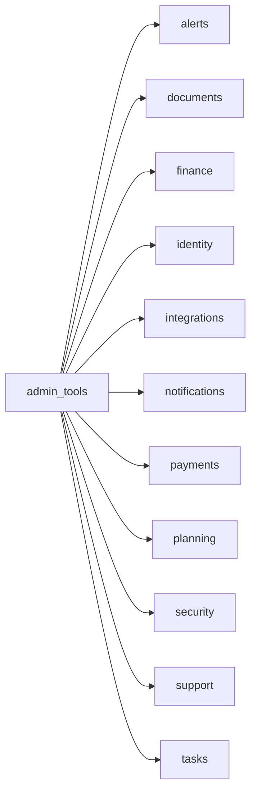

# admin_tools

## Que hace

`admin_tools` agrupa herramientas internas para operacion, soporte y revision
manual del sistema.

## Submodulos Presentes

- `dashboards`
- `user_lookup`
- `manual_adjustments`
- `alert_review`
- `audit_trails`

## Rol En El Sistema

Estas piezas no son parte de la experiencia B2C principal. Su lugar es apoyar:

- soporte
- operaciones
- revisiones manuales
- inspeccion interna del estado del sistema

## Principio Operativo

Estas herramientas deben permanecer:

- separadas de la API publica
- protegidas por permisos internos
- auditables
- alineadas con soporte y operaciones, no con features de usuario final

## Relacion Con Otros Modulos

- `support.audit`
  trazabilidad funcional.
- `identity`
  lookup o soporte sobre usuario y acceso.
- `alerts`
  revision o triage de alertas.
- `finance` y `payments`
  ajustes o inspecciones operativas cuando aplique.

## Encaje Con GCP

Estas herramientas pueden vivir sobre el mismo backend en Cloud Run, pero deben
mantener separacion fuerte de permisos y autenticacion respecto a la API B2C.

## Estado Actual

El bloque existe e incluso esta instalado en Django, pero en esta pasada no
detecte una superficie rica en cada subapp. Se documentan como herramientas
internas preparadas.

<!-- backend-source-audit:start -->
## Evidencia del codigo y mapa de dependencias

Inventario estatico reproducible del checkout. Describe declaraciones e imports;
no prueba despliegue, permisos efectivos ni que todos los caminos se ejecuten.
Las rutas son locales a su URLConf: el prefijo publico se consulta en
[`api/v1/routers.py`](../api/v1/routers.py).

- Archivos Python de implementacion: **30** (excluye tests y migraciones).
- Huella SHA-256 del codigo inventariado: `80827417b93045ce67db14d1dcd642192d34341e20ecc0200e9d8bf6a30381d3`.
- Familias detectadas: models, serializers, services, views.

### Rutas declaradas

| Patron local | Fuente |
| --- | --- |
| `` | [admin_tools/user_lookup/urls.py](user_lookup/urls.py) |
| `operations/` | [admin_tools/dashboards/urls.py](dashboards/urls.py) |
| `users/ [DRF router]` | [admin_tools/user_lookup/urls.py](user_lookup/urls.py) |

### Diagrama de dependencia estatica

Las flechas representan imports entre paquetes, no eventos ni orden de ejecucion.

Flujos transversales: [flujo actualizado](../docs/BACKEND_CURRENT_FLOW.md).

Regeneracion: `py -3 scripts/audit_backend_docs.py --write`.
Comprobacion de deriva: `py -3 scripts/audit_backend_docs.py --check`.
<!-- backend-source-audit:end -->
