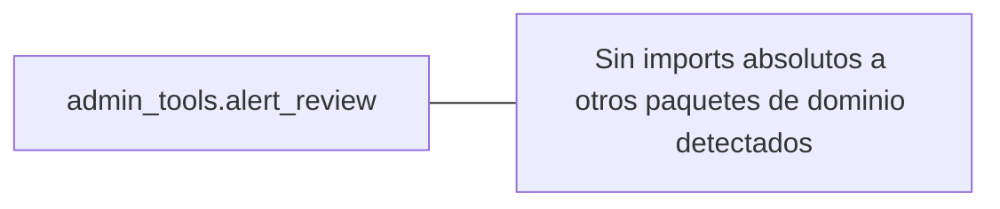

# admin_tools.alert_review

## Que hace

`admin_tools.alert_review` existe para revisar alertas desde una perspectiva
operativa o humana.

## Rol En El Sistema

Tiene sentido cuando se necesita:

- revisar alertas sensibles
- validar relevancia de ciertos hallazgos
- apoyar soporte o mejora del sistema

## Valor Operativo

Revisar alertas de forma interna ayuda a mejorar calidad, reducir ruido y
entender si una señal automatica esta aportando valor real.

## Relacion Con Otros Modulos

- `alerts.alerts`
  fuente principal de alertas.
- `support.audit`
  registro de revisiones o acciones.

## Estado Actual

Subapp instalada, pero no detecte una capa rica y visible en esta pasada.

<!-- backend-source-audit:start -->
## Evidencia del codigo y mapa de dependencias

Inventario estatico reproducible del checkout. Describe declaraciones e imports;
no prueba despliegue, permisos efectivos ni que todos los caminos se ejecuten.
Las rutas son locales a su URLConf: el prefijo publico se consulta en
[`api/v1/routers.py`](../../api/v1/routers.py).

- Archivos Python de implementacion: **5** (excluye tests y migraciones).
- Huella SHA-256 del codigo inventariado: `89e2cd839c20a15a2daad42522338e996ef4699887e4cbf881b0740c158fb0e7`.
- Familias detectadas: models, views.

No se detectan declaraciones `path`/`re_path` propias en este alcance.
Esto no implica que el modulo carezca de consumidores internos.

### Diagrama de dependencia estatica

Las flechas representan imports entre paquetes, no eventos ni orden de ejecucion.

Flujos transversales: [flujo actualizado](../../docs/BACKEND_CURRENT_FLOW.md).

Regeneracion: `py -3 scripts/audit_backend_docs.py --write`.
Comprobacion de deriva: `py -3 scripts/audit_backend_docs.py --check`.
<!-- backend-source-audit:end -->
