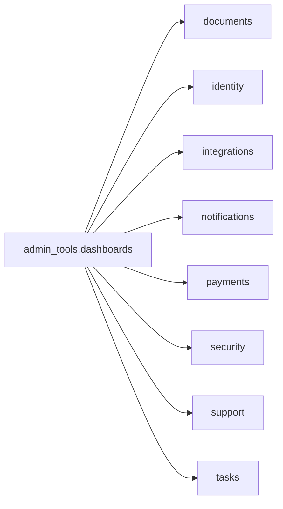

# admin_tools.dashboards

## Que hace

`admin_tools.dashboards` existe para dashboards internos de operacion.

## Rol En El Sistema

Seria el lugar natural para consolidar:

- salud operativa
- volumen de negocio
- colas, fallos o lags
- soporte e indicadores internos

## Valor Operativo

Un dashboard interno no reemplaza la observabilidad tecnica, pero ayuda a
traducir señales del sistema en una vista operable para negocio y soporte.

## Relacion Con Otros Modulos

- `observability`
  metricas y salud tecnica.
- `support.audit`
  trazabilidad funcional.
- `payments`, `accounts`, `notifications`
  dominios que producen senales operativas.

## Estado Actual

La superficie staff-only `GET /api/internal/support/operations/` consolida:

- pendientes, fallos, dead letters y antiguedad por outbox
- estado persistido de scheduler
- estados del worker `documents.ocr`
- entregas de notificacion pendientes/fallidas
- callbacks invalidos, casos abiertos y settlement mismatches de pagos
- contrato de busqueda de logs JSON por `request_id`
- version activa de cifrado, credenciales pendientes de rotacion, bloqueos de
  throttle, eventos criticos y ultimo trabajo de llaves

Cada consulta queda registrada en `support.audit`. Los logs HTTP siguen en
stdout JSON; el dashboard no pretende reemplazar un agregador de logs.

<!-- backend-source-audit:start -->
## Evidencia del codigo y mapa de dependencias

Inventario estatico reproducible del checkout. Describe declaraciones e imports;
no prueba despliegue, permisos efectivos ni que todos los caminos se ejecuten.
Las rutas son locales a su URLConf: el prefijo publico se consulta en
[`api/v1/routers.py`](../../api/v1/routers.py).

- Archivos Python de implementacion: **7** (excluye tests y migraciones).
- Huella SHA-256 del codigo inventariado: `a7bb4fedae221d63ead212ce52952f25f45f70c55171190b9f78969603cba1ec`.
- Familias detectadas: models, services, views.

### Rutas declaradas

| Patron local | Fuente |
| --- | --- |
| `operations/` | [admin_tools/dashboards/urls.py](urls.py) |

### Diagrama de dependencia estatica

Las flechas representan imports entre paquetes, no eventos ni orden de ejecucion.

Flujos transversales: [flujo actualizado](../../docs/BACKEND_CURRENT_FLOW.md).

Regeneracion: `py -3 scripts/audit_backend_docs.py --write`.
Comprobacion de deriva: `py -3 scripts/audit_backend_docs.py --check`.
<!-- backend-source-audit:end -->
