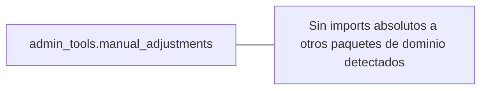

# admin_tools.manual_adjustments

## Que hace

`admin_tools.manual_adjustments` existe para ajustes manuales internos cuando el
negocio o soporte lo exigen.

## Importante

Por definicion, este tipo de capacidad debe ser excepcional, auditable y muy
protegida.

## Casos De Uso Naturales

- correcciones controladas
- reparacion de datos despues de un incidente
- apoyo manual temporal mientras madura una automatizacion

## Relacion Con Otros Modulos

- `support.audit`
  trazabilidad obligatoria.
- `finance.accounts` y `finance.transactions`
  posibles dominios sensibles a ajustes.
- `payments`
  podria requerir correcciones operativas en casos extremos.

## Estado Actual

La subapp esta instalada, pero no detecte superficie funcional visible en esta
pasada. Debe verse como una frontera interna preparada.

<!-- backend-source-audit:start -->
## Evidencia del codigo y mapa de dependencias

Inventario estatico reproducible del checkout. Describe declaraciones e imports;
no prueba despliegue, permisos efectivos ni que todos los caminos se ejecuten.
Las rutas son locales a su URLConf: el prefijo publico se consulta en
[`api/v1/routers.py`](../../api/v1/routers.py).

- Archivos Python de implementacion: **5** (excluye tests y migraciones).
- Huella SHA-256 del codigo inventariado: `74c30351c4bb4d781d1dafbefbe6bf26014e7f584d399a2ed32aea799969c651`.
- Familias detectadas: models, views.

No se detectan declaraciones `path`/`re_path` propias en este alcance.
Esto no implica que el modulo carezca de consumidores internos.

### Diagrama de dependencia estatica

Las flechas representan imports entre paquetes, no eventos ni orden de ejecucion.

Flujos transversales: [flujo actualizado](../../docs/BACKEND_CURRENT_FLOW.md).

Regeneracion: `py -3 scripts/audit_backend_docs.py --write`.
Comprobacion de deriva: `py -3 scripts/audit_backend_docs.py --check`.
<!-- backend-source-audit:end -->
