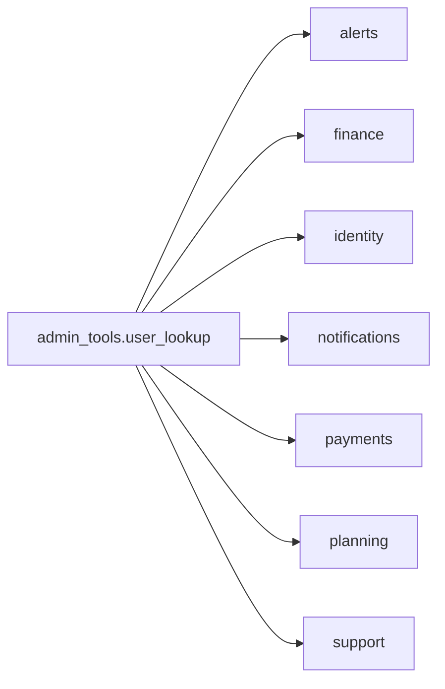

# admin_tools.user_lookup

## Que hace

`admin_tools.user_lookup` existe para busqueda o inspeccion interna de usuarios.

## Rol En El Sistema

Es una necesidad clasica de soporte:

- localizar un usuario
- revisar contexto basico
- ayudar a investigar problemas

## Principio De Uso

Debe operar siempre con cuidado de privacidad y trazabilidad. Buscar un usuario
internamente es una accion de soporte, no una capacidad neutra.

## API Interna

- `GET /api/internal/support/users/?q=<texto>` busca por email, username,
  telefono o nombre y limita el resultado a 20 usuarios
- `GET /api/internal/support/users/<id>/` devuelve una vista 360 minimizada
- ambas rutas requieren staff o superuser
- `X-Support-Reason` es obligatorio y admite entre 10 y 500 caracteres
- `X-Support-Case` permite asociar el acceso a un ticket o investigacion y
  admite hasta 100 caracteres

La vista 360 contiene identidad operativa y conteos por estado de seguridad,
finanzas y operaciones. No devuelve saldos, importes, descripciones de
transacciones, payloads de alertas ni secretos.

Cada busqueda genera auditoria `READ`. El texto buscado se guarda como hash,
no en claro. Cada consulta individual registra el usuario objetivo, el actor,
el motivo y el caso.

## Relacion Con Otros Modulos

- `identity.users`
  fuente de verdad del usuario.
- `support.audit`
  auditoria de consultas o acciones internas.

## Estado Actual

Modulo operativo basico con API interna read-only, permisos staff, minimizacion
de datos, auditoria y pruebas de aislamiento. No permite ajustes manuales ni
cambios de estado.

<!-- backend-source-audit:start -->
## Evidencia del codigo y mapa de dependencias

Inventario estatico reproducible del checkout. Describe declaraciones e imports;
no prueba despliegue, permisos efectivos ni que todos los caminos se ejecuten.
Las rutas son locales a su URLConf: el prefijo publico se consulta en
[`api/v1/routers.py`](../../api/v1/routers.py).

- Archivos Python de implementacion: **8** (excluye tests y migraciones).
- Huella SHA-256 del codigo inventariado: `6e76cf41d14b00cf6bc23d5239d123269752a8ae51071c6fe3cbcbc5253c5bf9`.
- Familias detectadas: models, serializers, services, views.

### Rutas declaradas

| Patron local | Fuente |
| --- | --- |
| `` | [admin_tools/user_lookup/urls.py](urls.py) |
| `users/ [DRF router]` | [admin_tools/user_lookup/urls.py](urls.py) |

### Diagrama de dependencia estatica

Las flechas representan imports entre paquetes, no eventos ni orden de ejecucion.

Flujos transversales: [flujo actualizado](../../docs/BACKEND_CURRENT_FLOW.md).

Regeneracion: `py -3 scripts/audit_backend_docs.py --write`.
Comprobacion de deriva: `py -3 scripts/audit_backend_docs.py --check`.
<!-- backend-source-audit:end -->
