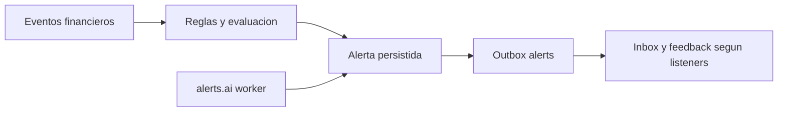
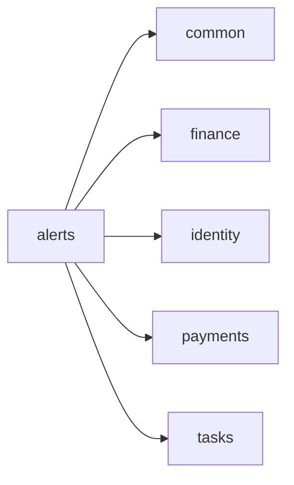

# alerts

Alerts aplica reglas y construye alertas a partir del contexto financiero.
El enriquecimiento de IA no reemplaza las reglas ni la decision del usuario.

- [alerts](alerts/README.md): alertas, contratos y outbox.
- [rules](rules/README.md): reglas configurables.
- [listeners](listeners/README.md): consumo de eventos.
- [triggers](triggers/README.md): disparadores y estado implementado.
- [ai_stub](ai_stub/README.md): frontera de enriquecimiento simulado.

`alerts-outbox` y `alerts-ai-worker` son procesos declarados en Compose local.
La disponibilidad y calidad del proveedor se evalua aparte de la existencia
del worker.

<!-- backend-source-audit:start -->
## Evidencia del codigo y mapa de dependencias

Inventario estatico reproducible del checkout. Describe declaraciones e imports;
no prueba despliegue, permisos efectivos ni que todos los caminos se ejecuten.
Las rutas son locales a su URLConf: el prefijo publico se consulta en
[`api/v1/routers.py`](../api/v1/routers.py).

- Archivos Python de implementacion: **48** (excluye tests y migraciones).
- Huella SHA-256 del codigo inventariado: `9c5e425d9af1ff4a46855fd78643ee12e4d4a265ffee94c2a7c93644183d1cff`.
- Familias detectadas: listeners, management, models, serializers, services, views.

### Declaraciones de modelos detectadas

- `Alert` en [alerts/alerts/models/alerts.py](alerts/models/alerts.py).
- `AlertAiDispatchState` en [alerts/alerts/models/ai_dispatch.py](alerts/models/ai_dispatch.py).
- `AlertDomainEventOutbox` en [alerts/alerts/models/outbox.py](alerts/models/outbox.py).
- `Rule` en [alerts/rules/models/rules.py](rules/models/rules.py).

### Rutas declaradas

| Patron local | Fuente |
| --- | --- |
| `` | [alerts/alerts/urls.py](alerts/urls.py) |
| `` | [alerts/rules/urls.py](rules/urls.py) |
| `ai-worker/` | [alerts/alerts/internal_urls.py](alerts/internal_urls.py) |
| `alertas/ [DRF router]` | [alerts/alerts/urls.py](alerts/urls.py) |
| `internal/ai-worker/` | [alerts/alerts/urls.py](alerts/urls.py) |
| `reglas/ [DRF router]` | [alerts/rules/urls.py](rules/urls.py) |

### Diagrama de dependencia estatica

Las flechas representan imports entre paquetes, no eventos ni orden de ejecucion.

Flujos transversales: [flujo actualizado](../docs/BACKEND_CURRENT_FLOW.md).

Regeneracion: `py -3 scripts/audit_backend_docs.py --write`.
Comprobacion de deriva: `py -3 scripts/audit_backend_docs.py --check`.
<!-- backend-source-audit:end -->
