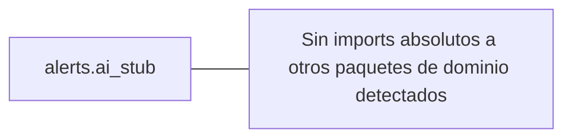

# alerts.ai_stub

## Que hace

`alerts.ai_stub` representa una frontera temporal para integracion de IA o
simulacion de enriquecimiento de alertas.

## Estado Del Codigo

Hoy esta en scaffold:

- `models.py` vacio
- `views.py` vacio
- sin endpoints, servicios ni contratos visibles

## Relacion Con Otros Modulos

La IA operativa de alertas que hoy si se detecta vive en:

- `alerts.alerts.ai_services`
- `alerts.alerts.dispatch_service`
- `alerts.alerts.event_handlers`

`ai_stub` queda como una pieza de apoyo o placeholder, no como la frontera
canonica actual.

## Rol En El Producto

El concepto sigue siendo util cuando se necesita:

- probar enriquecimiento sin depender del gateway LLM real
- desacoplar feature flags o proveedores de IA
- mantener una frontera temporal mientras la integracion cloud madura

## Encaje Con GCP

La frontera final de IA de Vexxo esta pensada para trabajar con:

- `llm_gateway`
- Gemini u otro proveedor
- Cloud Run workers
- Cloud Tasks para jobs asincronos

Este app hoy no implementa esa capa.

## Estado Actual

Contexto reservado, no feature productiva cerrada.

<!-- backend-source-audit:start -->
## Evidencia del codigo y mapa de dependencias

Inventario estatico reproducible del checkout. Describe declaraciones e imports;
no prueba despliegue, permisos efectivos ni que todos los caminos se ejecuten.
Las rutas son locales a su URLConf: el prefijo publico se consulta en
[`api/v1/routers.py`](../../api/v1/routers.py).

- Archivos Python de implementacion: **5** (excluye tests y migraciones).
- Huella SHA-256 del codigo inventariado: `d5d7504850e3fe5ff1a9545e7f35b32f95bae7005a4e0e30878cbb4171cb4a4e`.
- Familias detectadas: models, views.

No se detectan declaraciones `path`/`re_path` propias en este alcance.
Esto no implica que el modulo carezca de consumidores internos.

### Diagrama de dependencia estatica

Las flechas representan imports entre paquetes, no eventos ni orden de ejecucion.

Flujos transversales: [flujo actualizado](../../docs/BACKEND_CURRENT_FLOW.md).

Regeneracion: `py -3 scripts/audit_backend_docs.py --write`.
Comprobacion de deriva: `py -3 scripts/audit_backend_docs.py --check`.
<!-- backend-source-audit:end -->
