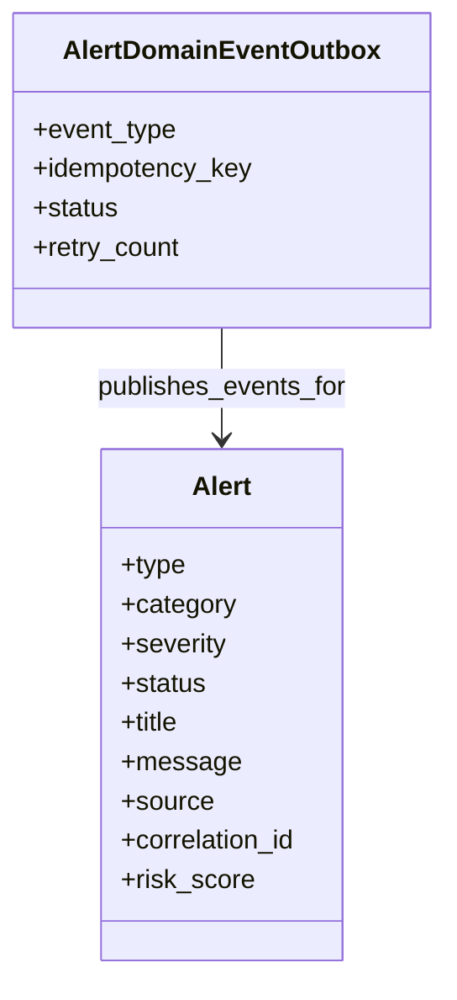
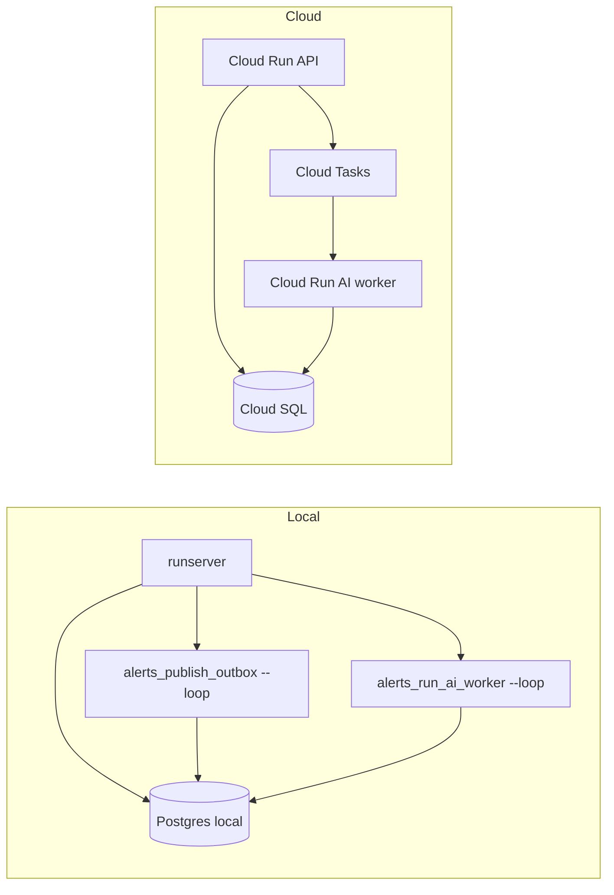
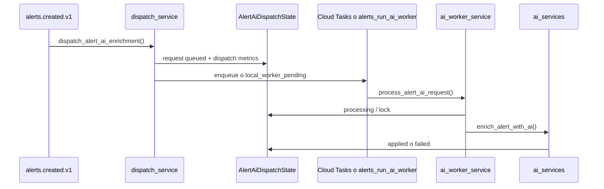
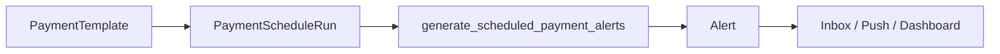
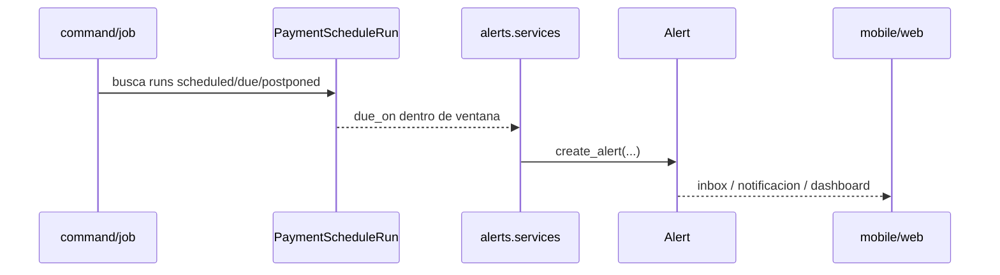
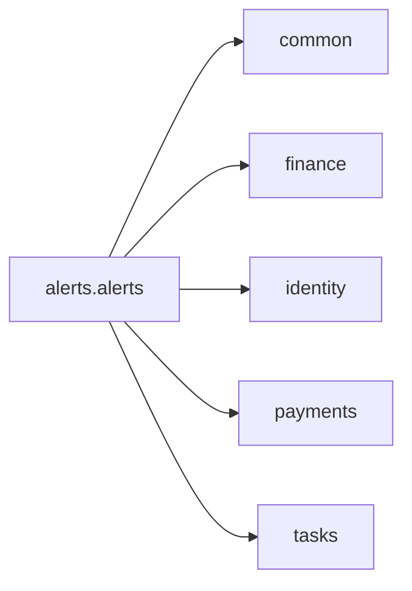

# alerts.alerts

## Que hace

Gestiona alertas de producto y su enriquecimiento con IA.

No deberia resolver IA pesada dentro del request path principal. La regla es:

- crear alerta rapido
- emitir `alerts.created.v1`
- despachar enriquecimiento IA a worker/cola
- publicar `alerts.ai.enriched.v1` cuando termina

## Rol En El Producto

Este modulo es la capa que convierte eventos financieros y operativos en
mensajes accionables para el usuario.

De cara al cliente:

- ayuda a detectar cambios relevantes
- resume anomalias, riesgo o friccion operativa
- complementa dashboard, cuentas y pagos con contexto util
- prepara explicaciones e insights que luego pueden mostrarse en mobile/web

No reemplaza el ledger ni a `accounts`; interpreta lo que otros contextos ya
registraron.

## Vista visual

Lectura:

- `Alert` sigue siendo el agregado visible
- `AlertAiDispatchState` es la fuente de verdad operativa del enrichment async
- local y cloud cambian de transporte, no de semantica del lifecycle

## Alertas de pagos programados

El flujo canonico de pagos programados ya no lee `transactions.ScheduledPayment`.
Ese modelo tambien fue retirado fisicamente del runtime y del esquema actual.

- `generate_scheduled_payment_alerts(...)` consulta `PaymentScheduleRun`
- genera `AlertType.SCHEDULED_PAYMENT_DUE`
- cada alerta nueva referencia:
  - `payment_schedule_run_id`
  - `payment_template_id`
- cualquier wrapper legacy alrededor de este flujo es solo placeholder
  historico y no debe reintroducir ids o payloads legacy en alertas nuevas

## Flujo actual

### Creacion

1. `alerts.alerts.services.create_alert()` persiste la alerta.
2. Encola `alerts.created.v1` en outbox.
3. En local puede autopublicarse after-commit solo si se habilita
   explicitamente; el camino recomendado es worker de outbox separado.
4. Un listener despacha el enriquecimiento IA mediante
   `alerts.alerts.dispatch_service`.

### Enriquecimiento IA

`dispatch_service` intenta:

- Cloud Tasks hacia `/api/internal/alerts/ai-worker/` si la infraestructura esta lista
- worker local durable solo en entornos permitidos

La solicitud queda persistida en `AlertAiDispatchState` y el endpoint interno o
el worker local ejecutan `alerts.alerts.ai_worker_service.process_alert_ai_request()`.

La politica de entrega ya no deberia quedar modelada dentro del contexto. La
frontera comun es `tasks.async_backends` con `job_type=alerts.ai`.

Estados operativos relevantes:

- `queued`
- `processing`
- `dispatch_failed`
- `processing_stale`
- `applied`
- `failed`
- `dead_letter`

La ruta legacy:

- `/api/alerts/internal/ai-worker/`

se mantiene por compatibilidad, pero el prefijo canonico nuevo para trafico
interno es `/api/internal/alerts/...`.

### Consumo por mobile/web

1. `accounts`, `transactions` o `payments` emiten eventos
2. `alerts` decide si crear una alerta o enriquecer una existente
3. la alerta queda persistida
4. otras superficies como notificaciones, inbox o dashboard consumen ese
   resultado

## Casos De Uso

- saldo anomalo o movimiento relevante
- cuenta con sync fallido o stale
- drift o recalculo relevante de balance
- friccion de pago o fallo externo
- insight resumido a partir de patrones o IA

## Alertas de Pago Programado

El flujo de alertas de pagos proximos ya no lee
`transactions.ScheduledPayment` como fuente operativa.

La fuente operativa actual es:

- `PaymentTemplate`: define el pago programado
- `PaymentScheduleRun`: representa la ocurrencia concreta

La alerta se genera desde `alerts.alerts.services.generate_scheduled_payment_alerts()`
leyendo corridas con estado:

- `scheduled`
- `due`
- `postponed`

Lectura:

- el template define el plan reusable
- el run define la ocurrencia que realmente vence
- `alerts` mira la fecha `due_on` del run
- la alerta queda enlazada al `payment_schedule_run_id`

### Payload esperado

La alerta de pago programado ya puede incluir:

- `payment_schedule_run_id`
- `payment_template_id`
- `name`
- `amount`
- `currency`
- `due_date`
- `account_id`
- `account_name`

### Por que importa

Esto evita dos problemas del esquema viejo:

- alertar sobre un concepto abstracto en vez de una ocurrencia real
- depender de `ScheduledPayment` cuando el lifecycle operativo ya vive en
  `PaymentScheduleRun`

## Flujo de alerta por vencimiento

Regla actual:

- el scheduler de alertas mira una ventana `today .. today + days_ahead`
- no necesita crear o tocar transacciones
- solo interpreta la proximidad operativa del run
- la materializacion contable sigue ocurriendo en `transactions`

## Relacion con otros modulos

- `finance.accounts`: produce eventos de balance/sync que disparan alertas
- `finance.transactions`: puede aportar hechos contables para alertas
- `payments.scheduled_payments`: aporta el lifecycle canonico de pagos
  programados
- `payments.payment_intents`: aporta eventos operativos de pagos externos
- `identity.users`: consume `alerts.*` para refrescar usage projection
- `notifications`: puede convertir alertas o eventos relacionados en inbox
- `realtime`: puede ayudar a reflejar cambios interactivos de bajo costo
- futuro `llm_gateway`: destino natural de este flujo cuando salga del monolito

## Encaje Con GCP

La forma esperada de operar en GCP es:

- API Gateway / BFF crea o consulta alertas rapido
- Cloud Run worker o Cloud Tasks ejecuta enriquecimiento asincrono
- `llm_gateway` puede vivir como servicio separado en Cloud Run
- Gemini u otro modelo se consume fuera del request principal
- Pub/Sub puede distribuir eventos relevantes a analytics o pipelines

El principio es:

- request corto
- enriquecimiento pesado fuera del request path
- eventos claros para trazabilidad y producto

## Politicas Del Modulo

- una alerta puede existir sin IA; la IA es enriquecimiento, no precondicion
- el listener no debe bloquear el request original del dominio fuente
- si la infraestructura async cloud no esta lista, solo se permite worker local
  durable en entornos permitidos
- el futuro `llm_gateway` debe respetar la misma frontera publica del modulo
- `alerts` no debe volver a publicar eventos criticos directo desde el request
  path; usa outbox como los demas bounded contexts fuertes

## Estado operativo actual

`alerts` ya tiene outbox propio para `alerts.created.v1`.

Eso permite:

- retry
- dead-letter
- worker dedicado
- worker local durable para IA sin caer en fallback inline del request

Todavia no implica que todo `alerts.*` tenga ya la misma riqueza operativa de
`accounts`.

## Comandos operativos locales

- `manage.py alerts_publish_outbox --loop`
  publica el outbox de `alerts` en modo durable local.
- `manage.py alerts_run_ai_worker --loop`
  consume `AlertAiDispatchState` desde BD, aplica enriquecimiento y recupera
  solicitudes stale.

Wrappers unificados equivalentes:

- `manage.py publish_outbox alerts`
- `manage.py run_worker alerts.ai`

## Esqueleto/futuro

Cuando exista un servicio dedicado de IA, este modulo ya tiene la frontera:

- `dispatch_service` se mantiene como orquestador
- el worker interno puede reemplazarse por `llm_gateway`
- la API publica de alertas no necesita cambiar

<!-- backend-source-audit:start -->
## Evidencia del codigo y mapa de dependencias

Inventario estatico reproducible del checkout. Describe declaraciones e imports;
no prueba despliegue, permisos efectivos ni que todos los caminos se ejecuten.
Las rutas son locales a su URLConf: el prefijo publico se consulta en
[`api/v1/routers.py`](../../api/v1/routers.py).

- Archivos Python de implementacion: **24** (excluye tests y migraciones).
- Huella SHA-256 del codigo inventariado: `c3ce1ca7c6e2abef516bde63af47029d8dad49dc32208a901a83d4c932dddebd`.
- Familias detectadas: management, models, serializers, services, views.

### Declaraciones de modelos detectadas

- `Alert` en [alerts/alerts/models/alerts.py](models/alerts.py).
- `AlertAiDispatchState` en [alerts/alerts/models/ai_dispatch.py](models/ai_dispatch.py).
- `AlertDomainEventOutbox` en [alerts/alerts/models/outbox.py](models/outbox.py).

### Rutas declaradas

| Patron local | Fuente |
| --- | --- |
| `` | [alerts/alerts/urls.py](urls.py) |
| `ai-worker/` | [alerts/alerts/internal_urls.py](internal_urls.py) |
| `alertas/ [DRF router]` | [alerts/alerts/urls.py](urls.py) |
| `internal/ai-worker/` | [alerts/alerts/urls.py](urls.py) |

### Diagrama de dependencia estatica

Las flechas representan imports entre paquetes, no eventos ni orden de ejecucion.

Flujos transversales: [flujo actualizado](../../docs/BACKEND_CURRENT_FLOW.md).

Regeneracion: `py -3 scripts/audit_backend_docs.py --write`.
Comprobacion de deriva: `py -3 scripts/audit_backend_docs.py --check`.
<!-- backend-source-audit:end -->
