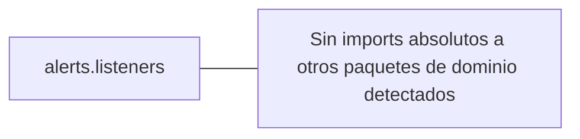

# alerts.listeners

## Que hace

`alerts.listeners` existe como contexto reservado para listeners dedicados a
construir o disparar alertas desde eventos del dominio.

## Estado Del Codigo

Hoy el app esta en scaffold:

- `models.py` vacio
- `views.py` vacio
- sin handlers propios detectados en este paquete

## Relacion Con Otros Modulos

La logica operativa que hoy si existe para alertas derivadas y enriquecimiento
vive principalmente en:

- `alerts.alerts`
- `alerts.rules`
- `alerts.alerts.dispatch_service`
- `alerts.alerts.event_handlers`

Por eso este modulo no debe documentarse como cerrado o productivo hoy.

## Encaje Con El Negocio

El nombre del contexto sigue teniendo sentido: Vexxo necesita escuchar cambios
de cuentas, transacciones, pagos o metas y convertirlos en alertas utiles.
Solo que hoy ese trabajo no esta centralizado aqui.

## Encaje Con GCP

Si mas adelante se separa un servicio de listeners de alertas, este modulo es
un candidato natural para:

- consumidores Pub/Sub
- workers en Cloud Run
- pipelines async que terminen creando `Alert`

## Estado Actual

Hoy es una reserva estructural. La capa productiva actual de alertas esta en
otros submodulos del contexto `alerts`.

<!-- backend-source-audit:start -->
## Evidencia del codigo y mapa de dependencias

Inventario estatico reproducible del checkout. Describe declaraciones e imports;
no prueba despliegue, permisos efectivos ni que todos los caminos se ejecuten.
Las rutas son locales a su URLConf: el prefijo publico se consulta en
[`api/v1/routers.py`](../../api/v1/routers.py).

- Archivos Python de implementacion: **5** (excluye tests y migraciones).
- Huella SHA-256 del codigo inventariado: `133b57d551b25569837c44bab05aa8dcd8abba7ebe8b1904d9e2e2d1a525aff2`.
- Familias detectadas: listeners, models, views.

No se detectan declaraciones `path`/`re_path` propias en este alcance.
Esto no implica que el modulo carezca de consumidores internos.

### Diagrama de dependencia estatica

Las flechas representan imports entre paquetes, no eventos ni orden de ejecucion.

Flujos transversales: [flujo actualizado](../../docs/BACKEND_CURRENT_FLOW.md).

Regeneracion: `py -3 scripts/audit_backend_docs.py --write`.
Comprobacion de deriva: `py -3 scripts/audit_backend_docs.py --check`.
<!-- backend-source-audit:end -->
