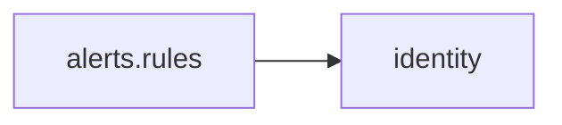

# alerts.rules

## Que hace

`alerts.rules` administra reglas configurables del usuario para disparar o
controlar alertas.

Su responsabilidad actual es:

- CRUD de reglas (`Rule`)
- aplicar gating por plan para cantidad de reglas activas
- mantener actualizado el usage projection de reglas

## Rol En El Producto

Este modulo acerca a Vexxo a la automatizacion.

De cara al usuario, permite:

- definir comportamiento repetible
- pasar de alertas puramente reactivas a reglas configuradas
- crear una experiencia mas `pro` sin romper el loop manual base

## Flujo Principal

1. el usuario crea una regla
2. si la regla queda activa, se valida limite por plan
3. la regla se persiste
4. `identity.users.product_usage_projection_service` actualiza `rules_count`
5. al activar, desactivar o eliminar, el uso se ajusta incrementalmente

## Relacion Con Otros Modulos

- `identity.users`
  valida el limite de reglas por plan y guarda uso proyectado
- `alerts.alerts`
  consume o puede reaccionar a la existencia de reglas
- futuros motores de automatizacion pueden ejecutar la logica definida aqui

## Encaje Con GCP

Hoy es una capa CRUD sobre Cloud SQL y Cloud Run.

La evolucion natural es:

- workers o evaluadores async
- triggers por eventos de dominio
- ejecucion desacoplada por Cloud Tasks o Pub/Sub

sin cambiar el rol de este modulo como repositorio de reglas.

## Estado Actual

Hoy `ReglaViewSet`:

- lista solo reglas del owner
- valida limite de plan al crear o activar
- ajusta `rules_count` incrementalmente

Lo que todavia no se documenta como cerrado aqui es un motor rico de ejecucion
de reglas; hoy la superficie fuerte es administracion y policy de uso.

<!-- backend-source-audit:start -->
## Evidencia del codigo y mapa de dependencias

Inventario estatico reproducible del checkout. Describe declaraciones e imports;
no prueba despliegue, permisos efectivos ni que todos los caminos se ejecuten.
Las rutas son locales a su URLConf: el prefijo publico se consulta en
[`api/v1/routers.py`](../../api/v1/routers.py).

- Archivos Python de implementacion: **8** (excluye tests y migraciones).
- Huella SHA-256 del codigo inventariado: `bb459a7a590e14379d4ea19b3537284b0f691c24f3187f6dca4779fb92cd1063`.
- Familias detectadas: models, serializers, views.

### Declaraciones de modelos detectadas

- `Rule` en [alerts/rules/models/rules.py](models/rules.py).

### Rutas declaradas

| Patron local | Fuente |
| --- | --- |
| `` | [alerts/rules/urls.py](urls.py) |
| `reglas/ [DRF router]` | [alerts/rules/urls.py](urls.py) |

### Diagrama de dependencia estatica

Las flechas representan imports entre paquetes, no eventos ni orden de ejecucion.

Flujos transversales: [flujo actualizado](../../docs/BACKEND_CURRENT_FLOW.md).

Regeneracion: `py -3 scripts/audit_backend_docs.py --write`.
Comprobacion de deriva: `py -3 scripts/audit_backend_docs.py --check`.
<!-- backend-source-audit:end -->
