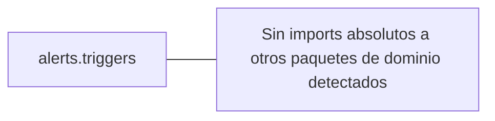

# alerts.triggers

## Que hace

`alerts.triggers` existe como lugar natural para modelar condiciones o
disparadores de alertas separados de:

- la alerta generada (`alerts.alerts`)
- la regla configurable (`alerts.rules`)

## Estado Del Codigo

Hoy el modulo esta en scaffold:

- `models.py` vacio
- `views.py` vacio
- sin motor de triggers publico detectado

## Rol En El Producto

La separacion conceptual sigue siendo util:

- `rules` describe configuracion del usuario
- `triggers` describiria la condicion evaluable
- `alerts` materializaria el resultado observable

Eso encaja con una app financiera que quiere pasar de alertas simples a
automatizacion y deteccion mas rica.

## Relacion Con Otros Modulos

- `alerts.rules`
  reglas configurables del usuario.
- `alerts.alerts`
  la alerta final visible para el usuario.
- `finance.transactions`, `finance.accounts`, `payments`
  posibles fuentes de eventos para futuros triggers.

## Encaje Con GCP

Cuando se materialice, este modulo encajara bien con:

- Cloud Tasks o Pub/Sub para evaluar triggers desacoplados
- Cloud Run workers para reglas pesadas o por lotes
- Cloud SQL para definicion y estado

## Estado Actual

Hoy la idea del modulo es correcta, pero no hay una implementacion operativa
documentable mas alla del scaffold.

<!-- backend-source-audit:start -->
## Evidencia del codigo y mapa de dependencias

Inventario estatico reproducible del checkout. Describe declaraciones e imports;
no prueba despliegue, permisos efectivos ni que todos los caminos se ejecuten.
Las rutas son locales a su URLConf: el prefijo publico se consulta en
[`api/v1/routers.py`](../../api/v1/routers.py).

- Archivos Python de implementacion: **5** (excluye tests y migraciones).
- Huella SHA-256 del codigo inventariado: `5c552fa4aa3905288b6dde9e9945c297421f32e7899ff489d69143e852027332`.
- Familias detectadas: models, views.

No se detectan declaraciones `path`/`re_path` propias en este alcance.
Esto no implica que el modulo carezca de consumidores internos.

### Diagrama de dependencia estatica

Las flechas representan imports entre paquetes, no eventos ni orden de ejecucion.

Flujos transversales: [flujo actualizado](../../docs/BACKEND_CURRENT_FLOW.md).

Regeneracion: `py -3 scripts/audit_backend_docs.py --write`.
Comprobacion de deriva: `py -3 scripts/audit_backend_docs.py --check`.
<!-- backend-source-audit:end -->
