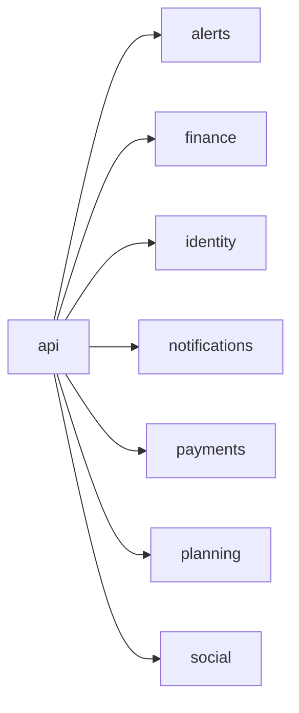

# api

## Que hace

`api` es la superficie HTTP principal del backend.

Su responsabilidad es:

- exponer rutas versionadas
- agrupar bounded contexts bajo una convencion coherente
- servir como BFF para mobile y web
- mantener una frontera clara entre request/response y logica de dominio

## Rol En El Producto

Para mobile/web, este modulo es la puerta de entrada a:

- identidad y plan
- cuentas y ledger
- pagos
- alertas
- notificaciones
- realtime persistido
- soporte y auditoria operativa

No debe concentrar la logica de negocio profunda. Esa vive en serializers,
services, modelos y bounded contexts.

## Versionado y estructura

El punto de entrada principal hoy es [api/v1/routers.py](v1/routers.py).

La organizacion actual separa:

- `identity/*`
- `finance/*`
- `planning/*`
- `social/*`
- `payments/*`
- `alerts/*`
- `notifications/*`
- `realtime/*`
- `support/*`

## Por Que Existe

Aunque la logica fuerte viva en cada contexto, el backend necesita una
superficie uniforme para mobile/web.

`api` evita:

- rutas dispersas sin convencion
- acoplar la app a detalles internos del monolito
- mezclar controllers HTTP con logica de negocio profunda

## Flujo General

1. mobile/web llama un endpoint versionado
2. DRF enruta al módulo correspondiente
3. serializers validan input
4. el bounded context ejecuta el caso de uso
5. si hace falta trabajo pesado, se emite evento o se agenda worker
6. la respuesta HTTP vuelve rapido al cliente

## Runtime actual

La superficie corre localmente en Django/DRF sobre PostgreSQL. Los trabajos
pesados salen del request mediante outbox y workers durables.

Regla importante:

- el API no debe depender de conexiones largas
- el API ordena, valida y responde
- el procesamiento fuerte vuelve por eventos, polling o workers locales

## Relacion Con Otros Modulos

- enruta a todos los bounded contexts principales
- refleja la estrategia de producto y la segmentacion de dominio
- sirve como capa estable para mobile aunque cambien integraciones internas

## Politicas De Diseño

- endpoints claros por bounded context
- versionado por namespace (`v1`)
- acciones de dominio explicitas cuando un CRUD no alcanza
- respuestas rápidas y compatibles con flows asincronos

## Estado Actual

Hoy `api` ya enruta identidad, finanzas, pagos, alertas, notificaciones,
realtime y soporte.

La evolucion natural no es cargar mas logica aqui, sino:

- mantener contratos estables para mobile
- mover trabajo pesado a workers y callbacks
- seguir versionando la superficie cuando cambien contratos publicos

<!-- backend-source-audit:start -->
## Evidencia del codigo y mapa de dependencias

Inventario estatico reproducible del checkout. Describe declaraciones e imports;
no prueba despliegue, permisos efectivos ni que todos los caminos se ejecuten.
Las rutas son locales a su URLConf: el prefijo publico se consulta en
[`api/v1/routers.py`](v1/routers.py).

- Archivos Python de implementacion: **23** (excluye tests y migraciones).
- Huella SHA-256 del codigo inventariado: `0608c40b0304c9386b97774e092672ffde08ee97328d7d16dad749fa19e254ca`.
- Familias detectadas: management, models, views.

### Rutas declaradas

| Patron local | Fuente |
| --- | --- |
| `alerts/` | [api/v1/routers.py](v1/routers.py) |
| `alerts/rules/` | [api/v1/routers.py](v1/routers.py) |
| `bootstrap/` | [api/mobile/urls.py](mobile/urls.py) |
| `contacts/` | [api/v1/routers.py](v1/routers.py) |
| `documents/` | [api/v1/routers.py](v1/routers.py) |
| `finance/accounts/` | [api/v1/routers.py](v1/routers.py) |
| `finance/budgets/` | [api/v1/routers.py](v1/routers.py) |
| `finance/categories/` | [api/v1/routers.py](v1/routers.py) |
| `finance/debts/` | [api/v1/routers.py](v1/routers.py) |
| `finance/fx/` | [api/v1/routers.py](v1/routers.py) |
| `finance/transactions/` | [api/v1/routers.py](v1/routers.py) |
| `finance/vendors/` | [api/v1/routers.py](v1/routers.py) |
| `identity/consents/` | [api/v1/routers.py](v1/routers.py) |
| `identity/devices/` | [api/v1/routers.py](v1/routers.py) |
| `identity/eventing/` | [api/v1/routers.py](v1/routers.py) |
| `identity/permissions/` | [api/v1/routers.py](v1/routers.py) |
| `identity/sessions/` | [api/v1/routers.py](v1/routers.py) |
| `identity/users/` | [api/v1/routers.py](v1/routers.py) |
| `integrations/open-banking/` | [api/v1/routers.py](v1/routers.py) |
| `internal/accounts/` | [api/v1/routers.py](v1/routers.py) |
| `internal/alerts/` | [api/v1/routers.py](v1/routers.py) |
| `internal/payments/` | [api/v1/routers.py](v1/routers.py) |
| `internal/support/` | [api/v1/routers.py](v1/routers.py) |
| `internal/transactions/` | [api/v1/routers.py](v1/routers.py) |
| `markets/` | [api/mobile/urls.py](mobile/urls.py) |
| `mobile/` | [api/v1/routers.py](v1/routers.py) |
| `notifications/deliveries/` | [api/v1/routers.py](v1/routers.py) |
| `notifications/preferences/` | [api/v1/routers.py](v1/routers.py) |
| `payments/intents/` | [api/v1/routers.py](v1/routers.py) |
| `payments/scheduled/` | [api/v1/routers.py](v1/routers.py) |
| `planning/goals/` | [api/v1/routers.py](v1/routers.py) |
| `planning/shared-goals/` | [api/v1/routers.py](v1/routers.py) |
| `realtime/consumers/` | [api/v1/routers.py](v1/routers.py) |
| `reports/` | [api/v1/routers.py](v1/routers.py) |
| `runtime/` | [api/v1/routers.py](v1/routers.py) |
| `social/invitations/` | [api/v1/routers.py](v1/routers.py) |
| `social/shared-expenses/` | [api/v1/routers.py](v1/routers.py) |
| `social/teams/` | [api/v1/routers.py](v1/routers.py) |
| `support/audit/` | [api/v1/routers.py](v1/routers.py) |
| `sync-state/` | [api/mobile/urls.py](mobile/urls.py) |

### Diagrama de dependencia estatica

Las flechas representan imports entre paquetes, no eventos ni orden de ejecucion.

Flujos transversales: [flujo actualizado](../docs/BACKEND_CURRENT_FLOW.md).

Regeneracion: `py -3 scripts/audit_backend_docs.py --write`.
Comprobacion de deriva: `py -3 scripts/audit_backend_docs.py --check`.
<!-- backend-source-audit:end -->
