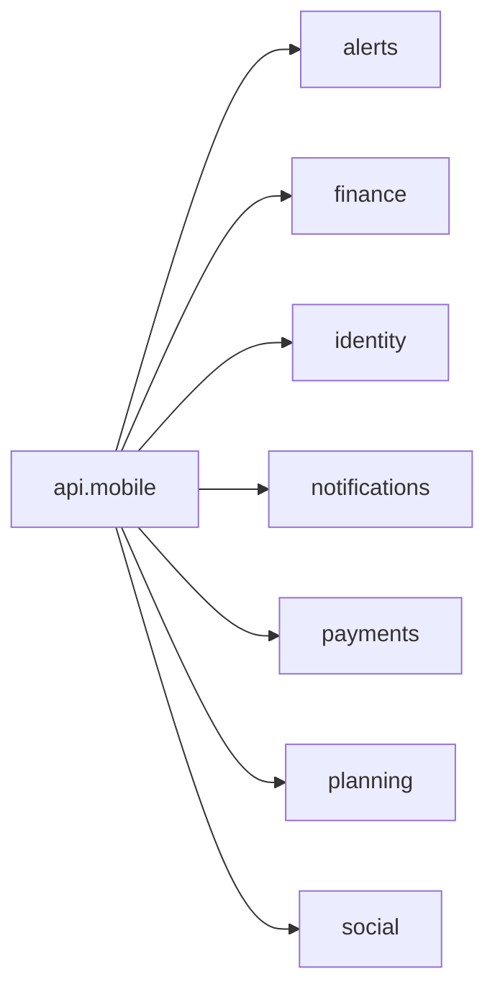

# API mobile

`api.mobile` es un BFF de lectura para reducir round-trips de Flutter. No
reemplaza las APIs de escritura ni decide permisos o verdad contable.

## Endpoints

- `GET /api/mobile/bootstrap/`: snapshot versionado por secciones.
- `GET /api/mobile/sync-state/`: cursores y cambios disponibles.

El costo SQL de ambos endpoints puede medirse localmente con
`manage.py profile_mobile_queries --email <email> --endpoint bootstrap`. El
comando autentica internamente al usuario, es read-only y agrupa consultas
repetidas por fingerprint para detectar N+1 sin registrar tokens.

La prueba de crecimiento usa fixtures transaccionales y reversibles:

```powershell
docker compose --env-file .env.local -f docker-compose.local.yml `
  -f docker-compose.performance.yml exec -T api `
  python manage.py benchmark_mobile_queries --max-query-growth 0
```

Los perfiles `small`, `medium` y `large` escalan cuentas, categorias,
transacciones, presupuestos, pagos programados, metas, notificaciones, alertas y
equipos. Ningun fixture queda persistido. El comando falla si las consultas
crecen entre el primer y ultimo perfil o superan los presupuestos de 100 para
el primer bootstrap, 25 para bootstrap con cache vigente y 25 para sync-state.

Linea base actual constante en los tres tamanos:

- `bootstrap=90`: primer arranque; calcula versiones canonicas y construye las
  12 secciones completas.
- `bootstrap-cached=18`: las versiones coinciden; no ejecuta builders de
  payload y responde `unchanged=true`, `data=null`.
- `sync-state=23`: compara estado y agrega salud de outboxes, sin transportar
  datos de pantalla.

Antes de la primera optimizacion, bootstrap crecia de 92 a 155 y sync-state
ejecutaba 43 consultas fijas. La subida posterior de 74 a 90 en el primer
bootstrap garantiza que ambos endpoints publiquen la misma version canonica;
el camino repetido baja a 18 consultas.
- `GET /api/mobile/markets/`: referencia de mercados con fallback local.

Todas las rutas requieren JWT. `finance.transactions` sigue siendo el ledger.
Las escrituras offline vuelven por su endpoint canonico con idempotency key.

Flutter debe aplicar progresivamente todas las secciones recibidas. El backend
debe medir el costo de construir versiones cuando aumente el volumen. Los GET
no encolan jobs; las proyecciones faltantes se representan mediante fallback y
se actualizan desde los flujos de escritura o workers correspondientes.

## Contrato incremental

1. Flutter envia `X-Vexxo-Mobile-Section-Versions` a `sync-state`.
2. Backend consulta estado liviano y devuelve `changed_sections`.
3. Si no hay cambios, Flutter conserva cache y no llama bootstrap.
4. Si hay cambios, Flutter llama bootstrap con las mismas versiones.
5. Backend ejecuta builders solo para secciones obsoletas; las demas vuelven
   como `unchanged=true` y `data=null`.

Las claves, formas y tipos internos de `data` no cambian. La version incluye
timestamp y firma de forma/conteo para detectar altas, cambios y eliminaciones.
Las metas usan `Goal.updated_at`, por lo que un aporte o cambio de progreso
invalida su seccion aunque la cantidad de metas permanezca igual.

<!-- backend-source-audit:start -->
## Evidencia del codigo y mapa de dependencias

Inventario estatico reproducible del checkout. Describe declaraciones e imports;
no prueba despliegue, permisos efectivos ni que todos los caminos se ejecuten.
Las rutas son locales a su URLConf: el prefijo publico se consulta en
[`api/v1/routers.py`](../v1/routers.py).

- Archivos Python de implementacion: **12** (excluye tests y migraciones).
- Huella SHA-256 del codigo inventariado: `d5f1adafaf296be0b2570de2ee166099367cd6c409d1038787e9e98e880ed5e6`.
- Familias detectadas: management, views.

### Rutas declaradas

| Patron local | Fuente |
| --- | --- |
| `bootstrap/` | [api/mobile/urls.py](urls.py) |
| `markets/` | [api/mobile/urls.py](urls.py) |
| `sync-state/` | [api/mobile/urls.py](urls.py) |

### Diagrama de dependencia estatica

Las flechas representan imports entre paquetes, no eventos ni orden de ejecucion.



Flujos transversales: [flujo actualizado](../../docs/BACKEND_CURRENT_FLOW.md).

Regeneracion: `py -3 scripts/audit_backend_docs.py --write`.
Comprobacion de deriva: `py -3 scripts/audit_backend_docs.py --check`.
<!-- backend-source-audit:end -->
