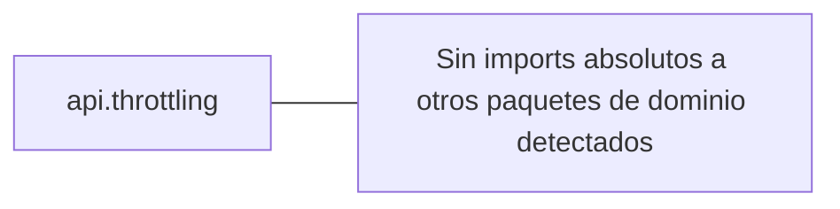

# API throttling

DRF aplica limites globales:

- anonimo: 100 requests por hora
- autenticado: 2.000 requests por hora

El permiso global es `IsAuthenticated`. Cada endpoint realmente publico debe
declarar `AllowAny` de forma explicita.

Estos limites no sustituyen scopes especificos para login, recuperacion,
intake, pagos o callbacks. Deben agregarse antes de exponer el sistema.

<!-- backend-source-audit:start -->
## Evidencia del codigo y mapa de dependencias

Inventario estatico reproducible del checkout. Describe declaraciones e imports;
no prueba despliegue, permisos efectivos ni que todos los caminos se ejecuten.
Las rutas son locales a su URLConf: el prefijo publico se consulta en
[`api/v1/routers.py`](../v1/routers.py).

- Archivos Python de implementacion: **5** (excluye tests y migraciones).
- Huella SHA-256 del codigo inventariado: `77a9320286f8b6ed1a07043f5578b48e1e1fd4c302d416651fe878dd42b82abd`.
- Familias detectadas: models, views.

No se detectan declaraciones `path`/`re_path` propias en este alcance.
Esto no implica que el modulo carezca de consumidores internos.

### Diagrama de dependencia estatica

Las flechas representan imports entre paquetes, no eventos ni orden de ejecucion.

Flujos transversales: [flujo actualizado](../../docs/BACKEND_CURRENT_FLOW.md).

Regeneracion: `py -3 scripts/audit_backend_docs.py --write`.
Comprobacion de deriva: `py -3 scripts/audit_backend_docs.py --check`.
<!-- backend-source-audit:end -->
