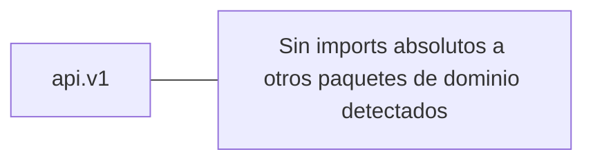

# api.v1

## Que hace

`api.v1` contiene la superficie HTTP versionada principal del backend.

## Rol En El Sistema

Este submodulo no modela negocio por si mismo. Su responsabilidad es ensamblar
los routers y exponer una API estable para mobile y web.

## Flujo Principal

1. `backend.urls` monta `api/`
2. `api.v1.routers` registra las rutas versionadas
3. cada bounded context expone su superficie por viewsets o vistas
4. mobile/web consume esa capa unificada como BFF

## Relacion Con Otros Modulos

- `backend.urls`
  monta `api/` sobre `api.v1.routers`.
- los bounded contexts del proyecto
  registran aqui sus viewsets, APIs o endpoints cuando corresponde.
- `api.throttling`
  puede complementar esta capa con proteccion de consumo.

## Encaje Con GCP

En despliegue cloud-first, `api.v1` es la puerta versionada que vive detras de:

- API Gateway
- Cloud Armor
- Cloud Run BFF

## Estado Actual

Su `AppConfig` existe y forma parte del ensamblaje del proyecto. La logica
detallada de endpoints y routers se documenta mejor en `api/README.md` y en los
modulos de negocio expuestos por esa API.

<!-- backend-source-audit:start -->
## Evidencia del codigo y mapa de dependencias

Inventario estatico reproducible del checkout. Describe declaraciones e imports;
no prueba despliegue, permisos efectivos ni que todos los caminos se ejecuten.
Las rutas son locales a su URLConf: el prefijo publico se consulta en
[`api/v1/routers.py`](routers.py).

- Archivos Python de implementacion: **6** (excluye tests y migraciones).
- Huella SHA-256 del codigo inventariado: `41db25512d4b2d7ddf6189e41c3b9fcfb1bbae0fc775bc34ab68117031354743`.
- Familias detectadas: models, views.

### Rutas declaradas

| Patron local | Fuente |
| --- | --- |
| `alerts/` | [api/v1/routers.py](routers.py) |
| `alerts/rules/` | [api/v1/routers.py](routers.py) |
| `contacts/` | [api/v1/routers.py](routers.py) |
| `documents/` | [api/v1/routers.py](routers.py) |
| `finance/accounts/` | [api/v1/routers.py](routers.py) |
| `finance/budgets/` | [api/v1/routers.py](routers.py) |
| `finance/categories/` | [api/v1/routers.py](routers.py) |
| `finance/debts/` | [api/v1/routers.py](routers.py) |
| `finance/fx/` | [api/v1/routers.py](routers.py) |
| `finance/transactions/` | [api/v1/routers.py](routers.py) |
| `finance/vendors/` | [api/v1/routers.py](routers.py) |
| `identity/consents/` | [api/v1/routers.py](routers.py) |
| `identity/devices/` | [api/v1/routers.py](routers.py) |
| `identity/eventing/` | [api/v1/routers.py](routers.py) |
| `identity/permissions/` | [api/v1/routers.py](routers.py) |
| `identity/sessions/` | [api/v1/routers.py](routers.py) |
| `identity/users/` | [api/v1/routers.py](routers.py) |
| `integrations/open-banking/` | [api/v1/routers.py](routers.py) |
| `internal/accounts/` | [api/v1/routers.py](routers.py) |
| `internal/alerts/` | [api/v1/routers.py](routers.py) |
| `internal/payments/` | [api/v1/routers.py](routers.py) |
| `internal/support/` | [api/v1/routers.py](routers.py) |
| `internal/transactions/` | [api/v1/routers.py](routers.py) |
| `mobile/` | [api/v1/routers.py](routers.py) |
| `notifications/deliveries/` | [api/v1/routers.py](routers.py) |
| `notifications/preferences/` | [api/v1/routers.py](routers.py) |
| `payments/intents/` | [api/v1/routers.py](routers.py) |
| `payments/scheduled/` | [api/v1/routers.py](routers.py) |
| `planning/goals/` | [api/v1/routers.py](routers.py) |
| `planning/shared-goals/` | [api/v1/routers.py](routers.py) |
| `realtime/consumers/` | [api/v1/routers.py](routers.py) |
| `reports/` | [api/v1/routers.py](routers.py) |
| `runtime/` | [api/v1/routers.py](routers.py) |
| `social/invitations/` | [api/v1/routers.py](routers.py) |
| `social/shared-expenses/` | [api/v1/routers.py](routers.py) |
| `social/teams/` | [api/v1/routers.py](routers.py) |
| `support/audit/` | [api/v1/routers.py](routers.py) |

### Diagrama de dependencia estatica

Las flechas representan imports entre paquetes, no eventos ni orden de ejecucion.

Flujos transversales: [flujo actualizado](../../docs/BACKEND_CURRENT_FLOW.md).

Regeneracion: `py -3 scripts/audit_backend_docs.py --write`.
Comprobacion de deriva: `py -3 scripts/audit_backend_docs.py --check`.
<!-- backend-source-audit:end -->
