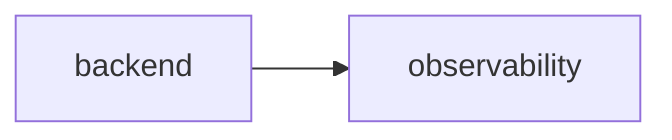

# backend

## Que hace

`backend` es el paquete de configuracion global del proyecto Django.

No es un bounded context de negocio. Su responsabilidad es ensamblar el
monolito modular y exponer sus entrypoints de servidor.

## Piezas Principales

- `settings.py`
  configuracion global del proyecto.
- `urls.py`
  tabla raiz de rutas.
- `asgi.py`
  entrypoint ASGI.
- `wsgi.py`
  entrypoint WSGI.

## Rol En El Sistema

Este paquete resuelve:

- carga de configuracion desde `.env`
- instalacion de apps del proyecto
- middlewares y autenticacion
- conexion a base de datos local o Cloud SQL
- feature flags y settings de GCP
- mapeo de URLs raiz

## Lo Que Se Ve Hoy En Codigo

### `settings.py`

Configura:

- `INSTALLED_APPS` con todos los bounded contexts del repo
- JWT, `dj-rest-auth` y `allauth`
- social auth con Google y Facebook
- `AUTH_USER_MODEL = users.User`
- base de datos local o Cloud SQL segun `ENV`
- settings de Pub/Sub, Cloud Tasks y varios handlers internos
- settings operativos de `accounts`, identidad y snapshots

## Flujo De Arranque

1. el proceso del servidor carga `backend.settings`
2. Django registra `INSTALLED_APPS` y middlewares
3. `backend.urls` monta las rutas raiz del proyecto
4. `asgi.py` o `wsgi.py` exponen el entrypoint segun el runtime
5. desde ahi el trafico entra a `api/` o a rutas internas controladas

Eso lo convierte en el punto donde se expresa el ensamblaje real del sistema.

### `urls.py`

Hoy expone dos entradas raiz:

- `admin/`
- `api/` usando `api.v1.routers`
- `internal/integrations/banks/` para la frontera interna del stub bancario

### `asgi.py` y `wsgi.py`

Exponen el proyecto para despliegue en servidores ASGI/WSGI segun el caso.

## Relacion Con Otros Modulos

- `api`
  define la superficie HTTP versionada que `backend.urls` monta.
- `common`
  aporta piezas transversales que terminan instaladas por settings.
- todos los bounded contexts
  son registrados desde `INSTALLED_APPS`.

## Por Que Importa

Aunque no sea dominio de negocio, este paquete es la pieza que hace que el
backend exista como sistema unico y coherente. Si aqui se rompe configuracion de
apps, auth, base de datos o routing, el resto del producto deja de funcionar.

## Encaje Con GCP

`backend` es la capa donde mas se nota la topologia cloud-first:

- Cloud SQL via socket `/cloudsql/...` en entorno cloud
- feature flags para Pub/Sub
- feature flags para Cloud Tasks
- settings para handlers internos y tokens de servicios

En Cloud Run, este paquete es el que hace que el contenedor arranque con el
contexto correcto.

## Estado Actual

Este paquete si es plenamente operativo hoy. La recomendacion es mantenerlo
como capa de composicion y evitar meter aqui logica de dominio.

<!-- backend-source-audit:start -->
## Evidencia del codigo y mapa de dependencias

Inventario estatico reproducible del checkout. Describe declaraciones e imports;
no prueba despliegue, permisos efectivos ni que todos los caminos se ejecuten.
Las rutas son locales a su URLConf: el prefijo publico se consulta en
[`api/v1/routers.py`](../api/v1/routers.py).

- Archivos Python de implementacion: **5** (excluye tests y migraciones).
- Huella SHA-256 del codigo inventariado: `3941ec2eb5fd99d43e258fdefb935418b4452ef53e7a69de024d1e23d48bc9a0`.
- Familias detectadas: sin capas convencionales detectadas.

### Rutas declaradas

| Patron local | Fuente |
| --- | --- |
| `admin/` | [backend/urls.py](urls.py) |
| `api/` | [backend/urls.py](urls.py) |
| `api/internal/integrations/banks/` | [backend/urls.py](urls.py) |
| `api/internal/integrations/llm/` | [backend/urls.py](urls.py) |
| `healthz/` | [backend/urls.py](urls.py) |
| `internal/integrations/banks/` | [backend/urls.py](urls.py) |
| `internal/integrations/llm/` | [backend/urls.py](urls.py) |
| `readyz/` | [backend/urls.py](urls.py) |

### Diagrama de dependencia estatica

Las flechas representan imports entre paquetes, no eventos ni orden de ejecucion.

Flujos transversales: [flujo actualizado](../docs/BACKEND_CURRENT_FLOW.md).

Regeneracion: `py -3 scripts/audit_backend_docs.py --write`.
Comprobacion de deriva: `py -3 scripts/audit_backend_docs.py --check`.
<!-- backend-source-audit:end -->
