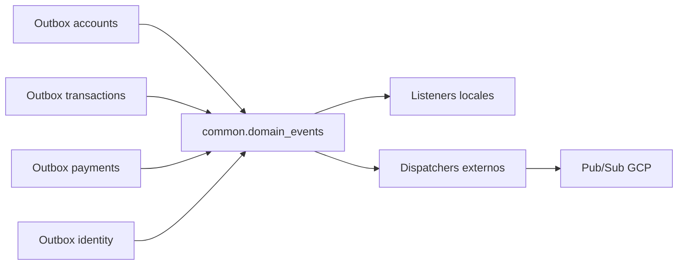
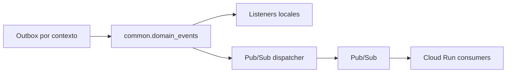

# common

## Que hace

`common` concentra piezas transversales del backend que no pertenecen a un
bounded context de negocio concreto.

Aqui viven, entre otras:

- bus local de eventos de dominio
- catalogo base de nombres `*.v1`
- bootstrap de eventing
- dispatchers compartidos
- integracion opcional con GCP Pub/Sub
- utilidades y componentes reutilizables

## Rol En La Arquitectura

Este modulo existe para evitar que cada contexto reinvente infraestructura
basica.

Su valor principal es dar consistencia en:

- contratos de evento
- publicacion local
- listeners
- dispatchers externos
- orden y prioridad de ejecucion

`common` no deberia contener reglas de negocio especificas de cuentas, pagos o
usuarios. Debe contener primitivas compartidas.

## Por Que Existe

Sin este modulo, cada bounded context tenderia a:

- inventar su propio bus
- nombrar eventos de forma distinta
- duplicar dispatchers
- mezclar contratos de dominio con transporte

`common` pone orden sin forzar que todos los dominios se vuelvan uno solo.

## Vista visual

## Vista cloud

Lectura:

- `common` no es el outbox ni el dominio; es la capa de reparto comun
- el backend puede reaccionar localmente y a la vez publicar hacia GCP
- el transporte cloud cuelga del contrato comun, no al reves

## Eventos De Dominio

El archivo clave es [domain_events.py](/c:/Users/Alamb/Documents/Vexxo_Backend_API/common/domain_events.py).

Ahí se define:

- `EventContext`
- `EventPriority`
- `EventNames`
- `KNOWN_EVENT_TYPES`
- `VexxoAppDomainEvent`
- registro de listeners via `@subscribe`
- bus local y dispatchers externos

### Politica de eventos

Principios actuales:

- nombre versionado: `bounded_context.resource.action.vN`
- contrato de dominio primero; transporte despues
- el bus local sirve para coordinacion intra-backend
- los bounded contexts fuertes publican por outbox antes de salir a transporte
- las senales livianas para UX no reemplazan al outbox
- si un bounded context queda muy por debajo de `accounts` en retry, locking,
  dead-letter o trazabilidad, la prioridad es cerrarlo antes de agregar mas
  fan-out cloud

## Relacion Con Los Otros Modulos

- `finance.accounts`, `identity.eventing` y `payments.payment_intents`
  publican eventos fuertes usando outbox y luego `common.domain_events`
- `alerts`, `notifications` y `realtime` consumen eventos para UX y soporte
- `integrations_stub` o futuros servicios externos pueden recibir eventos ya
  publicados

## Encaje Con GCP

`common.gcp.pubsub_dispatcher` conecta el contrato comun del evento con GCP.

Topologia esperada:

- bounded context persiste evento en outbox
- worker del contexto llama `common.domain_events.publish_domain_event`
- si Pub/Sub esta habilitado, `common.gcp.pubsub_dispatcher` publica el evento
- Cloud Run, Dataflow o analytics pueden consumirlo desacoplados

Modo local actual:

- si `DOMAIN_EVENTS_LOCAL_AUTOPUBLISH_ENABLED=true`, los bounded contexts con
  outbox pueden autopublicar sus eventos despues del commit
- esto permite que listeners locales, notificaciones, realtime y proyecciones
  reaccionen en desarrollo sin correr workers aparte
- la salida opcional a Pub/Sub sigue intacta y no se elimina la configuracion
  cloud; simplemente no se usa si `DOMAIN_EVENTS_PUBSUB_ENABLED=false`

Esto permite:

- mantener consistencia local aunque falle GCP
- usar Pub/Sub solo como distribucion externa, no como origen de verdad

## Estado Actual

Hoy `common` ya sostiene:

- catalogo base de `EventNames`
- modelo de evento comun
- suscripciones por `@subscribe`
- bus local
- dispatcher opcional a Pub/Sub

## Estado operativo actual

`common` ya no lanza un thread ad-hoc por listener async.

Ahora:

- `run_async=True` usa un `ThreadPoolExecutor` acotado
- los errores async quedan loggeados al resolver el `future`

Importante:

- esto mejora el runtime local
- no reemplaza outbox
- no convierte el bus local en cola durable

Lo que no debe absorber es:

- outboxs de cada bounded context
- read models de producto
- politicas de dominio

## Casos De Uso

- un pago confirmado emite `payments.intent.succeeded.v1`
- `common.domain_events` lo reparte a listeners locales registrados
- un dispatcher opcional lo publica a Pub/Sub
- `notifications`, `realtime`, analytics o integradores lo consumen segun
  corresponda

## Que No Debe Hacer

- no debe guardar reglas de negocio especificas de producto
- no debe reemplazar outboxs por contexto
- no debe mezclar concerns de dominio con concerns de entrega final
