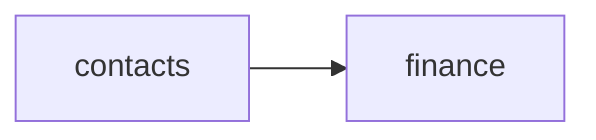

# contacts

## Que hace

`contacts` es el modulo operativo de contactos financieros reutilizables del
usuario.

No es lo mismo que `social.contacts`. Aqui vive el caso de uso real actual.

## Modelo Principal

El modelo `Contact` representa una contraparte recurrente del usuario:

- amiga/o
- familia
- coworker
- cliente
- pareja/roommate
- otro

Campos clave observados:

- `owner`
- `linked_user`
- `name`
- `nickname`
- `relationship`
- `email`
- `phone`
- `currency`
- `net_balance`
- `last_activity_at`
- `last_transaction_at`
- `last_transaction_amount`
- `is_archived`

## Rol En El Producto

Este modulo ayuda a convertir relaciones financieras repetidas en una entidad
estable y entendible para el usuario.

Sirve para:

- saber a quien le pagas seguido
- saber quien te debe o a quien debes
- reutilizar contrapartes
- ordenar relaciones personales y comerciales

## Flujo Principal

1. el usuario crea un contacto
2. si no indica moneda, el serializer usa la moneda preferida del usuario
3. el modulo aplica un limite por plan via `user.can_add_contact()`
4. el contacto puede archivarse o restaurarse
5. el saldo neto puede recalcularse desde `TransactionParticipant`

## Logica De Negocio Relevante

`Contact.recalc_net_balance()` recalcula el balance neto usando
`TransactionParticipant` activos de transacciones confirmadas:

- positivo: el contacto te debe
- negativo: tu debes al contacto
- cero: estado liquidado

Eso permite que el contacto no sea solo una libreta de direcciones, sino una
vista financiera util.

## API Actual

`ContactViewSet` ofrece:

- CRUD basico
- filtro por `relationship`
- filtro por archivado
- filtro por estado:
  - `debtor`
  - `creditor`
  - `settled`
- acciones:
  - `archive`
  - `unarchive`

## Relacion Con Otros Modulos

- `finance.transactions`
  fuente real del balance neto via participantes.
- `identity.users`
  plan del usuario y limite de contactos.
- `payments`
  posible reutilizacion futura como beneficiarios.
- `social`
  capa social general; este modulo es la vista financiera concreta.

## Encaje Con GCP

Hoy es un CRUD transaccional liviano sobre Cloud SQL y Cloud Run.

Si creciera:

- podria emitir eventos para sugerencias o growth
- podria alimentar autocomplete, pagos o contactos favoritos
- seguiria siendo un modelo OLTP, no un store analitico

## Estado Actual

Este modulo si es funcional hoy y no debe confundirse con `social.contacts`,
que sigue en estado scaffold.

<!-- backend-source-audit:start -->
## Evidencia del codigo y mapa de dependencias

Inventario estatico reproducible del checkout. Describe declaraciones e imports;
no prueba despliegue, permisos efectivos ni que todos los caminos se ejecuten.
Las rutas son locales a su URLConf: el prefijo publico se consulta en
[`api/v1/routers.py`](../api/v1/routers.py).

- Archivos Python de implementacion: **10** (excluye tests y migraciones).
- Huella SHA-256 del codigo inventariado: `8ccc82cfcfeedd270bcb51cec5a977b05e9b4edcd7dfc52eaaa47920dee9d6f3`.
- Familias detectadas: models, serializers, views.

### Declaraciones de modelos detectadas

- `Contact` en [contacts/models/contact.py](models/contact.py).

### Rutas declaradas

| Patron local | Fuente |
| --- | --- |
| `/ [DRF router]` | [contacts/urls.py](urls.py) |

### Diagrama de dependencia estatica

Las flechas representan imports entre paquetes, no eventos ni orden de ejecucion.

Flujos transversales: [flujo actualizado](../docs/BACKEND_CURRENT_FLOW.md).

Regeneracion: `py -3 scripts/audit_backend_docs.py --write`.
Comprobacion de deriva: `py -3 scripts/audit_backend_docs.py --check`.
<!-- backend-source-audit:end -->
