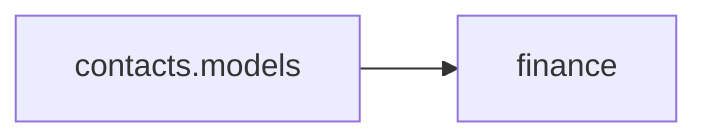

# contacts.models

## Que hace

Este directorio contiene el modelo canonico `Contact` del modulo `contacts`.

## Pieza Principal

- `contact.py`

## Responsabilidad

Modelar una contraparte financiera reutilizable del usuario con:

- datos basicos de identificacion
- relacion personal o comercial
- balance neto
- actividad reciente
- vinculacion opcional a un usuario real de Vexxo

## Relacion Con Otras Piezas

- `contacts.serializers`
  expone el modelo a la API.
- `contacts.views`
  aplica ownership, filtros y acciones HTTP.
- `finance.transactions`
  aporta el dato real para recalcular `net_balance`.

## Estado Actual

Este subdirectorio si contiene logica de dominio visible y activa, en contraste
con otros contextos del repo que hoy siguen en scaffold.

<!-- backend-source-audit:start -->
## Evidencia del codigo y mapa de dependencias

Inventario estatico reproducible del checkout. Describe declaraciones e imports;
no prueba despliegue, permisos efectivos ni que todos los caminos se ejecuten.
Las rutas son locales a su URLConf: el prefijo publico se consulta en
[`api/v1/routers.py`](../../api/v1/routers.py).

- Archivos Python de implementacion: **2** (excluye tests y migraciones).
- Huella SHA-256 del codigo inventariado: `5b18d772fd5771fca03e22260975437045cc9dc6404ef4cac4325cc2069a261b`.
- Familias detectadas: models.

### Declaraciones de modelos detectadas

- `Contact` en [contacts/models/contact.py](contact.py).

No se detectan declaraciones `path`/`re_path` propias en este alcance.
Esto no implica que el modulo carezca de consumidores internos.

### Diagrama de dependencia estatica

Las flechas representan imports entre paquetes, no eventos ni orden de ejecucion.

Flujos transversales: [flujo actualizado](../../docs/BACKEND_CURRENT_FLOW.md).

Regeneracion: `py -3 scripts/audit_backend_docs.py --write`.
Comprobacion de deriva: `py -3 scripts/audit_backend_docs.py --check`.
<!-- backend-source-audit:end -->
