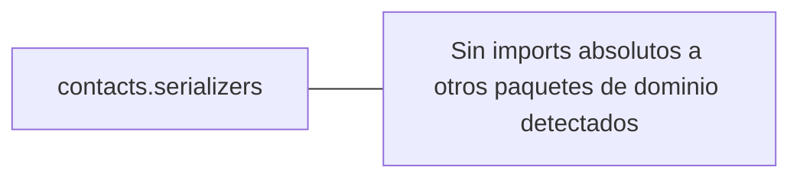

# contacts.serializers

## Que hace

Este directorio transforma el modelo `Contact` en superficie API.

## Pieza Principal

- `contact_serializer.py`

## Responsabilidad

El serializer actual:

- expone `Contact`
- agrega `net_status`
- deja campos contables como read-only
- toma la moneda preferida del usuario si no viene una moneda explicita
- fija `owner` al crear usando el request autenticado

## Relacion Con Otras Piezas

- `contacts.models`
  fuente de verdad del contacto.
- `contacts.views`
  usa este serializer para CRUD y acciones.

## Estado Actual

La capa de serializacion es simple pero funcional y alineada con el modulo
operativo actual de contactos.

<!-- backend-source-audit:start -->
## Evidencia del codigo y mapa de dependencias

Inventario estatico reproducible del checkout. Describe declaraciones e imports;
no prueba despliegue, permisos efectivos ni que todos los caminos se ejecuten.
Las rutas son locales a su URLConf: el prefijo publico se consulta en
[`api/v1/routers.py`](../../api/v1/routers.py).

- Archivos Python de implementacion: **2** (excluye tests y migraciones).
- Huella SHA-256 del codigo inventariado: `cfa7e880753f6380f4acfc4f58ce4997faaefeee8c9c3ba77f144b70598a0ddd`.
- Familias detectadas: serializers.

No se detectan declaraciones `path`/`re_path` propias en este alcance.
Esto no implica que el modulo carezca de consumidores internos.

### Diagrama de dependencia estatica

Las flechas representan imports entre paquetes, no eventos ni orden de ejecucion.

Flujos transversales: [flujo actualizado](../../docs/BACKEND_CURRENT_FLOW.md).

Regeneracion: `py -3 scripts/audit_backend_docs.py --write`.
Comprobacion de deriva: `py -3 scripts/audit_backend_docs.py --check`.
<!-- backend-source-audit:end -->
