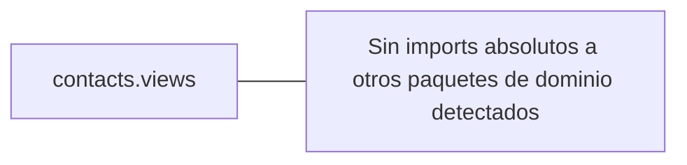

# contacts.views

## Que hace

Este directorio expone la API HTTP del modulo `contacts`.

## Pieza Principal

- `contact_view.py`

## Responsabilidad

`ContactViewSet`:

- lista solo contactos del usuario autenticado
- filtra por relacion, archivado y estado financiero
- valida limite por plan al crear
- permite archivar y desarchivar

## Casos De Uso

- crear un contacto nuevo
- buscar contactos por nombre o telefono
- ver a quien debes o quien te debe
- ocultar contactos archivados sin borrar historial financiero

## Relacion Con Otras Piezas

- `contacts.serializers`
  entrada y salida de datos.
- `identity.users`
  policy de plan para cantidad de contactos.
- `finance.transactions`
  impacto indirecto via balance neto del contacto.

## Estado Actual

La superficie HTTP es funcional hoy y responde a un caso de uso real del
producto, no a un scaffold vacio.

<!-- backend-source-audit:start -->
## Evidencia del codigo y mapa de dependencias

Inventario estatico reproducible del checkout. Describe declaraciones e imports;
no prueba despliegue, permisos efectivos ni que todos los caminos se ejecuten.
Las rutas son locales a su URLConf: el prefijo publico se consulta en
[`api/v1/routers.py`](../../api/v1/routers.py).

- Archivos Python de implementacion: **2** (excluye tests y migraciones).
- Huella SHA-256 del codigo inventariado: `6981f2e89d6cdc850c77113cf3ad6afd2ba931e009c727ed27dc7eb7fbf70899`.
- Familias detectadas: views.

No se detectan declaraciones `path`/`re_path` propias en este alcance.
Esto no implica que el modulo carezca de consumidores internos.

### Diagrama de dependencia estatica

Las flechas representan imports entre paquetes, no eventos ni orden de ejecucion.

Flujos transversales: [flujo actualizado](../../docs/BACKEND_CURRENT_FLOW.md).

Regeneracion: `py -3 scripts/audit_backend_docs.py --write`.
Comprobacion de deriva: `py -3 scripts/audit_backend_docs.py --check`.
<!-- backend-source-audit:end -->
