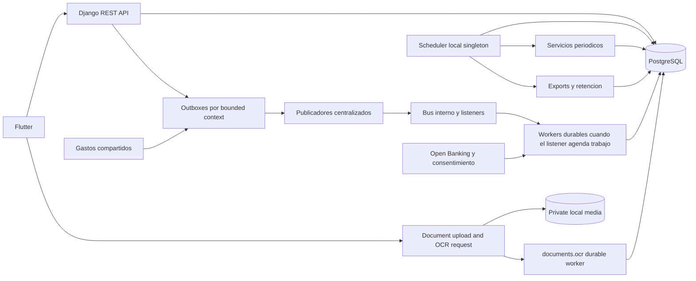

# Arquitectura local-first

## Alcance activo

Durante esta etapa solo existe un runtime operativo: `local`. Los adapters de
GCP permanecen deshabilitados como codigo futuro y no participan del arranque,
las pruebas ni la configuracion diaria.

## Topologia

PostgreSQL es la verdad operativa, la cola durable inicial y el mecanismo de
reintento. No se introduce Celery, RabbitMQ o Redis hasta medir saturacion,
contencion o lag que justifique esa complejidad.

Los rate limits sensibles tambien viven en PostgreSQL; `LocMemCache` no es una
frontera de abuso multi-proceso. Los secretos dinamicos de proveedores se
guardan como envelopes AES-256-GCM en `integrations.credentials`; `.env.local`
contiene solo material bootstrap no versionado.

## Reglas

- El dominio no pregunta si corre local o cloud.
- Los requests escriben estado y outbox dentro de fronteras atomicas.
- Los workers reclaman trabajo durable y pueden reintentarlo.
- Ningun trabajo relevante se delega a threads del proceso web.
- Los signals solo conectan lifecycle tecnico.
- Debts y goals no orquestan negocio con signals: usan servicios atomicos y
  outboxes registrados en `tasks/outbox_registry.py`.
- Notifications es inbox durable; Flutter usa polling incremental mientras la
  pantalla esta activa. Realtime sigue siendo invalidacion UX.
- Documents conserva binarios privados, checksum y OCR como datos auxiliares;
  nunca materializa una transaccion sin confirmacion visible del usuario.
- `Account.balance` es cache reconstruible; transactions es ledger.

## Entrada HTTP Y Salida De Eventos

En local existe una sola entrada HTTP: Django/DRF y su URLConf bajo `/api`.
No hay un API Gateway separado porque todavia no aporta aislamiento ni escala
que justifique otra pieza. Autenticacion, permisos, throttling, request IDs y
serializacion se resuelven en esa frontera.

No existe una tabla outbox global. Cada bounded context conserva su outbox para
mantener ownership y transaccion atomica. La operacion si esta centralizada:
`tasks/outbox_registry.py`, `publish_outbox` y los procesos Compose conocen los
contextos soportados. Esto evita una tabla acoplada y tambien evita registrar
el mismo modulo en scripts distintos.

El flujo canonico es:

1. API valida autenticacion, ownership e idempotencia.
2. Servicio de aplicacion ejecuta la regla dentro de `transaction.atomic`.
3. Estado y evento outbox se guardan en la misma transaccion.
4. El publicador reclama el evento y lo entrega al bus interno.
5. Listeners requeridos actualizan proyecciones, alertas o trabajo durable.
6. Mobile consulta bootstrap/sync-state; realtime solo invalida o avisa.

## Scheduler Local

`scheduler-local` es un unico proceso para todos los jobs periodicos livianos.
Antes de ejecutar obtiene `pg_try_advisory_lock`, por lo que dos replicas no
corren el mismo ciclo a la vez. Cada job persiste estado, ultima ejecucion,
errores y siguiente fecha en `ScheduledJobState`.

El catalogo contiene, entre otros:

- `debts.refresh_overdue`
- `payments.process_schedule_runs`
- `open_banking.retry_syncs`
- `open_banking.expire_consents`
- `open_banking.purge_payloads`
- `documents.migrate_encryption`
- `documents.purge_expired`
- `reports.process_exports`
- `reports.purge_exports`
- `security.purge_retention`

Las reglas siguen en los servicios de cada modulo. El scheduler solo resuelve
tiempo, singleton y observabilidad.

El contenedor `domain-outbox` procesa los outboxes de deudas, metas, documentos y gastos compartidos en un solo
loop. Esta agrupacion evita crear un proceso por cada modulo liviano y permite
sumar contextos en el catalogo comun sin bifurcar el dominio por entorno.

`documents-ocr-worker` reclama trabajos con `select_for_update(skip_locked)` y
recupera locks `processing` con mas de 15 minutos. Texto extraido en el movil y
archivos `text/*` pueden resolverse localmente; imagenes sin motor OCR quedan en
`review_required` en vez de producir datos inventados.

## Operacion Y Recuperacion

- `GET /api/internal/support/operations/` ofrece a staff un snapshot auditado
  de outboxes, workers, scheduler, notificaciones y pagos.
- `prune_operational_data` es dry-run por defecto y solo elimina datos
  operativos ya terminados; no toca ledger ni auditoria.
- `backup_local_db.ps1` genera backups PostgreSQL bajo `.runtime/backups`.
- `restore_local_db.ps1` exige `-ConfirmRestore` para evitar restauraciones
  accidentales.
- `load_test_local.py` mide status, promedio, p95 y maximo con concurrencia
  configurable; no reemplaza pruebas de negocio ni un ensayo de capacidad.

No se usa Celery/Redis porque PostgreSQL ya cubre la durabilidad y coordinacion
requeridas para la escala inicial. Se reevalua cuando metricas reales muestren
lag sostenido, alta contencion, throughput que afecte OLTP o necesidad de colas
independientes con autoscaling.

La topologia apunta a 1.000 usuarios registrados y decenas de concurrentes.
Antes de usuarios reales se debe ejecutar periodicamente la matriz ya preparada
de carga, backup, restauracion controlada, retencion y seguridad. Tener los
comandos no demuestra por si solo el objetivo de recuperacion ni la capacidad.

La paginacion debe incorporarse endpoint por endpoint y con contrato versionado;
no se activa globalmente porque varias listas actuales son consumidas como
arrays planos por Flutter y por otros bounded contexts.
