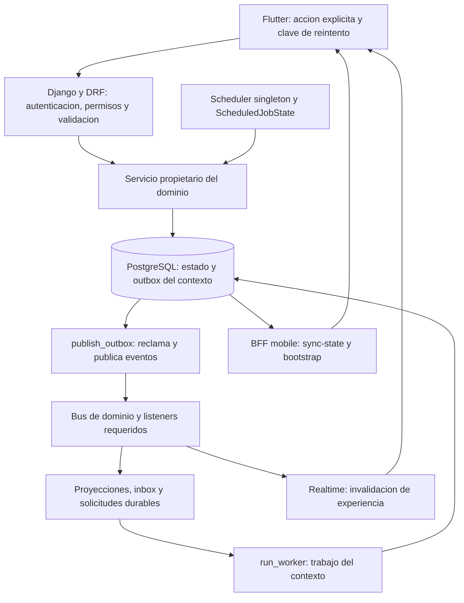
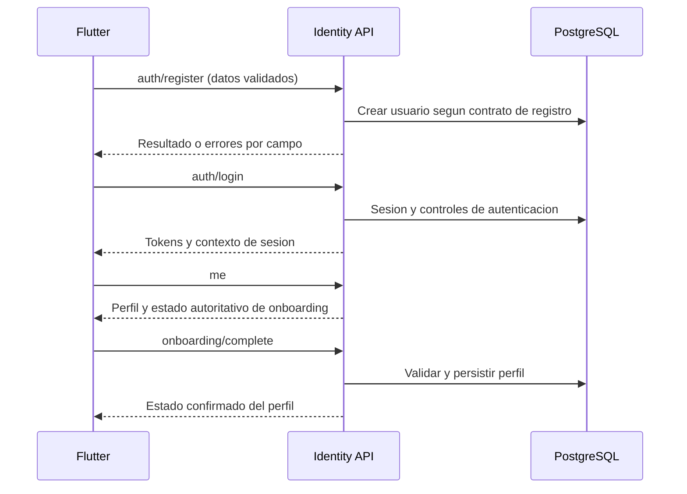
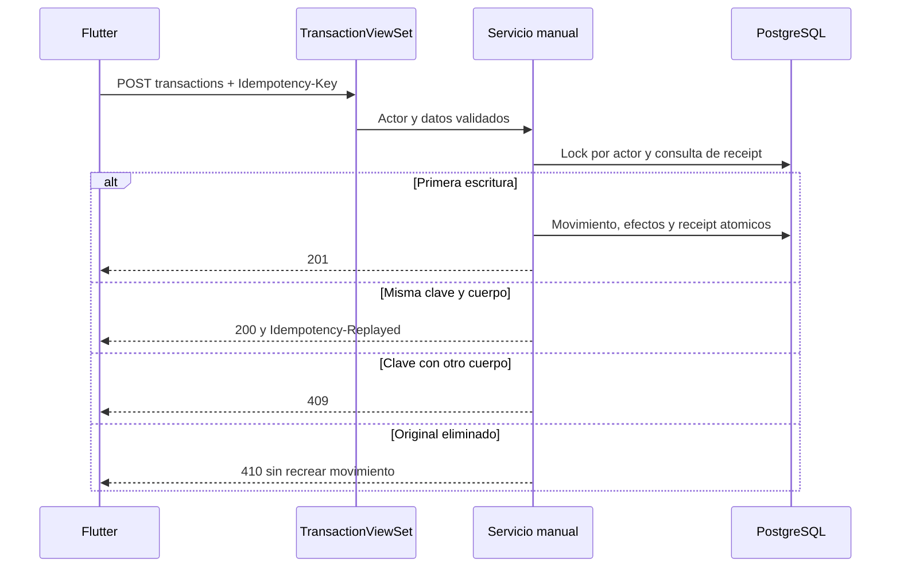
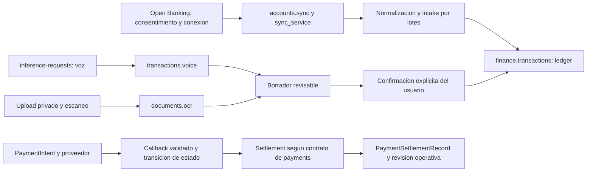
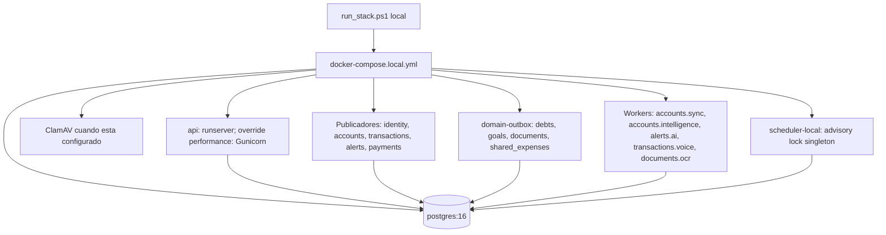

# Flujo actual del backend Vexxo

Revision documental: 2026-10-12. Fuentes: URLConf, Compose y catalogos ejecutables
del checkout. Local es la topologia activa declarada; disponer de adapters cloud
en el repositorio no demuestra que exista un despliegue GCP operativo.

## Recorrido de una accion del usuario

La API aplica la autoridad financiera y los permisos. Cada operacion define su
frontera atomica: no todas las lecturas ni todos los modulos tienen outbox.
Un evento fallido debe reintentarse; los consumidores necesitan deduplicacion,
porque publicacion y consumo no equivalen a entrega exactamente una vez.
`common/outbox_runtime.py` marca publicado despues de entregar los listeners
requeridos y registra fallos. El estado pendiente de Flutter no confirma ledger.

## Ownership

| Contexto | Responsabilidad vigente |
| --- | --- |
| identity + security | Usuarios, sesiones, dispositivos, consentimiento, grants, auditoria y secretos |
| finance.accounts | Cuentas y membresias; balance operacional reconstruible |
| finance.transactions | Ledger, registro manual, intake y confirmacion de inferencias |
| finance.budgets / debts / categories / fx / vendors | Presupuesto, deuda, clasificacion y referencias financieras |
| planning | Metas, colaboracion, hitos y proyecciones |
| payments | Intenciones y frontera con proveedor; no reemplaza el ledger |
| integrations.open_banking | Consentimiento, conexiones, normalizacion y sincronizacion bancaria |
| documents | Binarios privados, escaneo, OCR, lineage y vinculos a movimientos |
| social + contacts | Relaciones, invitaciones, membresias y gastos compartidos |
| reports | Consultas, snapshots mensuales y exports |
| alerts / notifications / realtime | Deteccion, inbox durable e invalidacion de UI |
| tasks / common | Entrega, locks, catalogos y contratos transversales |
| api.mobile / observability / admin_tools / support | Lectura mobile, salud y operacion autorizada |

La existencia de un directorio no implica una API publica o una implementacion
completa. El [inventario por README](BACKEND_DOCUMENTATION_AUDIT.md) permite
inspeccionar fuentes, rutas y dependencias, incluidos submodulos reservados.

## Registro, sesion y onboarding

Rutas: `identity/users/urls.py`. MFA, recovery, step-up y autenticacion social
tienen endpoints propios. No se presupone una rotacion diaria universal de JWT;
la politica se consulta en servicios de sesion y configuracion vigente.

## Escritura manual y reintentos

Fuente y limites: [finance.transactions](../finance/transactions/README.md).
Sin cabecera no existe garantia de deduplicacion. El registro manual, intake de
una fila, intake por lotes e inferencia mantienen contratos distintos.

## Ingestion, OCR y pagos

Open Banking usa `integrations/open_banking/sync_service.py`; la normalizacion
local conserva el intake existente. `local_mock` es simulacion local. Belvo y
Salt Edge requieren configuracion y certificacion; no se presentan como
integraciones productivas por existir sus clases. OCR e IA no autorizan una
escritura financiera por su cuenta. Callbacks duplicados o atrasados deben
respetar deduplicacion y estados terminales definidos en payments.
`record_payment_settlement` persiste un artefacto de conciliacion; no se dibuja
una escritura automatica al ledger desde ese servicio porque no esta presente
en su implementacion. Cualquier materializacion se debe comprobar en el intake
o accion concreta que la ejecuta.

## Runtime local

Los slices se seleccionan en `scripts/run_stack.ps1`; esta figura presenta los
servicios definidos, no afirma que todos esten corriendo. `security.key_rotation`
es un comando finito registrado en el wrapper, no un contenedor permanente.
`identity.consents` tiene modo inline configurado y no un worker durable propio.
Los adapters Pub/Sub y Cloud Tasks permanecen deshabilitados en Compose local.

El catalogo exacto de nueve outboxes, seis tipos de worker y once jobs se genera
desde `tasks/outbox_registry.py`, `run_worker.py` y `scheduled/registry.py` en el
inventario. Scheduler maneja syncs, consentimientos, attestations, retencion,
documentos, exports, cuotas vencidas y corridas de pagos.

## Lectura mobile y operacion

`/api/mobile/sync-state/` compara versiones; `/api/mobile/bootstrap/` devuelve
las secciones necesarias y omite builders de secciones vigentes. El frontend
conserva cache por usuario y solicita el estado autoritativo al backend.
`healthz` y `readyz` son las entradas de salud; las rutas internas de soporte
deben interpretarse junto con sus clases de permisos, no solo por su prefijo.

## Mantenimiento

1. Revisar el servicio, URLConf y catalogo afectados por cada cambio.
2. Actualizar narrativa y secuencias de negocio cuando cambie el comportamiento.
3. Ejecutar `py -3 scripts/audit_backend_docs.py --write` para refrescar evidencia.
4. Ejecutar `py -3 scripts/audit_backend_docs.py --check` para detectar deriva.

El inventario estatico complementa la revision contextual; no certifica toda la
narrativa historica ni sustituye pruebas de contratos, autorizacion o runtime.
