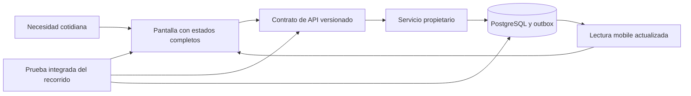

# Vexxo: producto, backend y conexion mobile en 2026

Fecha de revision: 2026-10-12.

## Diagnostico

La dificultad para avanzar tiene una causa estructural: Vexxo desarrolla muchas
fronteras y pantallas en paralelo, pero falta una puerta de cierre que compruebe
el recorrido Flutter -> API -> persistencia -> lectura actualizada para cada
capacidad. Tener un modelo, un endpoint o pruebas con mocks no cierra ese recorrido.

El backend tiene una base considerable: sesiones persistidas, registro manual
idempotente, ledger, cuentas, presupuestos, deudas, metas, outboxes y workers.
El problema no se resuelve implementando todas las carpetas vacias. La siguiente
fase debe cerrar conexiones y retirar ambiguedad sobre propietarios del codigo.

Esta evaluacion es una revision de codigo e investigacion de producto, no una
certificacion de produccion. No se reprodujeron fallos HTTP ni se ejecutaron
pruebas integradas contra PostgreSQL en esta sesion.

## Alcance y metodo

Backend revisado: checkout `vexxo_backend_api`, HEAD `9a6801c`, con cambios
documentales locales. Flutter revisado: checkout
`vexxo_frontend_mobile_android-master/vexxo_frontend_mobile_android-master`.
Hay otras copias del proyecto en disco; las conclusiones corresponden a estas.

- Inventario AST de 847 archivos Python de los paquetes de aplicacion.
- Exclusion de migraciones, tests y `__init__.py` para el conteo de archivos sin implementacion.
- Comparacion exacta de cuerpos de funciones de al menos 12 lineas, sin comentarios/docstrings.
- Lectura contextual de URLConf, vistas, serializers, modelos, outboxes y servicios.
- Contraste de endpoints Flutter, restauracion de sesion, OCR, cache y mutaciones.
- Consulta de sitios oficiales de productos competidores, con corte 2026-10-12.

La deteccion automatica produce candidatos: un archivo pequeno puede ser un
reexport correcto, un router necesario o una definicion de configuracion util.
Los imports relativos y las acciones dinamicas no se certifican por este scan.

## Lo que ya ofrece el mercado

| Producto y fuente oficial | Capacidades relevantes | Implicacion para Vexxo |
| --- | --- | --- |
| [Monarch](https://www.monarch.com/) | Vista consolidada, categorias, colaboracion, recurrencias, metas y reportes | Consolidacion y colaboracion ya son parte de la competencia |
| [YNAB](https://www.ynab.com/features) | Presupuesto, metas, importacion bancaria, sincronizacion offline y uso compartido | El producto debe ayudar a decidir y conservar confianza cuando no hay red |
| [Copilot Intelligence](https://help.copilot.money/en/articles/8182433-copilot-intelligence-for-spending) | Clasificacion que aprende de correcciones y reconoce incertidumbre | La IA debe reducir trabajo concreto y permitir correccion |
| [Copilot Dispatch](https://www.copilot.money/dispatch) | Money Assistant en beta con sugerencias y acciones sobre objetos financieros | Tener chat o IA no constituye por si solo una diferencia defendible |
| [Revolut Budgeting](https://www.revolut.com/en-UA/best-budget-planner/) | Categorias, tendencias, pockets y recordatorios de suscripciones | La calidad de la interaccion y los compromisos visibles importan |

Estas son declaraciones de producto de sus proveedores, no una medicion
independiente de calidad. La pagina Revolut consultada es regional: no se
presupone disponibilidad de todas sus funciones en Colombia o Latinoamerica.

## Propuesta recomendada para Vexxo

Hipotesis de posicionamiento: **tu dinero cotidiano, tus compromisos y tus
acuerdos compartidos en un solo lugar, con decisiones que puedes entender**.

Segmento inicial propuesto, pendiente de validar: personas con finanzas
personales y gastos con pareja, hogar o amigos; combinan pagos digitales,
efectivo y cuentas distintas. Comenzar en un mercado y idioma principal evita
que cobertura bancaria, FX, cumplimiento y UX crezcan a la vez.

Tres preguntas que la app debe resolver:

1. Que puedo gastar antes de mi siguiente ingreso sin olvidar compromisos.
2. Que pague, que viene y que necesita mi revision.
3. Que tenemos acordado entre nosotros, sin exponer toda mi vida financiera.

La respuesta a la primera pregunta es una estimacion con horizonte, datos y
supuestos visibles; no una garantia ni un numero inventado cuando falta informacion.

## Capacidades minimas competitivas y diferenciacion

| Problema cotidiano | Capacidad requerida | Resultado verificable |
| --- | --- | --- |
| No entiendo donde quedo mi dinero | Cuentas, saldo con fecha, movimientos buscables, transferencias excluidas del gasto | Resumen explicable y conciliable con movimientos |
| Registrar cada gasto me cansa | Captura manual corta, importacion y recibo/voz con revision | Una entrada confirmada sin duplicacion por reintento |
| Me sorprenden las facturas | Calendario unificado y recurrencias revisables | Proximos compromisos, pagado/pendiente y cambios visibles |
| Mi ingreso cambia cada mes | Plan flexible con horizonte y escenarios | Estimacion que distingue ingreso esperado de dinero confirmado |
| Compartir termina en discusiones | Acuerdo de gasto, participacion, aceptacion y trazabilidad | Cada persona ve que debe y puede discutir o corregirlo |
| No quiero compartir mis cuentas personales | Espacios compartidos con minimo acceso necesario | Revocar acceso sin destruir evidencia de acuerdos |
| No entiendo por que la IA dice eso | Sugerencia con fuente, razones, confianza y efectos | Confirmar, editar o descartar; sin escritura financiera silenciosa |
| No confio en datos atrasados | Fecha de sync, estado offline, errores accionables y reconciliacion | Pendiente local claramente diferente de confirmado |
| Quiero avanzar hacia una meta | Metas, aportes y relacion con compromisos | Progreso comprobable y opciones de ajuste |
| Quiero controlar mis datos | Consentimiento, acceso compartido, exportacion y borrado explicados | Alcance, estado y consecuencias comprensibles |

La novedad propuesta surge de combinar datos personales y acuerdos compartidos
en decisiones diarias explicables. Debe validarse con usuarios: la combinacion
tecnica no prueba demanda ni disposicion a pagar.

Para IA, empezar con reglas y calculos deterministas. Un modelo puede explicar
o extraer; los totales y permisos deben resolverse por servicios autoritativos.
Aprender de correcciones requiere consentimiento y procedencia de datos; no
convertir payloads financieros crudos en datasets por defecto.

## Hallazgos tecnicos ordenados por prioridad

### P1: contrato de restauracion de sesion desalineado

Flutter define y llama a `/api/identity/users/auth/session-state/` y
`/api/identity/users/auth/app-resume/`. Ninguna ruta ni handler con esos nombres
esta declarada en el backend inspeccionado. Sin overrides o un servidor distinto,
esas llamadas no tienen destino en este checkout.

Evidencia:

- Flutter `lib/core/config/api_endpoints.dart:15` y `:19`.
- Flutter `lib/features/auth/data/auth_api.dart:33` y `:38`.
- Backend `identity/users/urls.py` y `identity/sessions/urls.py`.
- Flutter `test/features/auth/data/session_restore_test.dart:46`: `_SessionApi` sobrescribe ambas llamadas.

Impacto: iniciar por primera vez y restaurar una sesion existente tienen caminos
distintos; una suite con mocks puede aprobar sin comprobar la restauracion real.
Resolver primero el contrato autoritativo y agregar un recorrido integrado
login -> reinicio -> restauracion -> perfil. No sustituir 404 por acceso local.

### P1: definiciones duplicadas y divergentes de transacciones

`finance/transactions/Views/__init__.py:88` y
`finance/transactions/Views/transactions_views.py:91` definen `TransactionViewSet`.
La segunda incorpora `create` con `submit_manual_once`; la primera no.
Tambien difieren busqueda, relaciones y flujo de escritura. URLs y tests
revisados usan la segunda; no se afirma que el endpoint actual duplique gastos.

Los serializers tambien se repiten en `Serializers/__init__.py:78` y
`Serializers/transactions_serializers.py:79`. Alerts conserva definiciones
duplicadas en `views/__init__.py` y `views/alert_views.py`.

Impacto: un nuevo import puede seleccionar una implementacion antigua y una
correccion puede aplicarse en el archivo equivocado. Mantener un archivo
canonico y convertir los `__init__.py` en reexports compatibles, despues de
verificar importadores y contratos. No cambiar nombres ni rutas al consolidar.

### P2: cuatro archivos Python no compilables

`realtime/redis_channels.py:5`, `routing.py:5`, `typing.py:5` y
`unread_counters.py:5` contienen Markdown. AST devuelve SyntaxError.
No se comprobo que el arranque activo los importe: no significa que todo Django
este caido. Si se importan o se exige compilacion completa, fallan.

Mover la explicacion a Markdown y conservar solo un modulo Python valido si
hay consumidores. No implementar Redis o WebSockets para llenar esos nombres.

### P1: CI no ejecuta los contratos ni los recorridos de usuario

El `.gitlab-ci.yml` inspeccionado contiene una sola etapa `security` y un job
`secret_detection`. No configura pruebas Django, comprobacion de migraciones,
contratos HTTP ni integracion Flutter/backend. Puede haber ejecucion manual o
automatizacion externa, pero no esta definida en este archivo.

Esto explica por que cambios independientes pueden aprobar sus pruebas locales
y aun romper la app al conectarlos. Agregar primero contratos y un smoke real
de sesion y escritura, con PostgreSQL aislado y datos sinteticos. Conservar el
scan de secretos; la prueba de integracion complementa ese control.

### P2: politicas de producto con referencias obsoletas y fallback permisivo

`identity/users/models/user.py:363` intenta importar
`reports.monthly_reports.models.report.MonthlyReport`, pero el modelo vigente es
`MonthlyReportClose` en `reports/monthly_reports/models.py`. El catch devuelve
`True`. No se encontraron consumidores de ese helper fuera de su definicion:
es una politica latente incorrecta, no evidencia de bypass activo del endpoint.

`can_add_api_connection` intenta usar `FinancialConnection` desde un models.py
stub y termina contando cuentas conectadas como aproximacion; el aggregate
actual de Open Banking es `OpenBankingConnection`. Revisar la unidad del limite
antes de centralizar: cuenta y conexion no son equivalentes.

### P2: duplicacion de mecanica de outbox

`claim_for_processing` tiene el mismo cuerpo AST en cinco implementaciones:
common, alerts, transactions, identity y payments. Tambien se repiten
`mark_published`, `mark_failed` y dead-letter entre algunos contextos.

Conservar tablas y ownership por contexto. Consolidar locks, estados y retries
en primitivas compartidas, con pruebas de concurrencia, sin una tabla global
ni una migracion amplia para resolver solo repeticion de metodos.

### P2: OCR mobile y Documents no cierran un mismo recorrido

Flutter `ReceiptIntakeController` ejecuta OCR local y guarda un borrador manual.
No se encontraron llamadas a Documents/OCR en `lib`. En backend,
`documents/ocr_requests/services.py:43` normaliza `client_extracted_text` y hints;
el worker no demuestra un motor de lectura de imagen servidor.

Son piezas utiles con responsabilidades distintas. Falta cerrar el recorrido
opcional: evidencia local -> documento privado -> lineage OCR -> revision ->
movimiento confirmado -> vinculo de comprobante. Se puede lanzar captura local
sin upload; no se debe afirmar que ya archiva o sincroniza documentos.

### P2: estados y localizacion de producto inconsistentes

- Flutter `transaction_repository.dart:61` llama "Movimiento registrado" a una mutacion `queued=true`; aclarar pendiente de sincronizacion.
- `debts_page.dart:109` envia `currency: COP` fijo aunque la app dispone de monedas y perfil.
- Hay textos ES hardcodeados en vistas fuera de onboarding, mientras la bienvenida usa ARB.
- `ApiEndpoints.deviceToken` apunta a una ruta no declarada; push esta deshabilitado en los tres JSON de entorno revisados. Es una integracion pendiente, no el bloqueo de restauracion activo.

### P2: cache y reintentos necesitan un contrato uniforme

`FinanceOverviewRepository.load` devuelve cache util sin validar versiones
cuando `forceRefresh=false`. Existen coordinadores de sync en otras capas;
este metodo aislado no demuestra que toda la home sea stale. Revisar
invalidacion tras mutaciones y restauracion para evitar secciones incoherentes.

`OpenBankingApi.connect` crea una Idempotency-Key nueva en cada invocacion.
Una clave por intento no garantiza idempotencia por operacion cuando se pierde
la respuesta y se vuelve a tocar el boton. Unificar persistencia de intento,
estado incierto y reintento; confirmar el contrato backend antes de cambiarlo.

## Magnitud observada

| Indicador estatico | Resultado | Interpretacion |
| --- | ---: | --- |
| Apps propias declaradas en INSTALLED_APPS | 78 | Fronteras tecnicas; no 78 funciones listas |
| Archivos Python de implementacion examinados | 847 | Excluye migraciones y tests |
| Archivos parseados | 843 | Cuatro errores de sintaxis |
| Archivos sin declaraciones ejecutables propias | 134 | Incluye admin/views/models scaffold; algunos imports son utiles |
| Apps sin funciones/clases propias fuera de configuracion | 26 | Candidatos; api.v1 es un agregador de rutas valido |
| Grupos de cuerpos de funcion exactamente iguales | 12 | Umbral de 12 lineas; no cuenta duplicacion aproximada |
| Instancias en esos grupos | 28 | Evidencia de mantenimiento repetido |

No convierto estos numeros en un porcentaje de producto terminado.

Tambien existen archivos grandes: auth.py (1147 lineas), budgets/services.py
(1036), transaction_intake_service.py (1012), scheduled_payments/services.py
(996) y api/mobile/views.py (947). Dividirlos por tamaño sin identificar una
responsabilidad puede empeorar la navegacion. Extraer casos de uso y reglas
cohesivas cuando exista una prueba de comportamiento que proteja el cambio.

## Destino recomendado para carpetas reservadas

| Directorio | Decision propuesta | Propietario activo o motivo |
| --- | --- | --- |
| social.contacts | Retirar reserva tras validar imports/apps/migraciones | contacts |
| planning.milestones / projections | Consolidar ownership; no implementar un segundo aggregate | planning.goals |
| social.groups / memberships | Elegir modelo conceptual frente a teams antes de crear codigo | social.teams y sus membresias |
| payments.reminders | Usar servicios/catalogo vigente de runs + notifications | scheduled_payments y notifications |
| payments.calendar | Construir read model cuando se cierre UX de compromisos | Deudas, runs y metas existentes |
| finance.limits / api.throttling | Delimitar cuotas de producto frente a proteccion contra abuso | Identity/product usage y security.rate_limits |
| documents.storage | Mantener frontera solo cuando haya segunda implementacion | files y almacenamiento privado actual |
| alerts.listeners / triggers / ai_stub | Consolidar ubicacion de handlers; no registrar listeners dos veces | alerts.alerts y providers existentes |
| reports.summaries | Reutilizar read models de BFF/reportes antes de otra app | api.mobile y reports |
| social.chat / documents_shared | Posponer; mantener fuera de menu hasta tener recorrido | No necesarios para primer valor |
| admin_tools.manual_adjustments | Posponer hasta politica contable y control de intervencion | Riesgo alto |
| integrations_stub.payments / ocr / ml | Revisar consumidores y archivar reservas sin uso | local_fake / OCR local / providers canonicos |

Retirar una app Django requiere comprobar AppConfig, imports, migraciones,
content types y dependencias. Esta es una propuesta; no se elimino ninguna app.
No hay razon para llenar todos los directorios por completar el arbol.

## Arquitectura objetivo para avanzar

Mantener un monolito modular, PostgreSQL, outbox por contexto y workers durables.
Las mejoras prioritarias estan en contrato y recorridos completos. Extraer
microservicios o añadir brokers requiere evidencia de carga o aislamiento.

Un contrato machine-readable debe cubrir payload, permisos, errores, moneda,
idempotencia, estados y version. Se puede introducir OpenAPI compatible con
DRF despues de revisar dependencias, y generar/verificar tipos Flutter
gradualmente. Postman complementa el contrato; mocks por si solos no prueban
que la ruta real exista ni que devuelva el mismo schema.

## Orden de trabajo propuesto

### Hito 1: recuperar una base confiable

- Fijar un checkout y un comando de runtime como referencia comun.
- Cerrar session-state/app-resume con politica autoritativa y prueba real.
- Consolidar vistas/serializers duplicados sin romper imports publicos.
- Separar los cuatro archivos Markdown de Python.
- Registrar los contratos reales y probar login, registro y transaccion manual.
- Ejecutar esos checks en CI junto con el detector de secretos existente.

Salida: un usuario nuevo y uno existente pueden entrar, crear cuenta y guardar
una transaccion; respuesta perdida y reintento no generan otro movimiento.

### Hito 2: valor personal diario

- Home con estados loading, empty, cached, stale, offline y error recuperable.
- Captura corta, revision, edicion y eliminacion comprobable.
- Moneda y texto coherentes con perfil y locale.
- Presupuesto flexible y vista de compromisos reutilizando modelos existentes.
- Mostrar fecha de sync y pendientes sin confundirlos con ledger.

Salida: el usuario entiende sus datos y el siguiente compromiso, incluso al
cerrar/reabrir, perder red y volver a sincronizar.

### Hito 3: una colaboracion que funcione

- Invitacion, aceptacion, gasto compartido, disputa y liquidacion.
- Privacidad entre espacio personal y compartido; roles explicables.
- Cuenta/movimientos/inbox se actualizan tras cada accion.

Salida: dos usuarios recorren el ciclo completo y revocar acceso no filtra
informacion ni elimina evidencia de acuerdos anteriores.

### Hito 4: automatizacion util y medible

- Cerrar OCR local y archivo de evidencia si se desea sincronizar recibos.
- Detectar recurrencias para revision y proponer clasificacion corregible.
- Probar un proveedor bancario real en el mercado objetivo antes de prometer cobertura.
- Agregar estimaciones de disponibilidad con supuestos y explicacion.

Salida: menos correcciones y menos trabajo manual en pruebas con usuarios;
medir calidad y latencia antes de ampliar modelos o proveedores.

## Criterio de terminado

Una capacidad pasa a "lista" cuando el recorrido con datos reales de prueba
cubre pantalla, ruta real, autorizacion, persistencia, lectura e invalidacion,
reintento, version/conflicto, offline cuando aplique y error entendible.

Objetivos propuestos para una beta, no resultados observados:

- Usuario nuevo obtiene un primer resumen util sin configurar nueve conceptos.
- Todas las escrituras expuestas tienen estado final o pendiente visible.
- Cero duplicados en la matriz de reintento y doble toque de pruebas.
- Matriz de acceso personal/compartido pasa con dos usuarios y revocacion.
- Cada release ejecuta los recorridos principales contra backend real.
- Medir tiempo al primer valor, retencion, correcciones de IA, lag de sync y costo por usuario activo.

## Que posponer

Emision de tarjeta, ejecucion de dinero real, trading/crypto, chat social,
microservicios adicionales y modelos propios de ML pueden esperar. No son
prerrequisitos para demostrar el valor personal y colaborativo de Vexxo.

La eleccion propuesta es cerrar un producto pequeno con continuidad antes de
ampliar superficies. No se cambiaron reglas de negocio ni contratos durante
esta evaluacion.
