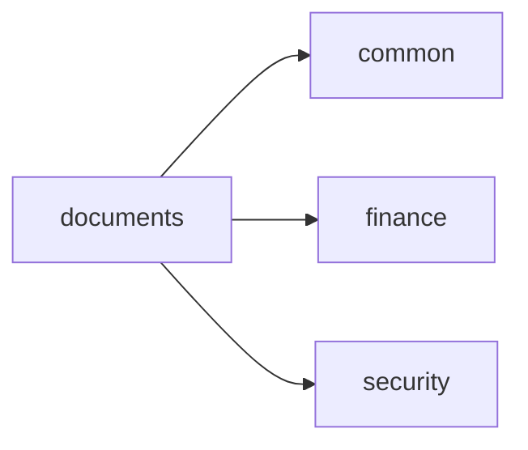

# Documents

`documents` es el bounded context local-first para comprobantes y soportes
financieros. No modifica el ledger por inferencia: almacena artefactos,
extraccion y vinculos; el usuario confirma cualquier efecto contable.

## Flujo operativo

1. `POST /api/documents/files/` recibe multipart autenticado.
2. El servidor valida tamano y calcula SHA-256; owner + checksum evita duplicados.
3. `POST /api/documents/files/{id}/request-ocr/` crea trabajo durable con
   `Idempotency-Key`.
4. `run_worker documents.ocr` reclama filas PostgreSQL y normaliza OCR local.
5. Texto extraido por ML Kit mobile se identifica como `client_mlkit_text_v1`.
6. Archivos `text/*` se procesan con `local_text_v1`; imagenes sin extraccion
   quedan `review_required`, nunca se inventa texto.
7. El resultado emite `documents.ocr.*` al outbox documental.
8. `POST /api/documents/transaction-links/` asocia el documento a una
   transaccion del mismo owner.

Los binarios viven en `.runtime/media` y no se versionan. La API no expone una
URL publica directa al archivo. El limite por defecto es 10 MiB y se controla
con `DOCUMENTS_MAX_UPLOAD_BYTES`.

## Modulos

- `files`: ownership, archivo, checksum, estado y soft delete.
- `metadata`: pistas estructuradas no autoritativas.
- `ocr_requests`: cola durable, resultados y outbox.
- `links_to_transactions`: relacion owner-scoped con el ledger.
- `storage`: frontera para sustituir filesystem local en el futuro.

## Operacion

```powershell
.\scripts\run_stack.ps1 local up documents
docker compose -f docker-compose.local.yml exec -T api python manage.py worker_status documents.ocr
docker compose -f docker-compose.local.yml exec -T api python manage.py outbox_status documents
```

Los documentos nuevos se cifran con AES-256-GCM cuando el keyring esta activo.
`documents.migrate_encryption --limit 25` migra historicos con lock, escaneo y
reemplazo transaccional. El scheduler ejecuta lotes de diez cada cinco minutos;
sin keyring devuelve `configured=false` y no modifica archivos.

La rotacion global tambien cuenta y reenvuelve envelopes documentales mediante
`security.key_rotation`; no vuelve a cifrar el binario. Una KEK no puede
retirarse mientras `key_retirement_check` encuentre documentos dependientes.
Consulta [Runbook de llaves](../docs/KEY_MANAGEMENT_RUNBOOK.md).

## Retencion, antivirus y lineage

- `documents.purge_expired` elimina fisicamente binario, envelope, OCR y
  metadata vencida; conserva un tombstone minimo para auditoria.
- `legal_hold` bloquea cualquier purga.
- ClamAV es un servicio opcional del slice `documents`; el backend falla
  cerrado cuando se selecciona `clamav` y el daemon no responde.
- El runner entrega la CA publica local a `freshclam` como secret efimero de
  Compose; el certificado y cualquier material sensible permanecen fuera de
  Git.
- `POST /api/documents/files/{id}/ocr-corrections/` exige motivo y crea una
  observacion que supersede a la anterior. Nunca reescribe silenciosamente la
  extraccion historica.

<!-- backend-source-audit:start -->
## Evidencia del codigo y mapa de dependencias

Inventario estatico reproducible del checkout. Describe declaraciones e imports;
no prueba despliegue, permisos efectivos ni que todos los caminos se ejecuten.
Las rutas son locales a su URLConf: el prefijo publico se consulta en
[`api/v1/routers.py`](../api/v1/routers.py).

- Archivos Python de implementacion: **40** (excluye tests y migraciones).
- Huella SHA-256 del codigo inventariado: `228da300aebaccaafb83dc9781fa9e18cd585fc9b69abf309ad08565020edf8c`.
- Familias detectadas: management, models, serializers, services, views.

### Declaraciones de modelos detectadas

- `DocumentDomainEventOutbox` en [documents/ocr_requests/models.py](ocr_requests/models.py).
- `DocumentDownloadGrant` en [documents/files/models.py](files/models.py).
- `DocumentFile` en [documents/files/models.py](files/models.py).
- `DocumentMetadata` en [documents/metadata/models.py](metadata/models.py).
- `DocumentTransactionLink` en [documents/links_to_transactions/models.py](links_to_transactions/models.py).
- `OcrFieldObservation` en [documents/ocr_requests/models.py](ocr_requests/models.py).
- `OcrRequest` en [documents/ocr_requests/models.py](ocr_requests/models.py).

### Rutas declaradas

| Patron local | Fuente |
| --- | --- |
| `` | [documents/files/urls.py](files/urls.py) |
| `` | [documents/links_to_transactions/urls.py](links_to_transactions/urls.py) |
| `downloads/ [DRF router]` | [documents/files/urls.py](files/urls.py) |
| `files/ [DRF router]` | [documents/files/urls.py](files/urls.py) |
| `transaction-links/ [DRF router]` | [documents/links_to_transactions/urls.py](links_to_transactions/urls.py) |

### Diagrama de dependencia estatica

Las flechas representan imports entre paquetes, no eventos ni orden de ejecucion.



Flujos transversales: [flujo actualizado](../docs/BACKEND_CURRENT_FLOW.md).

Regeneracion: `py -3 scripts/audit_backend_docs.py --write`.
Comprobacion de deriva: `py -3 scripts/audit_backend_docs.py --check`.
<!-- backend-source-audit:end -->
