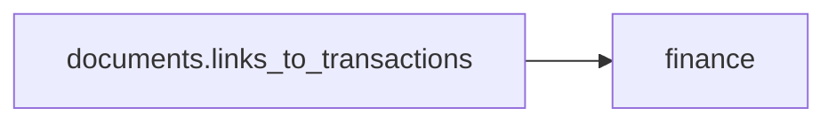

# documents.links_to_transactions

`DocumentTransactionLink` asocia un documento privado con una transaccion del
mismo propietario sin introducir el binario o el OCR dentro del ledger.

La API autenticada vive en `/api/documents/transaction-links/`. Los querysets y
serializers validan ownership de documento y transaccion; la restriccion
`document + transaction + relationship` evita relaciones duplicadas.

La relacion sirve como evidencia o soporte, no como autorizacion para alterar
montos, estados o conciliacion. Falta cerrar la UX mobile de vinculacion y la
politica ante soft delete del documento.

<!-- backend-source-audit:start -->
## Evidencia del codigo y mapa de dependencias

Inventario estatico reproducible del checkout. Describe declaraciones e imports;
no prueba despliegue, permisos efectivos ni que todos los caminos se ejecuten.
Las rutas son locales a su URLConf: el prefijo publico se consulta en
[`api/v1/routers.py`](../../api/v1/routers.py).

- Archivos Python de implementacion: **7** (excluye tests y migraciones).
- Huella SHA-256 del codigo inventariado: `c20768e7e84bc9da4bb9aae85a53c54e2e54d7218ac81f61c87d1d7198e9b0eb`.
- Familias detectadas: models, serializers, views.

### Declaraciones de modelos detectadas

- `DocumentTransactionLink` en [documents/links_to_transactions/models.py](models.py).

### Rutas declaradas

| Patron local | Fuente |
| --- | --- |
| `` | [documents/links_to_transactions/urls.py](urls.py) |
| `transaction-links/ [DRF router]` | [documents/links_to_transactions/urls.py](urls.py) |

### Diagrama de dependencia estatica

Las flechas representan imports entre paquetes, no eventos ni orden de ejecucion.

Flujos transversales: [flujo actualizado](../../docs/BACKEND_CURRENT_FLOW.md).

Regeneracion: `py -3 scripts/audit_backend_docs.py --write`.
Comprobacion de deriva: `py -3 scripts/audit_backend_docs.py --check`.
<!-- backend-source-audit:end -->
