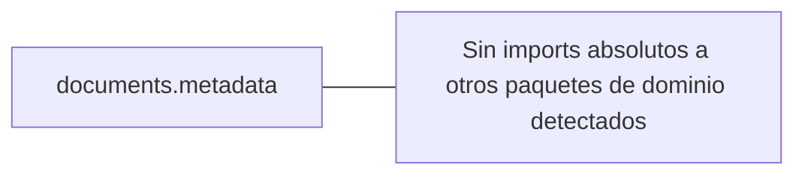

# documents.metadata

`DocumentMetadata` conserva metadata auxiliar de un comprobante: origen de
captura, pistas de comercio, monto, moneda y atributos adicionales.

La relacion con `DocumentFile` es uno-a-uno. Estos campos son pistas no
autoritativas: no modifican el ledger ni crean pagos. Cualquier efecto
financiero requiere una accion visible y una API canonica de dominio.

El siguiente cierre es una API versionada de correccion humana que conserve la
procedencia de cada campo y no sobrescriba silenciosamente la extraccion
original.

<!-- backend-source-audit:start -->
## Evidencia del codigo y mapa de dependencias

Inventario estatico reproducible del checkout. Describe declaraciones e imports;
no prueba despliegue, permisos efectivos ni que todos los caminos se ejecuten.
Las rutas son locales a su URLConf: el prefijo publico se consulta en
[`api/v1/routers.py`](../../api/v1/routers.py).

- Archivos Python de implementacion: **5** (excluye tests y migraciones).
- Huella SHA-256 del codigo inventariado: `c878c1a7ec1f4a092b1e737534be0ff9a0e2e55a0b21b04cc05011be6a9b1bda`.
- Familias detectadas: models, views.

### Declaraciones de modelos detectadas

- `DocumentMetadata` en [documents/metadata/models.py](models.py).

No se detectan declaraciones `path`/`re_path` propias en este alcance.
Esto no implica que el modulo carezca de consumidores internos.

### Diagrama de dependencia estatica

Las flechas representan imports entre paquetes, no eventos ni orden de ejecucion.

Flujos transversales: [flujo actualizado](../../docs/BACKEND_CURRENT_FLOW.md).

Regeneracion: `py -3 scripts/audit_backend_docs.py --write`.
Comprobacion de deriva: `py -3 scripts/audit_backend_docs.py --check`.
<!-- backend-source-audit:end -->
