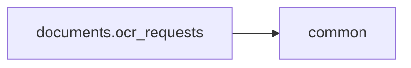

# documents.ocr_requests

`OcrRequest` es la cola PostgreSQL durable para OCR local. Conserva estado,
engine, intentos, lock, error, texto y datos estructurados. La unicidad
`owner + idempotency_key` evita trabajos duplicados.

El worker usa `select_for_update(skip_locked=True)` y recupera locks
`processing` con mas de 15 minutos. El resultado puede ser
`succeeded`, `review_required` o `failed`; una imagen sin motor/extraccion local
queda para revision humana en vez de producir datos falsos.

El outbox `DocumentDomainEventOutbox` publica `documents.ocr.completed.v1` o
`documents.ocr.review_required.v1` mediante el publisher central.

<!-- backend-source-audit:start -->
## Evidencia del codigo y mapa de dependencias

Inventario estatico reproducible del checkout. Describe declaraciones e imports;
no prueba despliegue, permisos efectivos ni que todos los caminos se ejecuten.
Las rutas son locales a su URLConf: el prefijo publico se consulta en
[`api/v1/routers.py`](../../api/v1/routers.py).

- Archivos Python de implementacion: **10** (excluye tests y migraciones).
- Huella SHA-256 del codigo inventariado: `27e01f73a944031ae56d4bafe1081f597bd7fc1174b5fdcc36d48ad4db1b8a05`.
- Familias detectadas: management, models, services, views.

### Declaraciones de modelos detectadas

- `DocumentDomainEventOutbox` en [documents/ocr_requests/models.py](models.py).
- `OcrFieldObservation` en [documents/ocr_requests/models.py](models.py).
- `OcrRequest` en [documents/ocr_requests/models.py](models.py).

No se detectan declaraciones `path`/`re_path` propias en este alcance.
Esto no implica que el modulo carezca de consumidores internos.

### Diagrama de dependencia estatica

Las flechas representan imports entre paquetes, no eventos ni orden de ejecucion.

Flujos transversales: [flujo actualizado](../../docs/BACKEND_CURRENT_FLOW.md).

Regeneracion: `py -3 scripts/audit_backend_docs.py --write`.
Comprobacion de deriva: `py -3 scripts/audit_backend_docs.py --check`.
<!-- backend-source-audit:end -->
