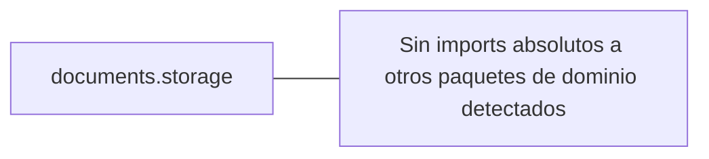

# documents.storage

Esta frontera define donde viven los binarios privados. En el runtime local el
backend efectivo es Django `FileSystemStorage` bajo `.runtime/media`; la ruta no
se expone como URL publica y el nombre fisico se aleatoriza por UUID.

La integridad se verifica en `documents.files` mediante SHA-256. No se agrega
un adapter abstracto hasta que exista un segundo backend real: anticiparlo ahora
solo duplicaria la interfaz de Django sin aportar aislamiento.

Antes de crecer se requiere definir retencion, borrado fisico diferido,
autorizacion temporal de descarga y backup de media independiente del backup de
PostgreSQL.

<!-- backend-source-audit:start -->
## Evidencia del codigo y mapa de dependencias

Inventario estatico reproducible del checkout. Describe declaraciones e imports;
no prueba despliegue, permisos efectivos ni que todos los caminos se ejecuten.
Las rutas son locales a su URLConf: el prefijo publico se consulta en
[`api/v1/routers.py`](../../api/v1/routers.py).

- Archivos Python de implementacion: **5** (excluye tests y migraciones).
- Huella SHA-256 del codigo inventariado: `c7c11d2e3ff59e5451504d2e3526058be246d3404fadae40dc24dc69fabdf5a0`.
- Familias detectadas: models, views.

No se detectan declaraciones `path`/`re_path` propias en este alcance.
Esto no implica que el modulo carezca de consumidores internos.

### Diagrama de dependencia estatica

Las flechas representan imports entre paquetes, no eventos ni orden de ejecucion.

Flujos transversales: [flujo actualizado](../../docs/BACKEND_CURRENT_FLOW.md).

Regeneracion: `py -3 scripts/audit_backend_docs.py --write`.
Comprobacion de deriva: `py -3 scripts/audit_backend_docs.py --check`.
<!-- backend-source-audit:end -->
