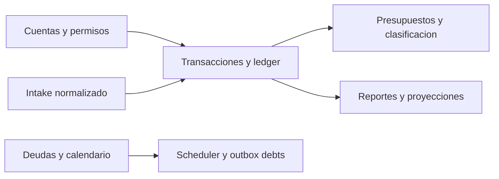
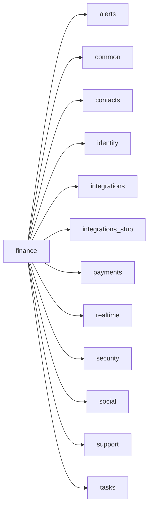

# finance

Finance es el nucleo financiero personal. `transactions` conserva el ledger;
`accounts` administra cuentas y acceso compartido y mantiene un balance operacional.

## Documentos propietarios

- [accounts](accounts/README.md): cuentas, membresias, sync e intelligence.
- [transactions](transactions/README.md): manual, intake, inferencias y reconciliacion.
- [budgets](budgets/README.md): presupuestos y contexto compartido.
- [debts](debts/README.md): calendarios de deuda e historial.
- [categories](categories/README.md), [vendors](vendors/README.md) y [fx](fx/README.md): referencias financieras.
- [investments](investments/README.md) y [limits](limits/README.md): alcances y estado propios; su presencia no implica una API activa.

Los rails externos pertenecen a payments e integrations. El frontend confirma
acciones y envia contexto; la autoridad contable permanece en estos servicios.

<!-- backend-source-audit:start -->
## Evidencia del codigo y mapa de dependencias

Inventario estatico reproducible del checkout. Describe declaraciones e imports;
no prueba despliegue, permisos efectivos ni que todos los caminos se ejecuten.
Las rutas son locales a su URLConf: el prefijo publico se consulta en
[`api/v1/routers.py`](../api/v1/routers.py).

- Archivos Python de implementacion: **204** (excluye tests y migraciones).
- Huella SHA-256 del codigo inventariado: `3adbbd01d66a1bb6df7506b6ccbc02010532d19c3397bc656e2c83e3002fbf20`.
- Familias detectadas: management, models, serializers, services, views.

### Declaraciones de modelos detectadas

- `Account` en [finance/accounts/models/account.py](accounts/models/account.py).
- `AccountAccess` en [finance/accounts/models/account_access.py](accounts/models/account_access.py).
- `AccountBalanceFallback` en [finance/accounts/models/fallback.py](accounts/models/fallback.py).
- `AccountBudget` en [finance/budgets/Models/accountbudget.py](budgets/Models/accountbudget.py).
- `AccountCurrencyExposure` en [finance/accounts/models/intelligence.py](accounts/models/intelligence.py).
- `AccountIntelligenceDispatchState` en [finance/accounts/models/intelligence.py](accounts/models/intelligence.py).
- `AccountInvitation` en [finance/accounts/models/invitation.py](accounts/models/invitation.py).
- `AccountMembership` en [finance/accounts/models/membership.py](accounts/models/membership.py).
- `AccountOwnerMetrics` en [finance/accounts/models/intelligence.py](accounts/models/intelligence.py).
- `AccountPortfolioSnapshot` en [finance/accounts/models/intelligence.py](accounts/models/intelligence.py).
- `AccountProductSignal` en [finance/accounts/models/intelligence.py](accounts/models/intelligence.py).
- `AccountRiskSnapshot` en [finance/accounts/models/intelligence.py](accounts/models/intelligence.py).
- `AccountTypeDistribution` en [finance/accounts/models/intelligence.py](accounts/models/intelligence.py).
- `Asset` en [finance/investments/Models/asset.py](investments/Models/asset.py).
- `BalanceSnapshot` en [finance/accounts/models/balance_snapshot.py](accounts/models/balance_snapshot.py).
- `Budget` en [finance/budgets/Models/budget.py](budgets/Models/budget.py).
- `Category` en [finance/categories/models/categories.py](categories/models/categories.py).
- `Debt` en [finance/debts/models/debts.py](debts/models/debts.py).
- `DebtDomainEventOutbox` en [finance/debts/models/outbox.py](debts/models/outbox.py).
- `DebtInstallment` en [finance/debts/models/debts.py](debts/models/debts.py).
- `DebtRestructuring` en [finance/debts/models/debts.py](debts/models/debts.py).
- `DomainEventOutbox` en [finance/accounts/models/outbox.py](accounts/models/outbox.py).
- `ExchangeRate` en [finance/fx/models/fx.py](fx/models/fx.py).
- `IncomeSource` en [finance/transactions/Models/transacciones.py](transactions/Models/transacciones.py).
- `InvestmentAccount` en [finance/investments/Models/account.py](investments/Models/account.py).
- `ManualTransactionReceipt` en [finance/transactions/Models/manual_receipt.py](transactions/Models/manual_receipt.py).
- `Position` en [finance/investments/Models/position.py](investments/Models/position.py).
- `PriceHistory` en [finance/investments/Models/price.py](investments/Models/price.py).
- `SharedBudget` en [finance/budgets/Models/shared_budget.py](budgets/Models/shared_budget.py).
- `SharedBudgetTemplateLink` en [finance/budgets/Models/shared_budget_links.py](budgets/Models/shared_budget_links.py).
- `SharedBudgetTransactionLink` en [finance/budgets/Models/shared_budget_links.py](budgets/Models/shared_budget_links.py).
- `Tag` en [finance/transactions/Models/transacciones.py](transactions/Models/transacciones.py).
- `Trade` en [finance/investments/Models/trade.py](investments/Models/trade.py).
- `Transaction` en [finance/transactions/Models/transacciones.py](transactions/Models/transacciones.py).
- `TransactionClassificationRevision` en [finance/transactions/Models/intake.py](transactions/Models/intake.py).
- `TransactionDomainEventOutbox` en [finance/transactions/Models/outbox.py](transactions/Models/outbox.py).
- `TransactionExternalDetails` en [finance/transactions/Models/intake.py](transactions/Models/intake.py).
- `TransactionFieldProvenance` en [finance/transactions/Models/intake.py](transactions/Models/intake.py).
- `TransactionInferenceRequest` en [finance/transactions/Models/inference.py](transactions/Models/inference.py).
- `TransactionIntakeBatch` en [finance/transactions/Models/intake.py](transactions/Models/intake.py).
- `TransactionIntakeReceipt` en [finance/transactions/Models/intake.py](transactions/Models/intake.py).
- `TransactionParticipant` en [finance/transactions/Models/transacciones.py](transactions/Models/transacciones.py).
- `TransactionReconciliationIssue` en [finance/transactions/Models/intake.py](transactions/Models/intake.py).
- `TransactionSourceLink` en [finance/transactions/Models/intake.py](transactions/Models/intake.py).
- `Vendor` en [finance/vendors/models/provedores.py](vendors/models/provedores.py).
- `VendorAlias` en [finance/vendors/models/provedores.py](vendors/models/provedores.py).

### Rutas declaradas

| Patron local | Fuente |
| --- | --- |
| `` | [finance/accounts/urls.py](accounts/urls.py) |
| `` | [finance/budgets/urls.py](budgets/urls.py) |
| `` | [finance/categories/urls.py](categories/urls.py) |
| `` | [finance/debts/urls.py](debts/urls.py) |
| `` | [finance/fx/urls.py](fx/urls.py) |
| `` | [finance/transactions/urls.py](transactions/urls.py) |
| `` | [finance/vendors/urls.py](vendors/urls.py) |
| `<int:account_id>/sync/<str:sync_status>/` | [finance/accounts/internal_urls.py](accounts/internal_urls.py) |
| `categorias/ [DRF router]` | [finance/categories/urls.py](categories/urls.py) |
| `cuentas/ [DRF router]` | [finance/accounts/urls.py](accounts/urls.py) |
| `cuotas-deuda/ [DRF router]` | [finance/debts/urls.py](debts/urls.py) |
| `deudas/ [DRF router]` | [finance/debts/urls.py](debts/urls.py) |
| `distribuciones-tipo-cuenta/ [DRF router]` | [finance/accounts/urls.py](accounts/urls.py) |
| `exposiciones-moneda-cuenta/ [DRF router]` | [finance/accounts/urls.py](accounts/urls.py) |
| `fallbacks-balance-cuenta/ [DRF router]` | [finance/accounts/urls.py](accounts/urls.py) |
| `income-sources/ [DRF router]` | [finance/transactions/urls.py](transactions/urls.py) |
| `inference-requests/ [DRF router]` | [finance/transactions/urls.py](transactions/urls.py) |
| `intake/batches/` | [finance/transactions/internal_urls.py](transactions/internal_urls.py) |
| `intake/batches/<uuid:batch_id>/apply/` | [finance/transactions/internal_urls.py](transactions/internal_urls.py) |
| `intake/message/` | [finance/transactions/internal_urls.py](transactions/internal_urls.py) |
| `intake/reconcile/` | [finance/transactions/internal_urls.py](transactions/internal_urls.py) |
| `intake/row/` | [finance/transactions/internal_urls.py](transactions/internal_urls.py) |
| `membresias-cuenta/ [DRF router]` | [finance/accounts/urls.py](accounts/urls.py) |
| `metricas-owner-cuenta/ [DRF router]` | [finance/accounts/urls.py](accounts/urls.py) |
| `outbox-cuentas/ [DRF router]` | [finance/accounts/urls.py](accounts/urls.py) |
| `presupuestos-categoria/ [DRF router]` | [finance/budgets/urls.py](budgets/urls.py) |
| `presupuestos-compartidos/ [DRF router]` | [finance/budgets/urls.py](budgets/urls.py) |
| `proveedores/ [DRF router]` | [finance/vendors/urls.py](vendors/urls.py) |
| `reconciliation/issues/<int:issue_id>/resolve/` | [finance/transactions/internal_urls.py](transactions/internal_urls.py) |
| `resumen-mensual/` | [finance/budgets/urls.py](budgets/urls.py) |
| `senales-producto-cuenta/ [DRF router]` | [finance/accounts/urls.py](accounts/urls.py) |
| `snapshots-balance/ [DRF router]` | [finance/accounts/urls.py](accounts/urls.py) |
| `snapshots-portafolio-cuenta/ [DRF router]` | [finance/accounts/urls.py](accounts/urls.py) |
| `snapshots-riesgo-cuenta/ [DRF router]` | [finance/accounts/urls.py](accounts/urls.py) |
| `tags/ [DRF router]` | [finance/transactions/urls.py](transactions/urls.py) |
| `tasas-fx/ [DRF router]` | [finance/fx/urls.py](fx/urls.py) |
| `transaction-participants/ [DRF router]` | [finance/transactions/urls.py](transactions/urls.py) |
| `transactions/ [DRF router]` | [finance/transactions/urls.py](transactions/urls.py) |

### Diagrama de dependencia estatica

Las flechas representan imports entre paquetes, no eventos ni orden de ejecucion.

Flujos transversales: [flujo actualizado](../docs/BACKEND_CURRENT_FLOW.md).

Regeneracion: `py -3 scripts/audit_backend_docs.py --write`.
Comprobacion de deriva: `py -3 scripts/audit_backend_docs.py --check`.
<!-- backend-source-audit:end -->
