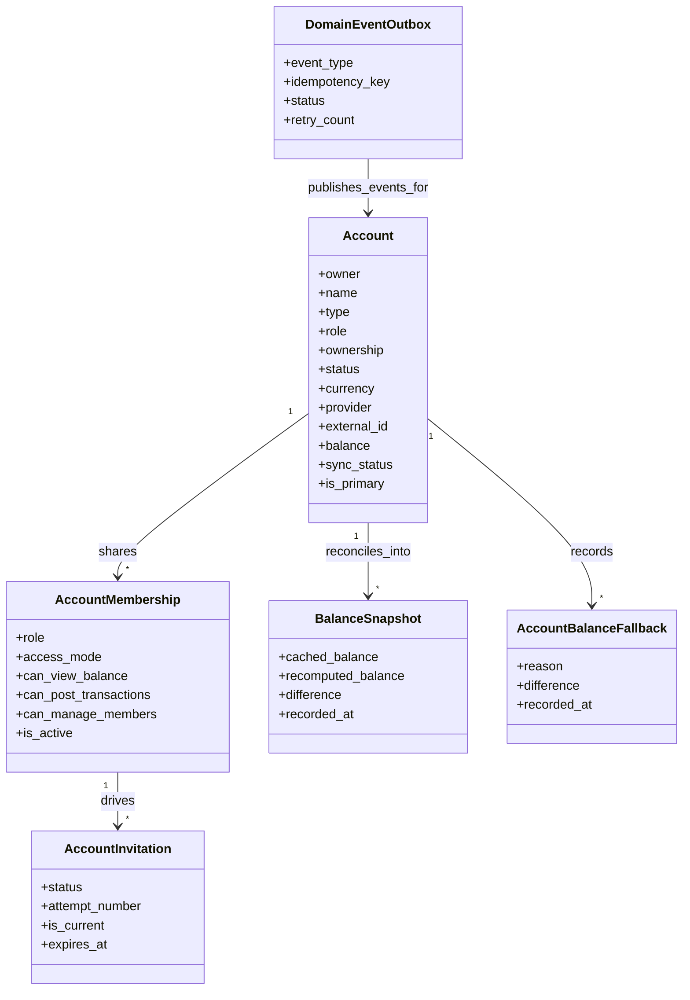
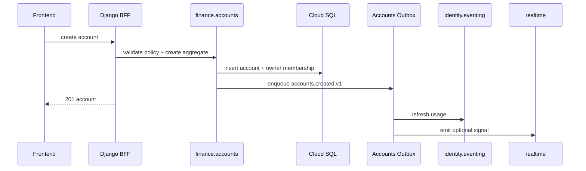
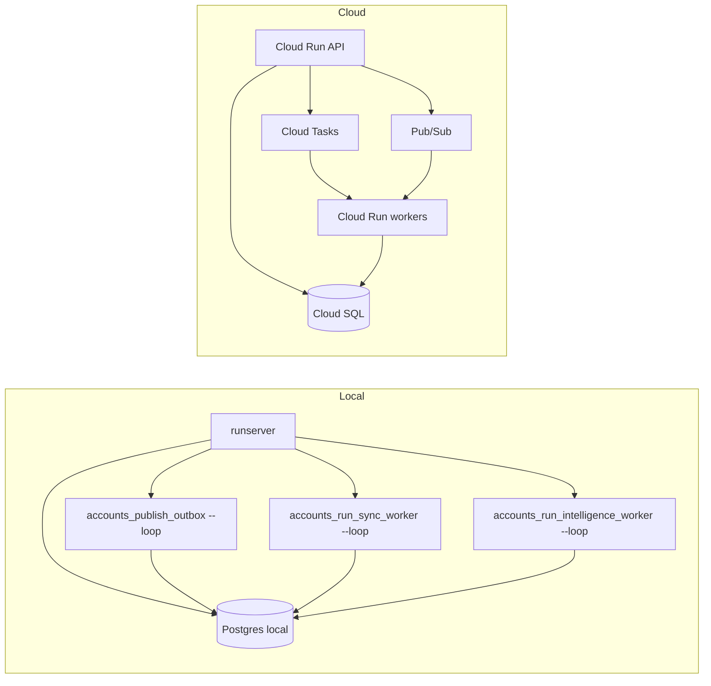
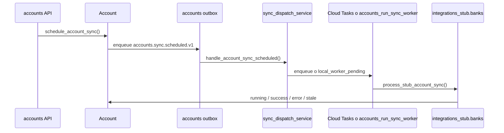
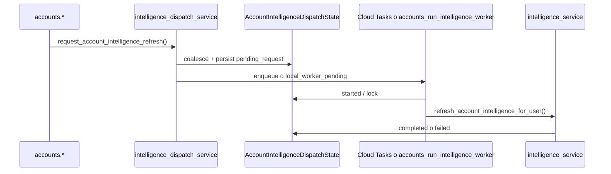

# Finance Accounts

## Proposito
`finance.accounts` es el bounded context que modela las cuentas financieras de Vexxo. No solo guarda cuentas tipo banco, wallet o credito; tambien gobierna sharing, balance operativo, reconciliacion, sync externo, eventos del dominio y proyecciones derivadas.

Preguntas que responde este modulo:
- donde vive el dinero del usuario
- quien puede ver u operar cada cuenta
- si el saldo cacheado sigue consistente con el ledger
- que cuentas son primarias, compartidas, observadas o externas
- que lectura consolidada de cuentas describe hoy al owner

## Rol En El Producto

De cara al cliente, este modulo cumple funciones visibles y criticas:

- mostrar cuentas y saldos en mobile/web
- permitir tracking manual sin romper el loop base del producto
- habilitar colaboracion simple o avanzada segun plan
- servir como base para sync, alertas, pagos y automatizaciones
- explicar la salud operativa de conexiones, balances y sharing

Sin `accounts`, Vexxo no sabe de donde sale el dinero ni sobre que superficie
debe interpretar, alertar o ejecutar.

## Vista visual

## Secuencia critica: create account

## Nota operativa de rutas internas

Los callbacks de sync ya tienen una frontera interna canonica:

- `POST /api/internal/accounts/{account_id}/sync/running/`
- `POST /api/internal/accounts/{account_id}/sync/success/`
- `POST /api/internal/accounts/{account_id}/sync/error/`
- `POST /api/internal/accounts/{account_id}/sync/stale/`

Las rutas antiguas `mark_sync_*` bajo `cuentas/{id}` siguen existiendo por
compatibilidad, pero ya requieren `X-Vexxo-Internal-Token` y no deben usarse
como superficie nueva para integraciones.

## Principios Del Modulo
- `Account` es el agregado operativo principal.
- `AccountMembership` es la fuente canonica del sharing moderno.
- `AccountInvitation` modela el ciclo de vida de invitaciones y `AccountMembership` conserva el acceso efectivo.
- `read_only` y `shared_from_user` sobreviven como datos representacionales; ya no gobiernan permisos ni balance.
- `AccountAccess` queda aislado a migracion, auditoria legacy y backoffice controlado; el agregado `Account` ya no lo expone como superficie operativa.
- `Account.balance` es un cache operativo; el ledger real vive en `finance.transactions`.
- Los planes visibles del producto se entienden como `free` y `pro`; `plus` sobrevive solo como alias legacy hacia `pro` y `enterprise` queda tecnico para escalabilidad.
- El producto distingue cuentas manuales de cuentas conectadas; el plan no debe bloquear el tracking manual base, pero si puede limitar conexiones externas y sharing avanzado.
- Los cambios relevantes deben emitir eventos `accounts.*`.
- La publicacion confiable de eventos pasa por `DomainEventOutbox`.
- Las vistas orquestan; serializers validan; servicios coordinan casos de uso; el agregado conserva su logica propia.
- Las proyecciones de inteligencia pertenecen al contexto mientras se deriven solo de datos de cuentas.

## Conceptos De Negocio

### Account
Representa una cuenta financiera del owner. Soporta lifecycle, metadata FX, configuracion de riesgo y objetivos, integracion externa y estados operativos derivados.

Entrada publica:
- [account.py](https://gitlab.com/vexxo-sas/vexxo_backend_api/-/blob/development/finance/accounts/models/account.py)

Piezas internas:
- [account_enums.py](https://gitlab.com/vexxo-sas/vexxo_backend_api/-/blob/development/finance/accounts/models/account_enums.py)
  Vocabulario estable del agregado.
- [account_mixins.py](https://gitlab.com/vexxo-sas/vexxo_backend_api/-/blob/development/finance/accounts/models/account_mixins.py)
  Validacion, lifecycle, sync, balance, memberships y health.
- [account_access.py](https://gitlab.com/vexxo-sas/vexxo_backend_api/-/blob/development/finance/accounts/models/account_access.py)
  Modelo legacy aislado para migracion o inspeccion historica; ya no participa en la operacion canonica del modulo.

### AccountMembership
Sistema moderno de colaboracion sobre cuentas. Modela rol, modo de acceso, permisos efectivos, invitaciones, aceptacion y revocacion.

Archivo:
- [membership.py](https://gitlab.com/vexxo-sas/vexxo_backend_api/-/blob/development/finance/accounts/models/membership.py)

### AccountInvitation
Representa un intento de invitacion versionado. Permite expiracion, reenvio, apertura, aceptacion y revocacion sin mezclar ese ciclo social dentro de la membresia estable.

Archivo:
- [invitation.py](https://gitlab.com/vexxo-sas/vexxo_backend_api/-/blob/development/finance/accounts/models/invitation.py)

### BalanceSnapshot
Foto entre balance cacheado y balance recomputado desde ledger para medir drift y consistencia.

Archivo:
- [balance_snapshot.py](https://gitlab.com/vexxo-sas/vexxo_backend_api/-/blob/development/finance/accounts/models/balance_snapshot.py)

### DomainEventOutbox
Persistencia confiable de eventos del dominio para publicacion fuera de la transaccion local. El request solo encola; un worker publica. La publicacion se ejecuta en dos fases: listeners locales requeridos o best-effort, y despues dispatchers externos. Si falla una fase externa, el retry no reejecuta la fase local ya completada. Tambien concentra trazabilidad operativa (`request_id`, `correlation_id`, `causation_id`, duracion y resultado de publicacion), backoff exponencial (`next_attempt_at`, `last_backoff_seconds`) y dead-letter formal para eventos agotados.

Archivo:
- [outbox.py](https://gitlab.com/vexxo-sas/vexxo_backend_api/-/blob/development/finance/accounts/models/outbox.py)

### AccountBalanceFallback
Registro persistente de degradaciones del flujo incremental de balance cuando el sistema tuvo que recalcular desde ledger. Tiene API operativa propia para soporte y observabilidad.

Archivo:
- [fallback.py](https://gitlab.com/vexxo-sas/vexxo_backend_api/-/blob/development/finance/accounts/models/fallback.py)

### Inteligencia Derivada
Read models por owner para producto, soporte y analytics operativo:
- `AccountPortfolioSnapshot`
- `AccountRiskSnapshot`
- `AccountProductSignal`
- `AccountOwnerMetrics`
- `AccountCurrencyExposure`
- `AccountTypeDistribution`
- `AccountIntelligenceDispatchState`

Archivo:
- [intelligence.py](https://gitlab.com/vexxo-sas/vexxo_backend_api/-/blob/development/finance/accounts/models/intelligence.py)

## Estructura Interna

### Domain
- [domain/events.py](https://gitlab.com/vexxo-sas/vexxo_backend_api/-/blob/development/finance/accounts/domain/events.py)
  Contrato de eventos `accounts.*`, builders de payload y catalogo.
- [domain/guards.py](https://gitlab.com/vexxo-sas/vexxo_backend_api/-/blob/development/finance/accounts/domain/guards.py)
  Limites por plan, uso actual y reglas previas a create/set_primary.
- [domain/enums.py](https://gitlab.com/vexxo-sas/vexxo_backend_api/-/blob/development/finance/accounts/domain/enums.py)
  Enums de memberships y balance reasons usados fuera del agregado principal.

### Models
- [models/account.py](https://gitlab.com/vexxo-sas/vexxo_backend_api/-/blob/development/finance/accounts/models/account.py)
  Fachada publica del agregado.
- [models/membership.py](https://gitlab.com/vexxo-sas/vexxo_backend_api/-/blob/development/finance/accounts/models/membership.py)
  Sharing canonico.
- [models/invitation.py](https://gitlab.com/vexxo-sas/vexxo_backend_api/-/blob/development/finance/accounts/models/invitation.py)
  Ciclo social versionado de invitaciones.
- [models/balance_snapshot.py](https://gitlab.com/vexxo-sas/vexxo_backend_api/-/blob/development/finance/accounts/models/balance_snapshot.py)
  Reconciliacion y drift.
- [models/fallback.py](https://gitlab.com/vexxo-sas/vexxo_backend_api/-/blob/development/finance/accounts/models/fallback.py)
  Fallbacks del balance incremental.
- [models/outbox.py](https://gitlab.com/vexxo-sas/vexxo_backend_api/-/blob/development/finance/accounts/models/outbox.py)
  Publicacion confiable de eventos.
- [models/intelligence.py](https://gitlab.com/vexxo-sas/vexxo_backend_api/-/blob/development/finance/accounts/models/intelligence.py)
  Proyecciones y snapshots derivados.

### Serializers
La capa REST de `Account` se separa por vertical para que cada contrato evolucione sin volver a concentrarse en un archivo unico.

- [account_serializers.py](https://gitlab.com/vexxo-sas/vexxo_backend_api/-/blob/development/finance/accounts/serializers/account_serializers.py)
  Fachada publica y reexports.
- [account_read_serializers.py](https://gitlab.com/vexxo-sas/vexxo_backend_api/-/blob/development/finance/accounts/serializers/account_read_serializers.py)
  Listado, detalle y summary.
- [account_write_serializers.py](https://gitlab.com/vexxo-sas/vexxo_backend_api/-/blob/development/finance/accounts/serializers/account_write_serializers.py)
  Create/update con reglas de negocio.
- [account_lifecycle_serializers.py](https://gitlab.com/vexxo-sas/vexxo_backend_api/-/blob/development/finance/accounts/serializers/account_lifecycle_serializers.py)
  Inputs de comandos de lifecycle.
- [account_sync_serializers.py](https://gitlab.com/vexxo-sas/vexxo_backend_api/-/blob/development/finance/accounts/serializers/account_sync_serializers.py)
  Inputs de schedule/running/success/error, con `sync_run_id` opcional.
- [account_external_link_serializers.py](https://gitlab.com/vexxo-sas/vexxo_backend_api/-/blob/development/finance/accounts/serializers/account_external_link_serializers.py)
  Contrato de vinculo externo.
- [account_plan_serializers.py](https://gitlab.com/vexxo-sas/vexxo_backend_api/-/blob/development/finance/accounts/serializers/account_plan_serializers.py)
  Snapshot de plan y uso.
- [account_membership_serializers.py](https://gitlab.com/vexxo-sas/vexxo_backend_api/-/blob/development/finance/accounts/serializers/account_membership_serializers.py)
  REST de memberships e invitaciones estrictas.
- [account_membership_support.py](https://gitlab.com/vexxo-sas/vexxo_backend_api/-/blob/development/finance/accounts/serializers/account_membership_support.py)
  Helpers de validacion/create/update de memberships.
- [fallback_serializers.py](https://gitlab.com/vexxo-sas/vexxo_backend_api/-/blob/development/finance/accounts/serializers/fallback_serializers.py)
  Salida operativa de `AccountBalanceFallback`.

### Views
La API de `cuentas` se reparte entre fachada, acciones, queries y recursos operativos. Los helpers demasiado pequenos se consolidan dentro de sus modulos vecinos para evitar fragmentacion artificial.

- [account_views.py](https://gitlab.com/vexxo-sas/vexxo_backend_api/-/blob/development/finance/accounts/views/account_views.py)
  Viewset publico con queryset por intencion (`list`, `detail`, `mutation`, `overview`).
- [account_action_handlers.py](https://gitlab.com/vexxo-sas/vexxo_backend_api/-/blob/development/finance/accounts/views/account_action_handlers.py)
  Acciones REST, auditoria y checks de permisos del agregado.
- [account_query_builders.py](https://gitlab.com/vexxo-sas/vexxo_backend_api/-/blob/development/finance/accounts/views/account_query_builders.py)
  Filtros, parsing booleano compartido, summaries, payloads operativos y querysets por intencion.

Vistas adicionales:
- [membership_views.py](https://gitlab.com/vexxo-sas/vexxo_backend_api/-/blob/development/finance/accounts/views/membership_views.py)
  Gestion de colaboracion, queryset de memberships, permisos y auditoria del recurso.
- [snapshot_views.py](https://gitlab.com/vexxo-sas/vexxo_backend_api/-/blob/development/finance/accounts/views/snapshot_views.py)
  Observabilidad y reconciliacion.
- [fallback_views.py](https://gitlab.com/vexxo-sas/vexxo_backend_api/-/blob/development/finance/accounts/views/fallback_views.py)
  API operativa de degradaciones del balance incremental.
- [outbox_views.py](https://gitlab.com/vexxo-sas/vexxo_backend_api/-/blob/development/finance/accounts/views/outbox_views.py)
  Soporte operativo del outbox.
- [intelligence_views.py](https://gitlab.com/vexxo-sas/vexxo_backend_api/-/blob/development/finance/accounts/views/intelligence_views.py)
  Consulta y refresh de proyecciones derivadas.

### Services
- [account_policy_service.py](https://gitlab.com/vexxo-sas/vexxo_backend_api/-/blob/development/finance/accounts/services/account_policy_service.py)
  Politicas de negocio compartidas entre serializers, guards y views, incluyendo separacion `manual` vs `connected`, limites de membresias por cuenta y snapshot de plan para mobile.
- [account_invitation_service.py](https://gitlab.com/vexxo-sas/vexxo_backend_api/-/blob/development/finance/accounts/services/account_invitation_service.py)
  Ciclo de vida de invitaciones versionadas.
- [account_lifecycle_service.py](https://gitlab.com/vexxo-sas/vexxo_backend_api/-/blob/development/finance/accounts/services/account_lifecycle_service.py)
  Create/update/close/freeze/archive/primary/recalc.
- [account_sync_service.py](https://gitlab.com/vexxo-sas/vexxo_backend_api/-/blob/development/finance/accounts/services/account_sync_service.py)
  Vinculacion externa, estados de sync, idempotencia de comandos y maquina monotona por `sync_run_id`.
- [account_balance_fallback_service.py](https://gitlab.com/vexxo-sas/vexxo_backend_api/-/blob/development/finance/accounts/services/account_balance_fallback_service.py)
  Observabilidad persistente de fallbacks contables.
- [account_access_migration_service.py](https://gitlab.com/vexxo-sas/vexxo_backend_api/-/blob/development/finance/accounts/services/account_access_migration_service.py)
  Migracion de `AccountAccess` hacia memberships y retiro operativo del legacy.
- [permission_service.py](https://gitlab.com/vexxo-sas/vexxo_backend_api/-/blob/development/finance/accounts/services/permission_service.py)
  Scope de lectura y permisos efectivos.
- [outbox_service.py](https://gitlab.com/vexxo-sas/vexxo_backend_api/-/blob/development/finance/accounts/services/outbox_service.py)
  Builders canonicos de eventos y encolado al outbox.
- [event_service.py](https://gitlab.com/vexxo-sas/vexxo_backend_api/-/blob/development/finance/accounts/services/event_service.py)
  Integracion con bus local, trazabilidad y publicacion del outbox desde worker con fases local y external, incluyendo retry/backoff y dead-letter.
- [reconcile_service.py](https://gitlab.com/vexxo-sas/vexxo_backend_api/-/blob/development/finance/accounts/services/reconcile_service.py)
  Snapshots, drift y auto-repair.
- [intelligence_service.py](https://gitlab.com/vexxo-sas/vexxo_backend_api/-/blob/development/finance/accounts/services/intelligence_service.py)
  Recalculo de snapshots y signals.
- [intelligence_dispatch_service.py](https://gitlab.com/vexxo-sas/vexxo_backend_api/-/blob/development/finance/accounts/services/intelligence_dispatch_service.py)
  Cola, coalescing persistente por owner, estado operativo del refresh de inteligencia y callback explicito de workers externos.
- [intelligence_health_service.py](https://gitlab.com/vexxo-sas/vexxo_backend_api/-/blob/development/finance/accounts/services/intelligence_health_service.py)
  Salud operativa de las proyecciones.
- [sync_dispatch_service.py](https://gitlab.com/vexxo-sas/vexxo_backend_api/-/blob/development/finance/accounts/services/sync_dispatch_service.py)
  Dispatch de jobs de sync.
- [snapshot_policy_service.py](https://gitlab.com/vexxo-sas/vexxo_backend_api/-/blob/development/finance/accounts/services/snapshot_policy_service.py)
  Politica de retencion de snapshots.
- [realtime_services.py](https://gitlab.com/vexxo-sas/vexxo_backend_api/-/blob/development/finance/accounts/services/realtime_services.py)
  Senales ligeras para UI.
- [user_integration_service.py](https://gitlab.com/vexxo-sas/vexxo_backend_api/-/blob/development/finance/accounts/services/user_integration_service.py)
  Adaptacion entre lifecycle de usuario y cuentas.

### Signals, Event Handlers Y Use Cases
- [signals.py](https://gitlab.com/vexxo-sas/vexxo_backend_api/-/blob/development/finance/accounts/signals.py)
  Mantiene `Account.balance` sincronizado con `transactions`, emite eventos y registra fallbacks persistentes cuando debe recalcular.
- [use_cases.py](https://gitlab.com/vexxo-sas/vexxo_backend_api/-/blob/development/finance/accounts/use_cases.py)
  Aplica deltas incrementales de balance.
- [event_handlers.py](https://gitlab.com/vexxo-sas/vexxo_backend_api/-/blob/development/finance/accounts/event_handlers.py)
  Reacciona a `accounts.*` y `users.*` desde el worker del outbox, sin threads locales del request path.

### Management Commands
- [accounts_publish_outbox.py](https://gitlab.com/vexxo-sas/vexxo_backend_api/-/blob/development/finance/accounts/management/commands/accounts_publish_outbox.py)
  Publica eventos pendientes del outbox.
- [accounts_run_sync_worker.py](https://gitlab.com/vexxo-sas/vexxo_backend_api/-/blob/development/finance/accounts/management/commands/accounts_run_sync_worker.py)
  Worker local durable para sync externo cuando no se usa Cloud Tasks.
- [accounts_run_intelligence_worker.py](https://gitlab.com/vexxo-sas/vexxo_backend_api/-/blob/development/finance/accounts/management/commands/accounts_run_intelligence_worker.py)
  Worker local durable para refresh de inteligencia derivada.
- [accounts_reconcile_balances.py](https://gitlab.com/vexxo-sas/vexxo_backend_api/-/blob/development/finance/accounts/management/commands/accounts_reconcile_balances.py)
  Reconciliacion masiva y opcional auto-repair.
- [accounts_cleanup_balance_snapshots.py](https://gitlab.com/vexxo-sas/vexxo_backend_api/-/blob/development/finance/accounts/management/commands/accounts_cleanup_balance_snapshots.py)
  Cleanup de snapshots por politica.
- [accounts_migrate_account_access.py](https://gitlab.com/vexxo-sas/vexxo_backend_api/-/blob/development/finance/accounts/management/commands/accounts_migrate_account_access.py)
  Migracion operativa de `AccountAccess` hacia memberships.

## Flujos Principales

## Topologia Local Vs Cloud

Lectura:

- en local ya no se recomienda recalculo inline ni sync inline
- `accounts` persiste la intencion y un worker durable separado consume desde BD
- en cloud la ejecucion esperada sigue siendo Cloud Tasks y workers externos
- la fuente de verdad de sync sigue en `Account.sync_runtime`
- la fuente de verdad de inteligencia async sigue en `AccountIntelligenceDispatchState`
- la politica de entrega converge hacia `tasks.async_backends` en vez de quedar
  repartida en `if ENV` del contexto
- `accounts.sync` y `accounts.intelligence` ya usan la misma frontera comun de
  dispatch; solo cambia el runtime efectivo

### Creacion De Cuenta
`POST /api/finance/accounts/cuentas/` responde `201` con el `id` persistido en
el payload. Ese identificador permite encadenar transacciones, presupuestos y
pruebas E2E sin ejecutar un listado adicional.

1. `AccountViewSet` valida input con `AccountWriteSerializer`.
2. El serializer aplica unicidad funcional y limites por plan.
3. Se persiste `Account`.
4. `account_lifecycle_service.create_account()` asegura membership del owner y publica `accounts.created.v1`.
5. La accion queda auditada.

### Sharing De Cuenta
1. Owner o admin gestiona members desde `membership_views.py`.
2. `AccountMembership` mantiene el acceso efectivo.
3. `AccountInvitation` versiona invitacion, expiracion, apertura y aceptacion.
4. `accept_invitation` exige `invitation_token` vigente y admite consumo idempotente del intento ya aceptado.
5. `permission_service.py` define scope visible y capacidades operativas.
6. El limite de miembros por cuenta depende del plan efectivo del owner; `free` permite colaboracion simple y `pro` la expande.
7. El modulo publica eventos `accounts.membership.*`.

### Balance Operativo
1. `finance.transactions` persiste transacciones.
2. `signals.py` escucha `post_save/post_delete`.
3. `use_cases.py` intenta aplicar delta incremental sobre `Account.balance`.
4. Si no es seguro, cae a `recalc_balance()`.
5. Cada fallback queda persistido en `AccountBalanceFallback` y visible por API operativa.
6. El modulo encola `accounts.balance.updated.v1` en outbox y un worker lo publica.
7. La senal realtime de balance nace desde el worker del outbox, no desde el request path.

### Reconciliacion Y Drift
1. `reconcile_service.create_balance_snapshot()` compara cache vs ledger.
2. Se guarda `BalanceSnapshot`.
3. Si el drift supera el umbral, se publica `accounts.balance.drift.detected.v1`.
4. Si `auto_repair` esta activo, el cache se corrige y queda evidencia operativa.

### Sync Externo

1. Una cuenta se vincula a un proveedor via `link_external_source`.
2. Antes de vincular, el modulo valida `max_connected_accounts` para no romper la promesa de `free = manual util, connected limitado`.
3. `schedule_sync` agenda la corrida, asigna o preserva `sync_run_id` y publica `accounts.sync.scheduled.v1`.
4. `event_handlers.py` convierte ese evento en trabajo async desde el worker del outbox.
5. `tasks.async_backends` decide el backend efectivo para `accounts.sync`.
6. Si Cloud Tasks no esta disponible pero el entorno local lo permite, el
   dispatcher deja la corrida pendiente para `accounts_run_sync_worker` en vez
   de ejecutarla inline.
7. Workers o integraciones marcan `running`, `success`, `error` o `stale` a traves del servicio canonico de sync.
8. El worker local durable reclama cuentas `scheduled` desde `sync_runtime`,
   deja locks y metricas operativas en el mismo JSON, y recupera corridas
   `running` stale antes de reprogramarlas.
9. El contexto aplica dedupe por comando y deja traza operativa en `provider_metadata`, `sync_runtime` y outbox.
10. El servicio valida transiciones monotonicamente por corrida para evitar reordenamientos o terminales de runs viejos.

### Inteligencia Derivada

1. Cualquier evento `accounts.*` puede detonar refresh de inteligencia.
2. `intelligence_dispatch_service.py` registra la solicitud y coalescea bursts por owner para no recalcular o encolar repetidamente dentro de la misma ventana operativa.
3. `tasks.async_backends` decide el transporte efectivo para
   `accounts.intelligence`.
4. Si el backend efectivo es local, la solicitud queda pendiente para
   `accounts_run_intelligence_worker`.
5. `AccountIntelligenceDispatchState` deja trazabilidad de request,
   backend de despacho, locking local, stale recovery y pipeline health.
6. Un worker externo o local puede cerrar la corrida via callback interno
   `worker_report` o via worker durable, sin recalculo inline del request.
7. `intelligence_views.py` expone snapshots, signals, overview, health y el callback interno de worker.
8. `overview` y `identity.users.dashboard` pueden disparar refresh si faltan
   snapshots; solo recargan en el mismo request cuando el modo efectivo es
   `sync_inline_for_tests`.

## Relacion Con Otros Bounded Contexts

- `identity.users`
  provee plan efectivo, capabilities y lifecycle base del usuario.
- `identity.permissions`
  deriva entitlements booleanos que complementan guards del dominio.
- `identity.eventing`
  consume eventos para materializar usage projection.
- `finance.transactions`
  provee el ledger real que alimenta balance incremental y reconciliacion.
- `payments`
  usa cuentas como origen contable y luego refleja pagos confirmados en ledger.
- `alerts`
  escucha cambios de cuentas, balances, drift y health para enriquecer la UX.
- `notifications` y `realtime`
  convierten eventos y cambios operativos en feedback persistente o liviano.
- `integrations_stub` o futuro `integrations_service`
  ejecuta sync externo, rails y callbacks operativos fuera del request path.

## Encaje Con GCP

`finance.accounts` esta pensado para operar asi en la nube:

- API Gateway recibe mobile/web y pasa al BFF Django/DRF en Cloud Run.
- Cloud SQL guarda el agregado `Account`, memberships, outbox y snapshots.
- Los eventos del modulo salen por outbox y pueden terminar en Pub/Sub.
- Cloud Tasks o workers de Cloud Run ejecutan sync, inteligencia y retry del outbox.
- BigQuery recibe metricas y datasets derivados, no lecturas OLTP en caliente.
- Cloud Logging/Monitoring/Trace observan:
  - sync lag
  - drift de balance
  - fallback rate
  - outbox lag
  - health de inteligencia

El principio operativo es:

- request corto
- persistencia transaccional local
- evento confiable
- trabajo pesado fuera del request path

## Casos De Uso Rapidos

### Usuario free

- crea cuentas manuales sin depender de open banking
- consulta saldo y movimientos derivados del ledger
- comparte una cuenta con colaboracion simple
- recibe una lectura coherente aunque el sync externo sea limitado

### Usuario pro

- conecta mas cuentas externas
- comparte mas ampliamente
- recibe mejor sync y mas inteligencia derivada
- sirve de base para automatizacion y ejecucion financiera

### Soporte u operaciones

- revisa fallbacks del balance incremental
- inspecciona snapshots y drift
- consulta outbox y retries
- revisa membresias, invitaciones y health de sync

## Documento Canonico Del Dominio

Este README es el documento principal de `finance.accounts`.

La documentacion global del proyecto ya no replica internamente este modulo.
El README raiz solo resume arquitectura y apunta a este archivo.

## Vistas Del Modulo Segun El Actor

### Usuario final

Ve este contexto como:

- lista de cuentas
- saldo por cuenta
- cuenta principal
- cuentas compartidas
- estado de sync o conectividad
- capa base para alertas, pagos y automatizacion

### Soporte y operaciones

Lo ve como:

- outbox y retries
- fallbacks de balance
- drift de snapshots
- memberships e invitaciones
- estado monotono de sync
- salud de inteligencia derivada

### Producto y growth

Lo ve como:

- base del loop financiero
- superficie para sharing
- punto de friccion controlado entre tracking manual y cuentas conectadas
- origen de señales para upgrade, engagement y automatizacion

### Lifecycle Del Usuario
`identity.users` emite eventos y `accounts` los materializa asi:
- `users.registered.v1`
  Crea o reutiliza de forma idempotente la cuenta financiera base del usuario.
- `users.plan.changed.v1`
  Refresca proyecciones del owner.
- `users.currency.changed.v1`
  Sincroniza `base_currency` de cuentas elegibles.
- `users.suspended.v1`
  Desactiva auto-sync de cuentas externas.
- `users.activated.v1`
  Refresca inteligencia y proyecciones.
- `users.permission.revoked.v1`
  Revoca acceso de integracion open banking cuando el permiso asociado deja de ser valido.

## API Del Contexto
Rutas principales:
- `/api/finance/accounts/cuentas/`
- `/api/finance/accounts/membresias-cuenta/`
- `/api/finance/accounts/snapshots-balance/`
- `/api/finance/accounts/fallbacks-balance-cuenta/`
- `/api/finance/accounts/outbox-cuentas/`
- `/api/finance/accounts/snapshots-portafolio-cuenta/`
- `/api/finance/accounts/snapshots-portafolio-cuenta/worker-report/`
- `/api/finance/accounts/snapshots-riesgo-cuenta/`
- `/api/finance/accounts/senales-producto-cuenta/`
- `/api/finance/accounts/metricas-owner-cuenta/`
- `/api/finance/accounts/exposiciones-moneda-cuenta/`
- `/api/finance/accounts/distribuciones-tipo-cuenta/`

## Relaciones Con Otros Modulos Del Negocio
- `finance.transactions`
  Fuente contable del ledger; `accounts` mantiene cache y reconciliacion.
- `identity.users`
  Fuente del lifecycle del usuario, plan y moneda preferida. El modulo de usuarios expone capabilities efectivas y snapshot de uso para mobile.
- `identity.consents`
  Revocar consent puede desactivar auto-sync o acceso de integracion.
- `identity.permissions`
  Revocar grants operativos puede cortar integraciones externas aunque no cambie el agregado de cuenta directamente. Los entitlements derivados del plan (`integrations.multi_connection.enabled`, `sharing.extended.enabled`) viven alli.
- `integrations_stub.banks`
  Worker o adapter temporal de sincronizacion bancaria.
- `notifications`
  Consume eventos de memberships, archive, primary y sync.
- `alerts`
  Consume balance updates, drift y fallos de sync.
- `realtime`
  Expone senales ligeras para UI.
- `support.audit`
  Registra acciones criticas.
- `identity.users.dashboard`
  Lee snapshots y metricas derivadas de `accounts`.

## Estado Actual E Invariantes
- El contrato REST publico de `cuentas` se mantiene estable desde la fachada de views y serializers.
- El contrato `accounts.*` se define en un solo lugar y debe permanecer versionado.
- `DELETE /cuentas/{id}/` sigue siendo cierre logico y exige saldo en cero.
- `set_primary` sigue validando limites por plan.
- El snapshot de plan en `accounts` distingue `manual_accounts` de `connected_accounts`.
- En `free`, el tracking manual no debe quedar bloqueado por los limites de conexiones externas.
- Las cuentas compartidas deben resolverse por `AccountMembership`; `AccountAccess` queda aislado para migracion o lectura legacy controlada.
- `read_only` y `shared_from_user` no deben afectar permisos efectivos ni escrituras de balance.
- Las cuentas con transacciones no deben permitir cambios estructurales que rompan el ledger.
- Snapshots, fallbacks y outbox son componentes operativos del negocio, no solo soporte.
- Ningun request web de `accounts` deberia publicar el bus local directamente; solo deja eventos persistidos para worker.
- Los retries del outbox deben volver a intentar eventos `failed` mientras no superen el maximo configurado.
- Los retries del outbox deben respetar `next_attempt_at` con backoff exponencial y mover eventos agotados a dead-letter formal.
- Una fase local ya completada del outbox no debe repetirse por fallos posteriores en dispatchers externos.
- Los listeners locales marcados como requeridos deben fallar la publicacion si no pueden materializar su side effect.
- El lifecycle de sync debe avanzar monotonicamente por `sync_run_id`; un terminal de una corrida vieja no debe pisar la corrida activa.
- Los workers de inteligencia externos deben poder reportar `started/completed/failed` con token interno y sin depender del proceso web que origino la solicitud.
- Las respuestas de limite excedido deben devolver una estructura estable para mobile (`detail` + `error` con `metric`, `limit`, `current`, `upgrade_plan` y `permission_code`).

## Politicas De Diseño Del Contexto

- `accounts` no debe convertirse en ledger; solo coordina la superficie de
  cuentas y su estado operativo
- el sharing se resuelve por memberships, no por banderas legacy
- un request de API no debe ejecutar integraciones largas ni publicar
  transportes externos directamente
- la reconciliacion y la observabilidad son parte del negocio, no un detalle
  de soporte
- la documentacion canonica del contexto debe vivir aqui, no en un documento
  global mezclado con otros dominios

## Mejoras Recomendadas
- Formalizar esquemas JSON o OpenAPI para `accounts.*` si habra consumidores externos.
- Separar adaptadores de proveedor por driver para que el sync no absorba convenciones especificas.
- Anadir pruebas por flujo de negocio: lifecycle, sharing, sync y reconciliacion.
- Retirar fisicamente campos legacy (`read_only`, `shared_from_user`) cuando todos los clientes dependan solo del modelo canonico.
- Elevar `sync_runtime` a un read model o timeline separado si soporte necesita historial multi-corrida mas profundo.

## Futures Posibles
- Cuenta observada con permisos granulares por feature.
- Sharing por grupo o meta con politicas de aprobacion y limites.
- Sync multi-proveedor por cuenta con reconciliacion entre fuentes.
- Timeline de salud de cuenta: drift, sync reliability y cambios de provider.
- Historial temporal de inteligencia para mostrar evolucion del portafolio.
- Reglas premium por plan para automatizaciones y cuentas de inversion.
- Motor de recomendaciones conectado a `AccountProductSignal`.
