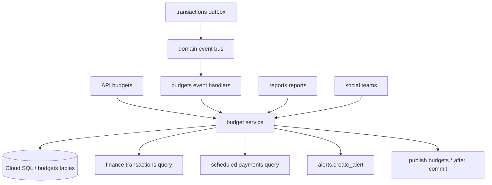
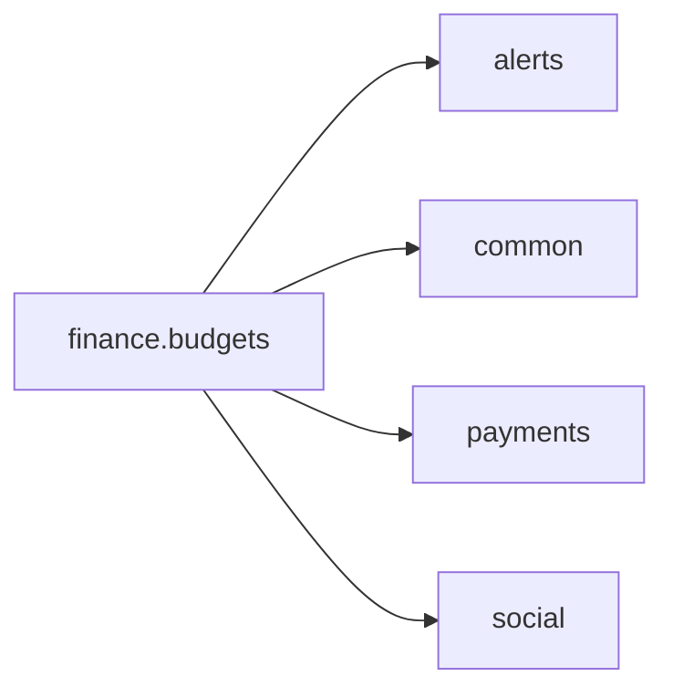

# finance.budgets

## Que hace

`finance.budgets` administra presupuestos mensuales de gasto en Vexxo con dos
superficies funcionales:

- presupuesto personal principal por categoria de gasto
- presupuesto compartido por equipo/pareja/grupo usando `social.teams`

Esta V2 ya no expone presupuesto publico por cuenta como camino principal. El
modelo legacy `AccountBudget` permanece en esquema por compatibilidad, pero el
producto oficial se centra en:

- `planned`: monto fijo que el usuario define
- `actual`: gasto ejecutado y contable derivado desde `finance.transactions`
- `committed`: gasto comprometido del mismo mes derivado desde
  `payments.scheduled_payments`
- `budget attribution`: decision separada de la categoria sobre si ese gasto
  cuenta para presupuesto `personal`, `shared` o `none`

## Regla de producto actual

### Presupuesto personal

- es `owner-only`
- se define por categoria de gasto
- el monto planeado es fijo durante el periodo
- lo dinamico es el consumo:
  - `actual_spent`
  - `committed_spent`
  - `projected_spent`
  - `remaining`
  - `available_after_committed`
  - umbrales disparados

### Presupuesto compartido

- se define sobre un `Team`
- cualquier miembro activo puede verlo
- solo `owner` y `accountant` pueden administrarlo
- miembros `viewer` no pueden editar ni vincular movimientos
- el BFF mobile incluye presupuestos visibles por membresia en datos y version
- no se apoya en inferencia ciega para clasificar gasto grupal
- si la UI ya conoce el contexto de una salida o evento, puede sugerir
  `shared_budget` sin obligar al usuario a linkear todo a mano
- el gasto real entra por linking explicito de:
  - transacciones compartidas
  - plantillas de pagos programados

Esto evita duplicidad semantica y mantiene clara la diferencia entre:

- presupuesto personal por categoria
- presupuesto compartido por outing/pareja/grupo

## Attribution vs categoria

`category` sigue diciendo:

- que tipo de gasto es

pero ya no decide por si sola:

- si cuenta para planning personal
- si cuenta para planning compartido
- para que `shared budget` especifico cuenta

Ese eje vive ahora en:

- `budget_scope`
- `shared_budget`
- `budget_attribution_source`

Regla actual:

- categoria = taxonomia
- budget attribution = participacion en planning

La misma categoria puede terminar en:

- `personal`
- `shared`
- o fuera de budgets (`none`)

## Politica de periodo

`month` sigue usando el formato `YYYY-MM`, pero ya no se trata como texto libre.

La politica canonica es:

- validacion estricta `YYYY-MM`
- ventana temporal `[primer_dia_del_mes, primer_dia_del_mes_siguiente)`
- calculo sobre `Transaction.date`
- para `actual` solo cuentan transacciones `expense` con:
  - `status in {posted, reconciled}`
  - `confirmed=True`
  - `affects_balance=True`

Como `transactions` trabaja con `DateField`, el corte mensual queda anclado al
calendario de la app sin meter conversiones de timezone en el calculo.

## Umbrales y alertas

Cada presupuesto tiene umbrales manuales ordenados, por defecto:

- `30`
- `50`
- `70`
- `100`

Cuando `actual` cruza un umbral:

- se crea una alerta `over_spend`
- el monto planeado no cambia
- lo que cambia es el estado dinamico del presupuesto

Si una transaccion se corrige o revierte:

- `planned` se mantiene
- `actual` baja
- las alertas activas de umbral se resuelven si ya no aplican

## Vista visual

## Superficie publica

Base: `/api/finance/budgets/`

- `presupuestos-categoria/`
  - `GET`, `POST`
- `presupuestos-categoria/{id}/`
  - `GET`, `PUT`, `PATCH`, `DELETE`
- `presupuestos-categoria/merge-period/`
  - `POST`
- `presupuestos-categoria/replace-period/`
  - `POST`
- `presupuestos-compartidos/`
  - `GET`, `POST`
- `presupuestos-compartidos/{id}/`
  - `GET`, `PUT`, `PATCH`, `DELETE`
- `presupuestos-compartidos/{id}/link-transaction/`
  - `POST`
- `presupuestos-compartidos/{id}/unlink-transaction/`
  - `POST`
- `presupuestos-compartidos/{id}/link-template/`
  - `POST`
- `presupuestos-compartidos/{id}/unlink-template/`
  - `POST`
- `resumen-mensual/?month=YYYY-MM`
  - `GET`

Las respuestas de listado incluyen:

- `summary`
- `results`
- `metrics` por fila:
  - `actual_spent`
  - `committed_spent`
  - `projected_spent`
  - `remaining`
  - `available_after_committed`
  - `% actual`
  - `% projected`
  - `alert_state`
  - `triggered_thresholds`

## Flujo principal

### Escritura personal

1. la API valida payload
2. `transactions` o `scheduled_payments` ya pueden traer `budget_scope`
   resuelto desde el origen del gasto/compromiso
3. `finance.budgets.services` valida owner, periodo y colisiones
4. persiste `Budget`
5. publica `budgets.created.v1`, `budgets.updated.v1` o `budgets.deleted.v1`
   despues del commit
6. reevalua el mes afectado y sincroniza alertas activas del owner

### Escritura compartida

1. la API valida payload
2. `budgets` valida acceso sobre `social.teams`
3. persiste `SharedBudget`
4. el gasto real y comprometido del shared budget puede entrar por dos caminos:
   - attribution nativa en `Transaction` / `PaymentTemplate`
   - linking explicito como override o correccion posterior
5. se recalculan metricas y alertas del aggregate compartido

### Lectura

1. la API consulta presupuestos visibles para el actor
2. el service agrega `planned`, `actual` y `committed`
3. devuelve rows enriquecidas con metricas derivadas

### Reaccion al ledger y al committed moderno

`budgets` escucha:

- `transactions.*` relevantes para recalcular `actual`
- `payments.recurring.template.*` para recalcular `committed` moderno

Esto permite que:

- un gasto nuevo dispare umbrales manuales
- una correccion o reversal los baje
- un cambio de `PaymentTemplate` ajuste `committed`

Las `PaymentTemplate` modernas ya pueden:

- nacer con attribution propia
- heredar `shared_budget` sugerido desde la UI interna
- publicar eventos de create/update/delete/activate/deactivate

Eso permite que `budgets` reaccione sin depender solo de lectura.

## Suggestion interna

Cuando la app ya sabe que el usuario esta operando dentro de una salida o
presupuesto compartido concreto, puede enviar un contexto interno:

- `budget_context_shared_budget`

No es un dato que el usuario deba entender o escribir manualmente. Sirve para:

- sugerir `shared_budget`
- marcar `budget_scope=shared`
- dejar `budget_attribution_source=suggested_rule`

El usuario todavia puede sobreescribirlo explicitamente:

- marcarlo como `personal`
- elegir otro `shared_budget`
- dejarlo fuera de budgets

La prioridad de decision hoy es:

1. eleccion manual del usuario
2. contexto interno de UI (`budget_context_shared_budget`)
3. default del sistema

Eso deja el flujo simple:

- si no hay senal clara, el gasto cae en `personal`
- si la app venia desde una salida compartida, puede sugerirse `shared`
- el usuario puede corregirlo en el momento o despues

## Relacion con otros modulos

- `finance.transactions`
  - fuente de verdad de `actual`
  - publica `transactions.*` que `budgets` escucha
- `payments.scheduled_payments`
  - aporta `PaymentTemplate` para `committed`
- `alerts`
  - recibe alertas `over_spend` generadas por el monitor de presupuestos
- `reports.reports`
  - reutiliza el resumen mensual de `budgets`
- `finance.categories`
  - aporta categorias de gasto validas para presupuesto personal
- `social.teams`
  - aporta ownership colaborativo para presupuesto compartido

## Local vs cloud

`finance.budgets` no introduce un backend async nuevo.

### Local

- `runserver`
- Postgres/Cloud SQL local segun entorno
- listeners en memoria del event bus
- si `transactions` autopublica localmente, `budgets` reacciona en el mismo
  runtime

### Cloud

- Cloud Run API
- Cloud SQL
- `transactions` sigue publicando por outbox
- cuando el evento entra al bus/dispatcher cloud, `budgets` reevalua el mes
  afectado o el shared budget vinculado

La semantica no cambia:

- el request persiste presupuesto en OLTP
- `planned` sigue fijo
- `actual/committed` siguen siendo derivados
- las alertas siguen siendo side effects del dominio

## Encaje con la arquitectura

Este contexto no tiene aun:

- outbox propio durable
- worker local dedicado
- Cloud Tasks propio

Eso es intencional.

Hoy `budgets` es un contexto OLTP y de lectura enriquecida. La complejidad async
real ya vive en `transactions` y `alerts`, y `budgets` se apoya en esos
contratos en vez de duplicarlos.

Si en el futuro aparecen:

- snapshots persistidos de presupuesto
- notificaciones batch
- recomendaciones async
- analytics costosos
- reevaluacion durable de templates modernas

ahi si tendria sentido endurecerlo con read models o jobs dedicados.

<!-- backend-source-audit:start -->
## Evidencia del codigo y mapa de dependencias

Inventario estatico reproducible del checkout. Describe declaraciones e imports;
no prueba despliegue, permisos efectivos ni que todos los caminos se ejecuten.
Las rutas son locales a su URLConf: el prefijo publico se consulta en
[`api/v1/routers.py`](../../api/v1/routers.py).

- Archivos Python de implementacion: **18** (excluye tests y migraciones).
- Huella SHA-256 del codigo inventariado: `478a46c334ed7a84e44f9d9f995f0fe458dd376d4244f04ab24f86d8d85b8a00`.
- Familias detectadas: models, serializers, services, views.

### Declaraciones de modelos detectadas

- `AccountBudget` en [finance/budgets/Models/accountbudget.py](Models/accountbudget.py).
- `Budget` en [finance/budgets/Models/budget.py](Models/budget.py).
- `SharedBudget` en [finance/budgets/Models/shared_budget.py](Models/shared_budget.py).
- `SharedBudgetTemplateLink` en [finance/budgets/Models/shared_budget_links.py](Models/shared_budget_links.py).
- `SharedBudgetTransactionLink` en [finance/budgets/Models/shared_budget_links.py](Models/shared_budget_links.py).

### Rutas declaradas

| Patron local | Fuente |
| --- | --- |
| `` | [finance/budgets/urls.py](urls.py) |
| `presupuestos-categoria/ [DRF router]` | [finance/budgets/urls.py](urls.py) |
| `presupuestos-compartidos/ [DRF router]` | [finance/budgets/urls.py](urls.py) |
| `resumen-mensual/` | [finance/budgets/urls.py](urls.py) |

### Diagrama de dependencia estatica

Las flechas representan imports entre paquetes, no eventos ni orden de ejecucion.

Flujos transversales: [flujo actualizado](../../docs/BACKEND_CURRENT_FLOW.md).

Regeneracion: `py -3 scripts/audit_backend_docs.py --write`.
Comprobacion de deriva: `py -3 scripts/audit_backend_docs.py --check`.
<!-- backend-source-audit:end -->
