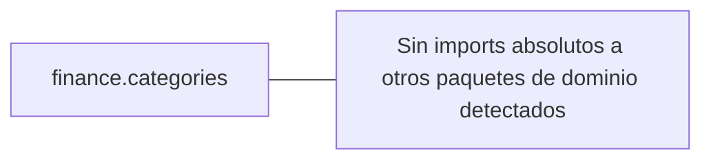

# finance.categories

## Que hace

`finance.categories` administra el vocabulario de categorizacion financiera del
usuario o del sistema.

Su responsabilidad actual es simple:

- CRUD de categorias
- servir como referencia para transacciones, pagos y analitica

## Rol En El Producto

Las categorias permiten que Vexxo convierta movimientos en informacion util.

De cara al usuario, sostienen:

- clasificacion de gastos e ingresos
- reportes por categoria
- reglas o automatizaciones futuras
- mejor interpretacion en dashboard, alertas y recomendaciones

Importante:

- categoria no equivale a presupuesto
- una categoria puede terminar en budget `personal`, `shared` o `none`
- el eje presupuestario ahora se resuelve aparte via `budget_scope` y
  `shared_budget`

## Flujo Principal

1. el usuario o backoffice crea/edita una categoria
2. `transactions` y otros contextos pueden referenciarla
3. reportes y analitica agrupan resultados usando esa semantica

## Seguridad Y Aislamiento

La API requiere autenticacion y solo expone categorias cuyo `owner` es el
usuario autenticado. En escrituras, `owner` es read-only y se asigna en el
servidor; un cliente no puede consultar ni crear categorias para otro usuario.

## Relacion Con Otros Modulos

- `finance.transactions`
  usa categoria como parte del ledger y del reporting
- `payments`
  puede propagar categoria sugerida a intents o templates
- `finance.budgets`
  usa categoria para presupuestos personales, pero no para decidir si el gasto
  es personal o compartido por si solo
- `reports`
  agrupa gasto por categoria

## Encaje Con GCP

Es un modulo OLTP liviano sobre Cloud SQL y BFF en Cloud Run.

No requiere procesamiento largo ni pipelines propios, pero su semantica impacta
los datos que luego llegan a BigQuery y reportes.

## Estado Actual

Hoy expone un `ModelViewSet` (`CategoriaViewSet`) sobre `Category`, acotado al
propietario autenticado.

Es una capa CRUD sencilla, pero funcionalmente importante porque aporta
semantica al resto del producto.

<!-- backend-source-audit:start -->
## Evidencia del codigo y mapa de dependencias

Inventario estatico reproducible del checkout. Describe declaraciones e imports;
no prueba despliegue, permisos efectivos ni que todos los caminos se ejecuten.
Las rutas son locales a su URLConf: el prefijo publico se consulta en
[`api/v1/routers.py`](../../api/v1/routers.py).

- Archivos Python de implementacion: **8** (excluye tests y migraciones).
- Huella SHA-256 del codigo inventariado: `42fc086372bf893a75e30edee941d3c168972e3408bb577c885c00c28da61779`.
- Familias detectadas: models, serializers, views.

### Declaraciones de modelos detectadas

- `Category` en [finance/categories/models/categories.py](models/categories.py).

### Rutas declaradas

| Patron local | Fuente |
| --- | --- |
| `` | [finance/categories/urls.py](urls.py) |
| `categorias/ [DRF router]` | [finance/categories/urls.py](urls.py) |

### Diagrama de dependencia estatica

Las flechas representan imports entre paquetes, no eventos ni orden de ejecucion.

Flujos transversales: [flujo actualizado](../../docs/BACKEND_CURRENT_FLOW.md).

Regeneracion: `py -3 scripts/audit_backend_docs.py --write`.
Comprobacion de deriva: `py -3 scripts/audit_backend_docs.py --check`.
<!-- backend-source-audit:end -->
