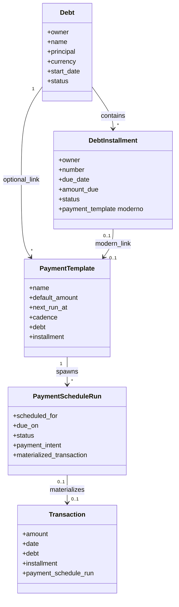
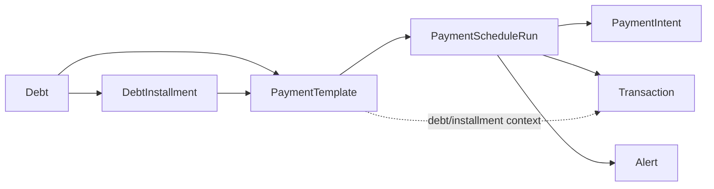

# finance.debts

## Que hace

`finance.debts` modela obligaciones financieras y sus cuotas.

Hoy ya no es solo un CRUD aislado. Este modulo conserva la fuente canonica de:

- `Debt`
- `DebtInstallment`

y ahora puede enlazarse directamente con el flujo moderno de `Pago programado`
mediante:

- `DebtInstallment.payment_template`
- `PaymentTemplate.debt`
- `PaymentTemplate.installment`

Eso permite que deuda/cuota viajen hasta el pago programado, el `PaymentIntent`
y la `Transaction` final sin depender del path legacy de
`transactions.ScheduledPayment`.

## Rol En El Producto

De cara al usuario, este modulo representa:

- obligaciones pendientes
- cuotas futuras
- vencimientos relevantes
- pago asociado a una cuota concreta

No ejecuta el pago por si solo. Define la relacion semantica entre la
obligacion y el flujo financiero que luego operan:

- `payments.scheduled_payments`
- `payments.payment_intents`
- `finance.transactions`

## Modelo de datos

## Flujo moderno

Lectura:

- la deuda y la cuota nacen en `finance.debts`
- el pago programado moderno vive en `PaymentTemplate`
- cada ocurrencia real vive en `PaymentScheduleRun`
- la transaccion final preserva `debt` e `installment`
- las alertas de proximidad ya salen desde el run moderno

## Politica actual de integracion

### Lo nuevo

Todo flujo nuevo debe usar:

- `PaymentTemplate`
- `PaymentScheduleRun`

si una deuda o cuota necesita entrar a pago programado.

### Lo legacy

`ScheduledPayment` ya no forma parte del modelo operativo de deuda/cuota ni del
esquema actual. La compatibilidad historica queda solo en migraciones antiguas
y metadata archivada, no en la relacion viva de `DebtInstallment`.

El objetivo es:

- mantener coherencia del backfill historico sin reactivar el path legacy
- converger todo lo operativo a `payment_template`

## Lifecycle de deuda/cuota con pago programado

1. existe una `Debt`
2. existe una `DebtInstallment`
3. se enlaza o crea un `PaymentTemplate` para esa cuota
4. el template crea una ocurrencia `PaymentScheduleRun`
5. si aplica, el run genera `PaymentIntent`
6. al confirmarse el pago, se crea la `Transaction`
7. la transaccion preserva `debt_id` e `installment_id`

Las transiciones se ejecutan en `finance.debts.services`. Guardar un modelo con
`Debt.objects.create()` ya no genera cuotas ni cambia estados de forma oculta.

## Seguridad Y Ownership

- las APIs de deudas y cuotas requieren autenticacion
- cada usuario solo lista y consulta sus propios registros
- `owner` se asigna desde `request.user` y es de solo lectura
- vendor, deuda, transaccion y payment template deben pertenecer al mismo
  usuario
- una cuota existente no puede trasladarse a otra deuda
- una relacion cruzada se rechaza antes de persistirse

## Que cambio con la migracion

Antes:

- deuda/cuota dependian del path legacy de `ScheduledPayment`
- la materializacion legacy era la que preservaba mejor la relacion con la
  transaccion

Ahora:

- `PaymentTemplate` puede cargar `debt` e `installment`
- `DebtInstallment` puede apuntar al template moderno
- el flujo moderno materializa `Transaction` manteniendo esas relaciones
- las alertas de pagos programados ya no necesitan leer `ScheduledPayment`

## Relacion con otros modulos

- `payments.scheduled_payments`
  crea el plan reusable y las ocurrencias concretas
- `payments.payment_intents`
  ejecuta el pago externo cuando aplica
- `finance.transactions`
  registra el hecho contable final
- `alerts.alerts`
  genera alertas de proximidad desde `PaymentScheduleRun`
- `finance.budgets`
  puede considerar el template como gasto comprometido

## Runtime local

Este modulo funciona sobre PostgreSQL local. La ejecucion durable se conserva
mediante los outboxes y workers ya existentes en los contextos que orquestan
pagos y transacciones:

- la API crea deuda/cuota y su enlace moderno
- `scheduled_payments` orquesta ocurrencias y recordatorios
- los workers locales procesan trabajo diferido cuando aplica
- `payment_intents` maneja la integracion externa
- `transactions` consolida el ledger final
- `domain-outbox` publica eventos de debts y goals en un solo proceso local

El comando `python manage.py debts_refresh_overdue` marca vencimientos y
recalcula estados. Puede recibir `--as-of YYYY-MM-DD` para pruebas o cortes
operativos reproducibles.

## Eventos Durables

La tabla `debts_debtdomaineventoutbox` guarda eventos en la misma transaccion
que modifica deuda o cuota:

- `debts.created.v1`
- `debts.updated.v1`
- `debts.deleted.v1`
- `debts.installments.generated.v1`
- `debts.installment.updated.v1`
- `debts.payment.applied.v1`
- `debts.status.changed.v1`
- `debts.overdue.refreshed.v1`
- `debts.debt.restructured.v1`

La integracion desde transactions ocurre por el listener requerido del evento
de transaccion. Ya no existe un `post_save(Transaction)` paralelo que pueda
aplicar el pago dos veces.

## Estado actual

Hoy este modulo ya soporta de forma coherente:

- deuda y cuota como fuente canonica
- enlace moderno a `PaymentTemplate`
- preservacion de `debt/installment` en la `Transaction`
- convivencia temporal con FKs y lectura legacy
- aislamiento por propietario y validacion de referencias cruzadas
- servicios atomicos, estados explicitos y outbox durable
- frecuencias semanal, quincenal, mensual, trimestral y anual
- reestructuracion versionada que preserva cuotas pagadas y reemplaza solo el
  calendario pendiente

Lo que no hace por si solo:

- no ejecuta pagos
- no maneja rails externos
- no es el scheduler de recordatorios

Esos roles ya quedaron fuera de `debts`, donde pertenecen. El scheduler local
ejecuta el refresco de vencimientos con advisory lock.

`POST /api/finance/debts/deudas/{id}/restructure/` exige
`Idempotency-Key`, motivo y nuevo calendario. El servicio bloquea la deuda,
rechaza cuotas parcialmente pagadas, conserva historia liquidada y guarda
snapshots antes/despues para soporte y auditoria.
