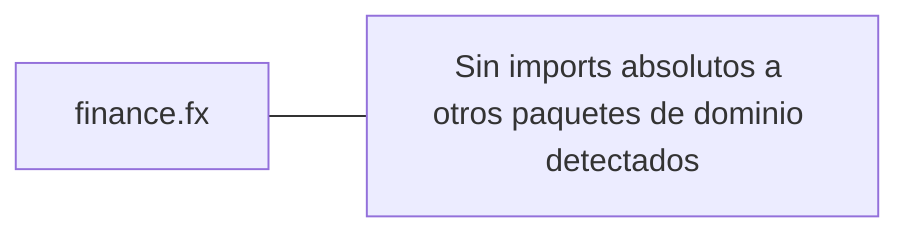

# finance.fx

## Que hace

`finance.fx` gestiona snapshots de tasas de cambio.

Documento complementario recomendado:

- [Catalogo de fuentes e integraciones](https://gitlab.com/vexxo-sas/vexxo_backend_api/-/blob/development/INTEGRATION_SOURCE_CATALOG.md)

Su responsabilidad actual es:

- CRUD operativo de `ExchangeRate`
- consulta de tasas ya persistidas

## Rol En El Producto

Este modulo permite que Vexxo:

- convierta montos entre monedas
- explique exposicion cambiaria
- soporte cuentas o productos multicurrency

## Flujo Principal

1. una tasa se persiste como snapshot
2. el API la expone ordenada por `observed_at`
3. otros contextos pueden usarla para conversion o analitica

## Relacion Con Otros Modulos

- `finance.accounts`
  puede apoyarse en FX para exposicion por moneda
- `reports`
  puede requerir conversiones o lecturas multicurrency
- `payments`
  puede necesitar contexto cambiario en ejecucion futura

## Encaje Con GCP

Hoy este contexto es principalmente OLTP.

La ingestion real de tasas deberia evolucionar a:

- job o integracion externa
- Cloud Scheduler / worker
- posible persistencia posterior en BigQuery para analitica

## Estado Actual

El viewset actual (`TasaFXViewSet`) expone CRUD de snapshots ya persistidos.

Importante:

- hoy no trae tasas de internet por si mismo
- la ingesta real debe vivir en un servicio o worker aparte

<!-- backend-source-audit:start -->
## Evidencia del codigo y mapa de dependencias

Inventario estatico reproducible del checkout. Describe declaraciones e imports;
no prueba despliegue, permisos efectivos ni que todos los caminos se ejecuten.
Las rutas son locales a su URLConf: el prefijo publico se consulta en
[`api/v1/routers.py`](../../api/v1/routers.py).

- Archivos Python de implementacion: **8** (excluye tests y migraciones).
- Huella SHA-256 del codigo inventariado: `0a3885d20267b5e4dfaddb563756067d219b1457616d5bdb687c68fe7397eefc`.
- Familias detectadas: models, serializers, views.

### Declaraciones de modelos detectadas

- `ExchangeRate` en [finance/fx/models/fx.py](models/fx.py).

### Rutas declaradas

| Patron local | Fuente |
| --- | --- |
| `` | [finance/fx/urls.py](urls.py) |
| `tasas-fx/ [DRF router]` | [finance/fx/urls.py](urls.py) |

### Diagrama de dependencia estatica

Las flechas representan imports entre paquetes, no eventos ni orden de ejecucion.

Flujos transversales: [flujo actualizado](../../docs/BACKEND_CURRENT_FLOW.md).

Regeneracion: `py -3 scripts/audit_backend_docs.py --write`.
Comprobacion de deriva: `py -3 scripts/audit_backend_docs.py --check`.
<!-- backend-source-audit:end -->
