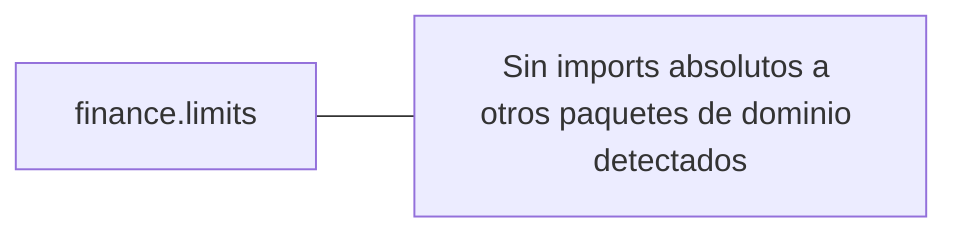

# finance.limits

## Que hace

`finance.limits` existe como contexto reservado para limites financieros
generales que no pertenezcan de forma natural a un solo bounded context.

Hoy este modulo no expone modelos, servicios ni vistas de negocio reales.
El codigo actual sigue en estado scaffold:

- `models.py` vacio
- `views.py` vacio
- sin endpoints publicos detectados

## Por Que Existe

Aunque hoy los limites efectivos viven repartidos, el proyecto ya necesita
pensar limites en varias capas:

- producto y plan en `identity.users`
- limites operativos de cuentas en `finance.accounts`
- limites de pagos y payouts en `payments.payment_intents`
- limites de contactos u otros recursos en modulos especificos

`finance.limits` deja un lugar natural para endurecer mas adelante reglas
transversales de dinero y riesgo sin contaminar otros modulos.

## Relacion Con Otros Modulos

- `identity.users`
  plan matrix, capabilities y gating comercial.
- `finance.accounts`
  limites de cuentas manuales, conectadas, investment y sharing.
- `payments.payment_intents`
  limites de volumen, payouts y caps operativos por rail.
- `contacts`
  hoy usa un control por plan (`can_add_contact`) fuera de este contexto.

## Encaje Con El Negocio

Vexxo necesita proteger:

- conciliacion correcta
- idempotencia
- trazabilidad
- fraude/AML
- reversos y errores
- soporte operativo
- salud del proveedor y del rail

En el estado actual, esas politicas se aplican en los modulos operativos
directos. `finance.limits` todavia no es el orquestador comun.

## Encaje Con GCP

Cuando este contexto madure, encajara naturalmente en una arquitectura
cloud-first:

- Cloud Run para exponer policy/validation
- Cloud SQL para configuracion y overrides
- Pub/Sub o Cloud Tasks para reaccionar a cambios de limite
- observabilidad en Cloud Logging/Monitoring

## Estado Actual

Este modulo existe como placeholder estructural.

No conviene inventarle responsabilidad productiva hoy. Si en el futuro se
endurecen limites transversales de riesgo o capacidad, este es el lugar mas
natural para centralizarlos.

<!-- backend-source-audit:start -->
## Evidencia del codigo y mapa de dependencias

Inventario estatico reproducible del checkout. Describe declaraciones e imports;
no prueba despliegue, permisos efectivos ni que todos los caminos se ejecuten.
Las rutas son locales a su URLConf: el prefijo publico se consulta en
[`api/v1/routers.py`](../../api/v1/routers.py).

- Archivos Python de implementacion: **5** (excluye tests y migraciones).
- Huella SHA-256 del codigo inventariado: `c031da8d51a09e4834b73d89dbfec023ad4f11998bc46bdb25bd3f433ef57c35`.
- Familias detectadas: models, views.

No se detectan declaraciones `path`/`re_path` propias en este alcance.
Esto no implica que el modulo carezca de consumidores internos.

### Diagrama de dependencia estatica

Las flechas representan imports entre paquetes, no eventos ni orden de ejecucion.

Flujos transversales: [flujo actualizado](../../docs/BACKEND_CURRENT_FLOW.md).

Regeneracion: `py -3 scripts/audit_backend_docs.py --write`.
Comprobacion de deriva: `py -3 scripts/audit_backend_docs.py --check`.
<!-- backend-source-audit:end -->
