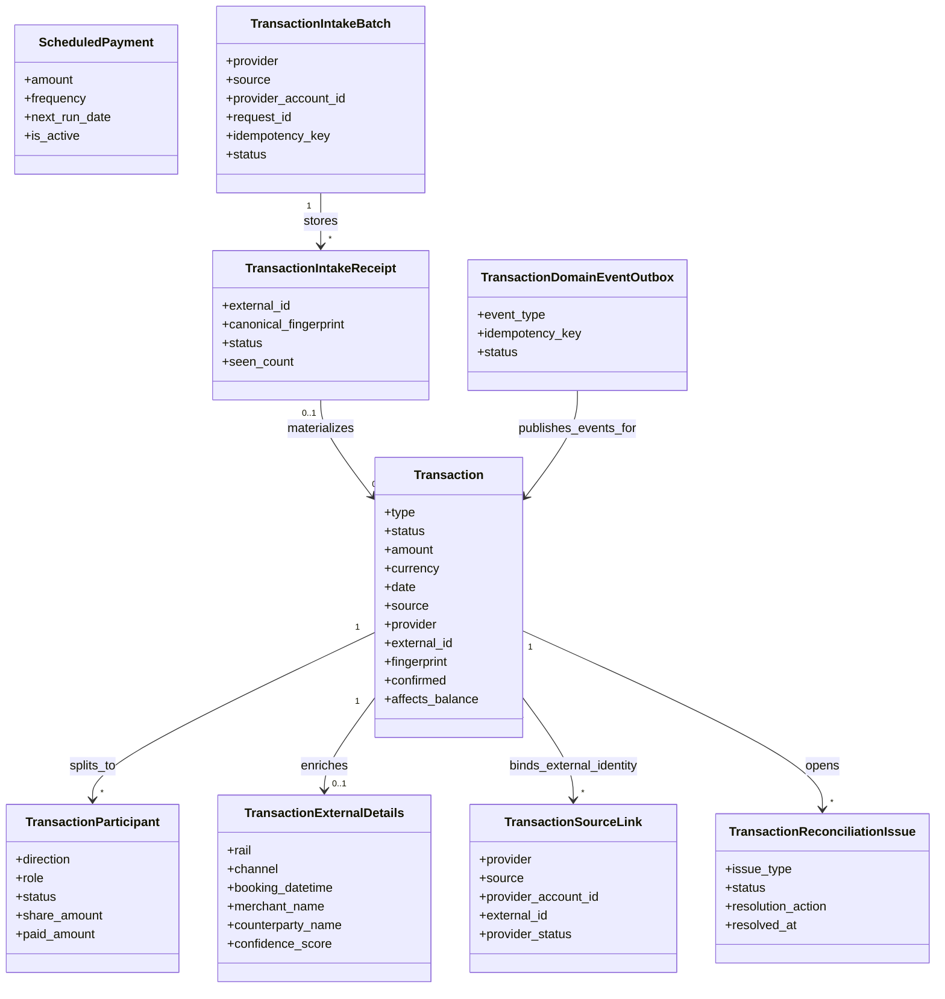
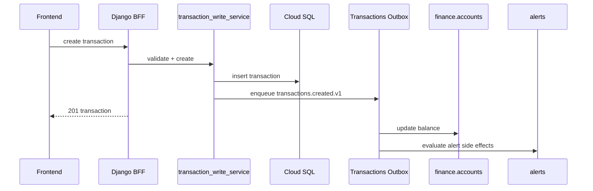
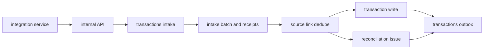
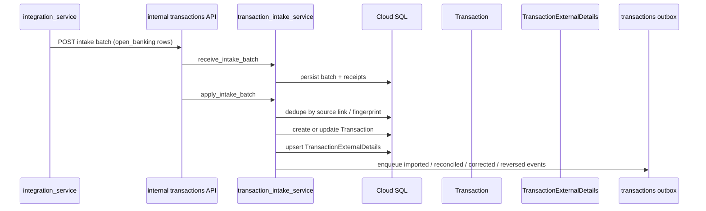
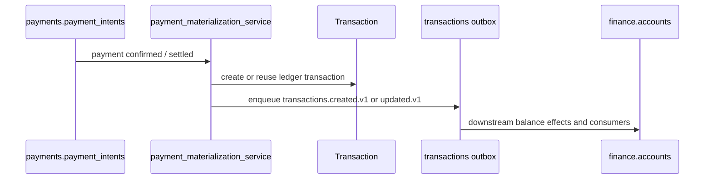
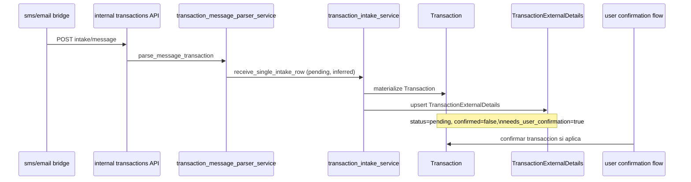

# finance.transactions

## Que hace

`finance.transactions` es el ledger transaccional personal de Vexxo.

Documento complementario recomendado:

- [Catalogo de fuentes e integraciones](/c:/Users/Alamb/Documents/Vexxo_Backend_API/INTEGRATION_SOURCE_CATALOG.md)
- [Contratos canonicos por rail](RAIL_NORMALIZATION_CONTRACTS.md)

Su trabajo no es ejecutar rails externos ni hablar con PSPs. Su trabajo es:

- registrar el hecho contable final
- sostener balances, reportes y categorias
- servir como base para alerts, debts, contacts y proyecciones
- reflejar en ledger pagos externos ya confirmados por `payments`

## Rol en el negocio

Desde producto, este modulo representa la respuesta a preguntas como:

- "en que me gaste la plata"
- "que ingresos tuve"
- "que paso realmente en esta cuenta"
- "este pago externo ya quedo registrado en mi historial"
- "cuanto me debe este contacto o cuanto le debo"

Es el punto donde Vexxo deja de hablar de intenciones y pasa a hablar de realidad contable.

## Vista visual

## Que no hace

`Transaction` no es:

- un `PaymentIntent`
- un callback de proveedor
- una corrida programada
- el transporte de eventos
- el rail externo

Eso vive en otros bounded contexts:

- `payments.payment_intents`: intencion, ejecucion, callback, settlement, dispute
- `payments.scheduled_payments`: planificacion recurrente o programada
- `finance.accounts`: balance operativo y relacion con cuentas

## Modelos principales

### `Transaction`

Representa un movimiento financiero final del ledger.

Campos importantes:

- `type`: `expense`, `income`, `transfer`
- `status`: `pending`, `posted`, `reconciled`, `canceled`, `failed`
- `confirmed`: aceptacion de usuario o fuente confiable
- `affects_balance`: permite separar hechos contables de splits analiticos
- resumen canonico externo util para consultas:
  - `description`
  - `booking_datetime` / `value_datetime`
  - `credit_debit_indicator`
  - `rail` / `channel`
  - `data_origin` / `confidence_score`
  - `country_code`
  - `balance_after_transaction`
  - `original_amount` / `original_currency` / `fx_rate`
- relaciones a `account`, `category`, `vendor`, `debt`, `installment`
- vinculo opcional a `payment_intent`
- metadata externa ligera: `source`, `provider`, `external_id`, `raw_payload`
- soporte de split y reembolso

### `TransactionExternalDetails`

Vista normalizada rica del rail o del origen externo.

No reemplaza al ledger ni al intake. Su trabajo es capturar metadata externa
consultable sin inflar `Transaction` ni obligar a parsear `raw_payload`.

Campos importantes:

- `description`
- `transaction_information`
- `booking_datetime` / `value_datetime`
- `credit_debit_indicator`
- `merchant_name` / `merchant_category_code`
- `counterparty_name` / `counterparty_account_ref`
- `rail` / `rail_reference`
- `authorization_status` / `settlement_status`
- `authorized_at` / `captured_at` / `settled_at` / `reversed_at`
- `balance_after_transaction`
- `original_amount` / `original_currency` / `fx_rate`
- `country_code`
- `channel`
- `data_origin`
- `confidence_score`
- `message_id` / `sender_id` / `received_at`
- `parsed_text` / `parser_version`
- `needs_user_confirmation` / `inference_status`

Decision de diseno actual:

- `Transaction` = ledger contable final + resumen canonico transversal
- `TransactionIntakeReceipt` = staging/intake
- `TransactionExternalDetails` = vista normalizada rica del rail

### `ScheduledPayment`

Es el modelo legacy/local de recordatorio o programacion manual dentro de `transactions`.

No es el scheduler canonico para ejecucion externa.

Se mantiene para:

- recordatorios locales
- materializacion manual de un movimiento contable
- compatibilidad con deudas/cuotas y vistas legacy

### `TransactionParticipant`

Fuente canonica para participaciones humanas en una transaccion.

Ahora ya no hay dos modelos efectivos compitiendo. Esta clase cubre:

- contacto local opcional
- contraparte `linked_user`
- `direction` acreedor/deudor
- `share_amount`, `paid_amount`, `pending_amount`
- `status` operativo del share

Esto alimenta `contacts` y futuros escenarios de shared expenses.

### `TransactionDomainEventOutbox`

Outbox fuerte del bounded context `transactions`.

Se usa para:

- publicar `transactions.*` fuera del request path
- desacoplar listeners locales y dispatchers externos
- dejar workers dedicados para Cloud Run, Pub/Sub o jobs batch

### `TransactionIntakeBatch`

Representa un lote recibido desde una fuente externa antes de tocar el ledger.

Guarda:

- `provider`
- `source`
- `provider_account_id`
- `cursor`
- `request_id`
- `idempotency_key`
- `status`
- `row_count`
- `received_at` / `applied_at`

Su trabajo es separar:

- "recibi un lote externo"
- "lo procese"
- "lo aplique o lo deje parcial/fallido"

### `TransactionIntakeReceipt`

Representa una fila individual normalizada de una fuente externa.

Guarda:

- identidad externa
- `canonical_fingerprint`
- payload normalizado
- payload crudo
- `status`
- `duplicate_of`
- `materialized_transaction`
- `reconciliation_issue`

Esta tabla existe para que un retry, re-sync o reenvio del proveedor no toque
el ledger directo ni pierda trazabilidad.

### `TransactionSourceLink`

Vinculo estable entre una `Transaction` y su identidad externa.

Es la pieza que sostiene la idempotencia fuerte para fuentes no manuales:

- `provider + source + provider_account_id + external_id`
- o `provider + source + provider_account_id + canonical_fingerprint`

Con eso el sistema ya no depende solo de buscar `provider + external_id` en la
tabla del ledger.

### `TransactionReconciliationIssue`

Registro formal de correcciones o reversos que no conviene aplicar
silenciosamente sobre una transaccion ya contable.

Se usa para casos como:

- cambio material de monto/fecha/cuenta sobre una transaccion ya countable
- reverso o cancelacion tardia informada por el proveedor

Ahora tambien guarda el cierre formal del caso:

- `resolution_action`
- `resolution_notes`
- `resolution_payload`
- `resolved_by`
- `resolution_transaction`

## Semantica de `status + confirmed`

Esto quedo formalizado en el modelo y en `transaction_state_service.py`.

Reglas:

- `pending`: transaccion todavia no aceptada para ledger final
- `posted`: ya cuenta para ledger
- `reconciled`: ya fue conciliada y siempre implica `confirmed=True`
- `canceled` y `failed`: no deben afectar balance
- si una transaccion llega `confirmed=True` y sigue `pending`, se promueve a `posted`

Regla operativa:

- una transaccion cuenta para ledger cuando es `posted`/`reconciled`, esta `confirmed` y `affects_balance=True`

Eso evita ambiguedad entre "existe un registro" y "ya es verdad contable".

## Secuencias criticas

### Transaccion manual

### Intake externo

### Open banking intake

### Payment intent confirmado

### SMS inferido

## Flujos principales

### 1. Transaccion manual

1. la API crea o actualiza `Transaction`
2. serializer valida reglas de acceso a cuenta, tipo, deuda, categoria y limites
3. model normaliza `status + confirmed`
4. signal fino encola `transactions.*` en outbox
5. worker publica
6. listeners locales disparan side effects desacoplados

### 1.a. Intake externo canonico

1. un `integration_service` o worker interno llama un endpoint interno de
   intake
2. el backend persiste `TransactionIntakeBatch`
3. el backend persiste `TransactionIntakeReceipt`
4. el servicio de intake deduplica por identidad externa o fingerprint
5. decide:
   - `duplicate`
   - `noop`
   - `materialized`
   - `updated`
   - `corrected`
   - `reversed`
6. solo despues materializa o actualiza `Transaction`
7. publica eventos `transactions.*` desde el mismo outbox del contexto

Regla importante:

- open banking e imports ya no deben crear `Transaction` directo
- primero pasan por la capa de intake

### 1.b. Transaccion en cuenta compartida

1. la cuenta visible no se resuelve solo por `owner`; se resuelve por
   `AccountMembership`
2. un usuario con acceso compartido puede leer transacciones de la cuenta si
   `accounts.permission_service.user_can_view_account()` lo permite
3. solo puede crear, editar, confirmar o borrar movimientos si
   `user_can_post_transactions()` lo permite
4. el ledger sigue quedando unificado bajo `account.owner`; el colaborador no
   crea un segundo ledger paralelo

Esto permite compartir la cuenta sin romper la verdad contable ni dividir el
historial por usuario colaborador.

### 2. Pago externo confirmado

1. `payments.payment_intents` procesa rail externo
2. cuando el pago ya es valido para ledger, `payment_materialization_service`
   crea o reutiliza `Transaction`
3. `transactions` queda como reflejo contable
4. el detalle rico del PSP sigue en `payments`

### 2.a. Mensaje SMS o email inferido

1. un bridge o integrador interno envia `POST /api/internal/transactions/intake/message/`
2. `transaction_message_parser_service.py` intenta inferir monto, tipo, descripcion y contraparte
3. el parser construye una fila canonica de intake con:
   - `status=pending`
   - `confirmed=False`
   - `rail=message`
   - `data_origin=inferred`
   - `needs_user_confirmation=True`
4. `transaction_intake_service.py` materializa `Transaction`
5. `TransactionExternalDetails` conserva `parsed_text`, `message_id`, `sender_id`, `parser_version`, `confidence_score` e `inference_status`
6. la transaccion queda persistida en `Transaction`, pero no es countable para ledger mientras siga `pending + confirmed=False`

Limites actuales:

- el parser es determinista y basado en patrones, no NLP libre
- hoy infiere bien monto, tipo, descripcion corta y contraparte minima
- si no puede inferir monto, el intake exige `amount` explicito
- el flujo esta pensado para bridge interno de sms/email, no para ingestion directa desde cliente final

### 3. Pago programado legacy local

1. el usuario crea `transactions.ScheduledPayment`
2. si quiere materializarlo localmente, usa `generar_transaccion`
3. eso crea `Transaction` y marca el scheduled legacy como `paid`

Regla:

- este flujo es local/manual
- no reemplaza `payments.scheduled_payments`
- no ejecuta rails externos

### 4. Reembolso

1. el gasto original debe ser `expense` y `is_reimbursable=True`
2. el caso de uso registra una nueva `Transaction` de ingreso
3. el gasto original queda marcado como `reimbursed`
4. se emite evento de reembolso registrado

## Casos de uso movidos a servicios

La logica importante ya no depende solo de serializer o view action.

Servicios clave:

- `transaction_validation_service.py`
  - reglas de validacion de payload
  - ownership de FKs
  - limites de cuenta y plan
- `transaction_actions_service.py`
  - reasignar cuenta
  - confirmar transaccion
  - agregar comentario
  - registrar reembolso
  - materializar scheduled payment legacy
- `transaction_intake_service.py`
  - intake externo canonico
  - persistencia de batch/receipt
  - dedupe por source link o fingerprint
  - decision `noop/create/update/correct/reverse`
  - reconciliacion basica sin tocar el CRUD manual
- `transaction_message_parser_service.py`
  - parser determinista para sms/email
  - infiere monto, tipo, descripcion y contraparte minima
  - materializa movimientos `pending` y `needs_user_confirmation`
- `transaction_reconciliation_service.py`
  - resuelve `TransactionReconciliationIssue`
  - soporta `apply_provider_update`, `create_adjustment`, `create_reversal`
    e `ignore`
- `transaction_write_service.py`
  - mueve el create/update/delete manual de `Transaction`
  - publica eventos de CRUD de forma explicita
  - deja signals como fallback para paths aun no migrados
- `payment_materialization_service.py`
  - reflejo contable desde `payments`

## Contratos canonicos por rail

La especificacion detallada de `normalized_payload` por rail vive en:

- [RAIL_NORMALIZATION_CONTRACTS.md](RAIL_NORMALIZATION_CONTRACTS.md)

Lectura corta:

- `open_banking` entra y se materializa aqui
- `message_inferred` entra y se materializa aqui
- `payment_reflection` entra aqui como reflejo contable
- `payment_execution` no vive aqui; vive en `payments.payment_intents`

## Eventos `transactions.*`

El contexto ya emite eventos canonicos como:

- `transactions.created.v1`
- `transactions.updated.v1`
- `transactions.financial.updated.v1`
- `transactions.deleted.v1`
- `transactions.intake.batch.received.v1`
- `transactions.intake.batch.applied.v1`
- `transactions.intake.batch.failed.v1`
- `transactions.intake.row.duplicate_detected.v1`
- `transactions.confirmed.v1`
- `transactions.imported.v1`
- `transactions.reconciled.v1`
- `transactions.corrected.v1`
- `transactions.reversed.v1`
- `transactions.account.reassigned.v1`
- `transactions.reimbursement.recorded.v1`
- `transactions.participant.created.v1`
- `transactions.participant.updated.v1`
- `transactions.participant.deleted.v1`
- `transactions.participant.settled.v1`
- `transactions.scheduled_payment.created.v1`
- `transactions.scheduled_payment.updated.v1`
- `transactions.scheduled_payment.deleted.v1`
- `transactions.scheduled_payment.paid.v1`

### `transactions.financial.updated.v1`

Este evento existe para el caso en que una transaccion ya contable cambia
despues de haber entrado al ledger.

El payload ahora distingue:

- `financial_change.kind`
  - `cosmetic`
  - `became_countable`
  - `stopped_countable`
  - `updated_while_countable`
  - `updated_while_non_countable`
- `financial_change.changed_fields`
- `countable_before`
- `countable_for_ledger`

Con esto un consumidor puede diferenciar un cambio material de monto, fecha,
cuenta, deuda o estado contable frente a un cambio solo visual o auxiliar.

### Actor y trazabilidad de CRUD

Los eventos normales de CRUD ya no dependen solo de atributos efimeros puestos
despues del `save()`.

`transactions` usa un contexto de actor por request/accion para que:

- `transactions.created.v1`
- `transactions.updated.v1`
- `transactions.financial.updated.v1`
- `transactions.deleted.v1`
- eventos de participantes
- eventos de scheduled payments legacy

propaguen `actor_user_id` de forma consistente cuando la mutacion nace desde
API o acciones del backend.

### Eventos nuevos del intake

Los eventos nuevos no reemplazan `transactions.created.v1` o
`transactions.financial.updated.v1`; los complementan.

- `transactions.intake.batch.received.v1`
  - confirma que el backend recibio y persistio el lote externo
- `transactions.intake.batch.applied.v1`
  - resume el resultado del procesamiento del lote
- `transactions.intake.row.duplicate_detected.v1`
  - deja trazabilidad de reenvios o retries del proveedor
- `transactions.imported.v1`
  - marca la primera materializacion contable desde una fuente externa
- `transactions.reconciled.v1`
  - marca cambios no destructivos o metadata reconciliada
- `transactions.corrected.v1`
  - marca que aparecio una correccion formal pendiente
- `transactions.reversed.v1`
  - marca reversos o cancelaciones tardias
- `transactions.reconciliation.issue.resolved.v1`
  - marca el cierre formal del issue y su accion de resolucion

### Resolucion formal de reconciliation issues

Cuando ya existe un `TransactionReconciliationIssue`, el cierre ya no es
informal ni manual fuera del dominio.

Acciones soportadas hoy:

- `apply_provider_update`
  - solo para cambios que no exigen replacement pair
- `create_adjustment`
  - crea ajuste compensatorio simple si el cambio sigue en la misma cuenta/tipo
  - o crea replacement pair si cambia cuenta/tipo/proveedor
- `create_reversal`
  - crea reverso compensatorio formal
- `ignore`
  - cierra el issue como ignorado explicitamente

Regla operativa:

- si la correccion cambia cuenta, tipo o proveedor, no se actualiza en sitio el
  ledger original
- se usa replacement pair:
  - reverso compensatorio del hecho viejo
  - nueva transaccion replacement con el estado correcto
  - `TransactionSourceLink` se relinka a la nueva transaccion

## Que sigue en signal y que ya paso a eventos

### Signal

Los signals ahora son delgados.

Su responsabilidad principal es:

- capturar estado anterior
- servir como fallback para create/update/delete fuera del write service
- encolar evento en outbox cuando el path aun no fue migrado

No deberian contener logica de negocio pesada.

En esta pasada ya no son el coordinador principal del CRUD manual de
`Transaction`:

- create/update/delete manual via API pasan por `transaction_write_service.py`
- acciones manuales clave como `confirm`, `reassign`, `add_comment`,
  `register_reimbursement` y `materialize_transaction_from_legacy_scheduled_payment`
  tambien ya publican por write path explicito
- ese servicio publica los eventos de CRUD de forma explicita
- los signals quedan para intake, materializaciones y otros paths todavia no
  migrados

### Event handlers

Los side effects relevantes se atienden desde listeners:

- aplicar pago a deudas cuando una transaccion se vuelve contable
- marcar scheduled payment legacy como pagado si corresponde
- crear alerta de over-spend si aplica
- recalcular net balance de contactos
- refrescar proyeccion de uso de scheduled payments

Regla actual importante:

- `transactions.financial.updated.v1` no reaplica automaticamente pagos a deuda
  para evitar duplicados sobre una transaccion ya contable
- ese evento existe para reconciliacion, observabilidad y futuros consumidores
  mas ricos; el balance incremental de `accounts` sigue resolviendose en su
  propio modulo

Cuando el update financiero toca deuda/cuota o scheduled payment legacy, el
listener ya ejecuta una correccion retroactiva acotada:

- reconstruye el estado de pagos de la deuda afectada desde el ledger real
- recompone el estado `paid/pending` del scheduled payment legacy segun
  transacciones contables existentes

Esto no reemplaza una conciliacion global del dominio, pero evita dejar objetos
derivados en estado viejo cuando una transaccion ya contable cambia despues.

Esto alinea `transactions` con el mismo estilo de `accounts` y `payments`.

## Endpoints internos de intake

Esta capa no es publica para mobile/web.

Rutas internas actuales:

- `POST /api/internal/transactions/intake/batches/`
  - recibe un lote normalizado
- `POST /api/internal/transactions/intake/batches/{id}/apply/`
  - aplica el lote ya persistido
- `POST /api/internal/transactions/intake/row/`
  - atajo para una fila unica
- `POST /api/internal/transactions/intake/reconcile/`
  - recibe y aplica un lote orientado a re-sync o conciliacion
- `POST /api/internal/transactions/reconciliation/issues/{id}/resolve/`
  - cierra un `TransactionReconciliationIssue` con accion formal

Headers obligatorios:

- `X-Vexxo-Internal-Token`
- `X-Request-Id`
- `Idempotency-Key`

Regla cloud:

- `integration_service` consume banco/agregador
- normaliza payload externo
- llama estos endpoints internos
- el backend sigue siendo el unico que escribe Cloud SQL

## Convivencia entre `transactions.ScheduledPayment` y `payments.scheduled_payments`

La decision actual es explicita:

- `transactions.ScheduledPayment`
  - legacy/local
  - recordatorio y materializacion manual del ledger
  - compatibilidad con deudas/cuotas existentes

- `payments.scheduled_payments`
  - capa nueva y mas limpia de planificacion
  - genera `PaymentIntent`
  - orientada a ejecucion externa futura

No se mezclan:

- legacy scheduled no es rail externo
- payment schedule no es ledger final

## Relacion con otros modulos

- `finance.accounts`
  - consume transacciones para balance operativo
  - usa el ledger como fuente de verdad contable
- `finance.debts`
  - puede aplicar pagos cuando una transaccion de gasto se vuelve contable
- `contacts`
  - recalcula saldo neto desde `TransactionParticipant`
- `alerts.alerts`
  - genera alertas de over-spend a partir del ledger
- `payments.payment_intents`
  - ejecuta afuera, `transactions` refleja adentro
- `payments.scheduled_payments`
  - comparte la idea de programacion, pero no reemplaza el ledger
- `identity.users`
  - usa slices/proyecciones para limites y usage

## Encaje con GCP

`finance.transactions` esta pensado para operar asi:

- Cloud SQL: ledger OLTP y relaciones transaccionales
- API Gateway + Cloud Run API: comandos CRUD y acciones de negocio
- outbox + worker: publicacion confiable de `transactions.*`
- Pub/Sub / listeners externos: integraciones, pipelines y consumers
- BigQuery: analitica y reporting pesado fuera del request path

### Publicacion e idempotencia

El outbox de `transactions` usa:

- `idempotency_key` por evento
- `claim_for_processing()` antes de publicar para reducir doble despacho en
  workers concurrentes
- retry con backoff creciente antes de dead letter
- metadata como `projection_event_key` y `outbox_idempotency_key`

Esto es relevante en GCP cuando varios workers de Cloud Run o jobs manuales
pueden procesar el mismo lote casi al mismo tiempo.

### Latencia, retrasos y reconciliacion

`transactions` no asume entrega instantanea en todos los consumidores:

- el hecho contable queda persistido primero en Cloud SQL
- `accounts` actualiza balance cacheado por delta incremental en el mismo flujo
- el outbox publica despues
- consumidores, alertas y proyecciones pueden llegar con retraso sin perder el
  hecho base

Si hay latencia o retraso, el ledger sigue siendo la verdad; lo derivado se
considera eventualmente consistente.

Regla clave:

- Cloud SQL guarda el hecho contable
- workers y projections resuelven derivaciones
- BigQuery absorbe analitica grande

## Consultas y performance

Este modulo no debe usarse para analitica pesada en caliente.

Uso correcto:

- lectura puntual por usuario/cuenta/mes
- joins razonables para ledger operacional
- proyecciones y snapshots para UI derivada
- filtros por `year`, `month`, `day`, `date_from`, `date_to` y `scope`
  (`owned/shared/all`) para evitar scans amplios desde mobile

Uso incorrecto:

- exploracion global pesada
- agregaciones cross-tenant desde OLTP
- reporting grande en request path

## Estado actual

Ya existe:

- modelo contable rico
- relacion limpia con `payment_intent`
- un solo `TransactionParticipant` efectivo
- semantica formal de `status + confirmed`
- outbox propio
- claim explicito e idempotencia de publicacion en outbox
- servicios de accion
- acceso a transacciones compartidas segun memberships de cuenta
- filtros temporales explicitos para consumo movil
- propagacion consistente de `actor_user_id` en CRUD normal
- reconciliacion retroactiva minima para deuda y scheduled payment legacy
- listeners desacoplados

## Pendientes reales

- materializar migraciones del app si el repo todavia no las tiene completas
- endurecer maquina de estados si en el futuro aparecen mas fuentes de ingestion
- mover mas casos de uso de reporte/presupuesto a eventos `transactions.*`
- definir productores canonicos adicionales si `budgets`, `reports` o `goals`
  empiezan a depender mas del ledger
- cerrar ingestion canonica para fuentes externas:
  - upsert controlado
  - politicas mas ricas de fingerprint por proveedor
  - reconciliacion y correccion formal para open banking
- seguir adelgazando signals:
  - hoy ya son mas finos
  - pero el lifecycle critico todavia depende bastante de ellos frente a imports
    futuros o paths no estandar

## Nota operativa despues de la ultima pasada

`transactions` ya no esta solo en estado "manual + pagos reflejados".

Ahora tambien tiene una capa explicita de intake externo con:

- `TransactionIntakeBatch`
- `TransactionIntakeReceipt`
- `TransactionExternalDetails`
- `TransactionSourceLink`
- `TransactionReconciliationIssue`
- endpoints internos de intake

Y la riqueza externa ya no queda solo atrapada en `raw_payload`:

- `Transaction` conserva el hecho contable final
- `TransactionIntakeReceipt` conserva staging y trazabilidad de entrada
- `TransactionExternalDetails` conserva la vista normalizada del rail

Ademas mejoro la proteccion de duplicados para fuentes no manuales:

- si llega `provider + external_id` ya no se acepta una segunda transaccion
  igual para el mismo `ledger_owner` en el write path manual
- y el intake externo ya usa `source link` y `canonical_fingerprint`
  antes de tocar el ledger

Eso ayuda, pero no cierra todavia la deuda principal:

- la reconciliacion ya cubre replacement pair para cambios complejos de
  cuenta/tipo/proveedor, pero todavia no resuelve todos los casos extremos de
  correccion por proveedor
- el CRUD manual principal y varias acciones operativas ya no dependen solo de
  signals
- los signals siguen existiendo como compatibilidad para paths no migrados; la
  migracion no esta terminada

