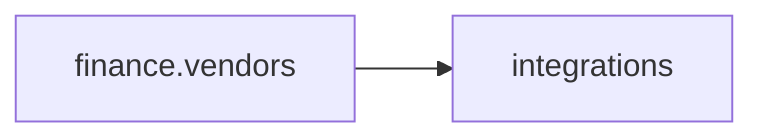

# finance.vendors

## Que hace

`finance.vendors` administra contrapartes o comercios asociados a movimientos
financieros.

Su responsabilidad actual es:

- CRUD de proveedores/comercios
- servir como dimension reutilizable para ledger, pagos y analitica

## Rol En El Producto

De cara al usuario, los vendors ayudan a entender:

- con quien gasta o recibe dinero
- recurrencia de pagos a terceros
- historial por comercio o contraparte

## Flujo Principal

1. se crea o edita un `Vendor`
2. `transactions` o `payments` pueden referenciarlo
3. reportes, busquedas y experiencias futuras se apoyan en esa relacion

La API solo lista y modifica vendors del usuario autenticado. El `owner` se
asigna en el servidor y no puede suplantarse desde el payload.

## Flujo De Soporte

Soporte puede ver en una vista interna auditada que el usuario tiene actividad
asociada, pero no obtiene automaticamente importes ni detalles de sus
transacciones. Una inspeccion mas profunda debe partir de un caso y permisos
explicitos.

## Relacion Con Otros Modulos

- `finance.transactions`
  usa vendor como parte del ledger
- `payments.payment_intents`
  puede asociar un vendor al intent externo
- `payments.scheduled_payments`
  puede heredar vendor al template recurrente

## Runtime Local

Es una pieza OLTP simple en PostgreSQL local y no necesita worker propio.

Su informacion es relevante para reportes y recomendaciones futuras.

## Estado Actual

Hoy expone `ProveedorViewSet` como CRUD autenticado y aislado por propietario
sobre `Vendor`.

Sigue siendo una capa sencilla, pero forma parte de la semantica del negocio y
no deberia tratarse como mero dato auxiliar.

El siguiente cierre funcional es normalizacion y deduplicacion de aliases por
usuario, no una integracion cloud.

<!-- backend-source-audit:start -->
## Evidencia del codigo y mapa de dependencias

Inventario estatico reproducible del checkout. Describe declaraciones e imports;
no prueba despliegue, permisos efectivos ni que todos los caminos se ejecuten.
Las rutas son locales a su URLConf: el prefijo publico se consulta en
[`api/v1/routers.py`](../../api/v1/routers.py).

- Archivos Python de implementacion: **9** (excluye tests y migraciones).
- Huella SHA-256 del codigo inventariado: `831f663f69de8a31bd9a0a94a8739a2279ecda8f5b0609ad408361c4b6a84225`.
- Familias detectadas: models, serializers, views.

### Declaraciones de modelos detectadas

- `Vendor` en [finance/vendors/models/provedores.py](models/provedores.py).
- `VendorAlias` en [finance/vendors/models/provedores.py](models/provedores.py).

### Rutas declaradas

| Patron local | Fuente |
| --- | --- |
| `` | [finance/vendors/urls.py](urls.py) |
| `proveedores/ [DRF router]` | [finance/vendors/urls.py](urls.py) |

### Diagrama de dependencia estatica

Las flechas representan imports entre paquetes, no eventos ni orden de ejecucion.

Flujos transversales: [flujo actualizado](../../docs/BACKEND_CURRENT_FLOW.md).

Regeneracion: `py -3 scripts/audit_backend_docs.py --write`.
Comprobacion de deriva: `py -3 scripts/audit_backend_docs.py --check`.
<!-- backend-source-audit:end -->
