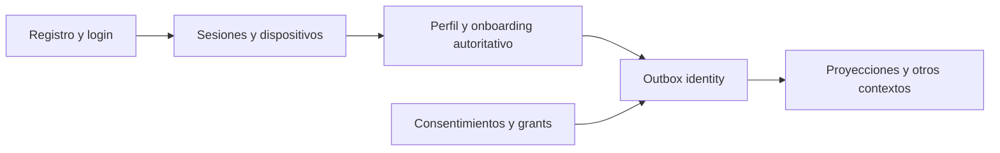
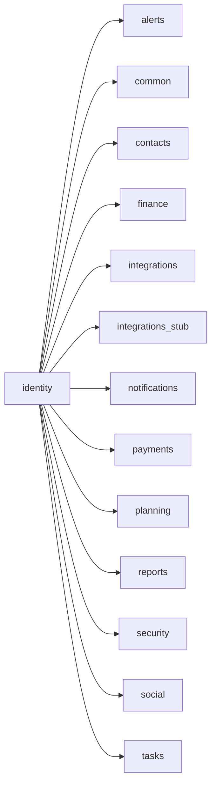

# identity

Identity concentra la identidad del usuario, autenticacion, sesiones, dispositivos,
consentimientos y permisos. Las decisiones de acceso se aplican en backend.

## Documentos propietarios

- [users](users/README.md): registro, perfil, onboarding, plan y autenticacion.
- [sessions](sessions/README.md): ciclo de vida de sesiones y tokens.
- [devices](devices/README.md): dispositivos y evidencia de plataforma.
- [consents](consents/README.md): consentimiento y revocacion.
- [permissions](permissions/README.md): grants y politicas.
- [eventing](eventing/README.md): outbox y proyecciones de identidad.
- [social_identities](social_identities/README.md): identidades externas.

## Flujo

Consultar [flujo actualizado](../docs/BACKEND_CURRENT_FLOW.md) y
[seguridad](../security/README.md). El modo inline de consentimientos local y el
publicador identity son responsabilidades distintas. Cloud permanece como adapter
configurable; no se certifica un despliegue por la presencia del codigo.

<!-- backend-source-audit:start -->
## Evidencia del codigo y mapa de dependencias

Inventario estatico reproducible del checkout. Describe declaraciones e imports;
no prueba despliegue, permisos efectivos ni que todos los caminos se ejecuten.
Las rutas son locales a su URLConf: el prefijo publico se consulta en
[`api/v1/routers.py`](../api/v1/routers.py).

- Archivos Python de implementacion: **103** (excluye tests y migraciones).
- Huella SHA-256 del codigo inventariado: `9de06da3792901c52b2261c71b0fa73e922c83e63a9ddc97cda11775b6982ffd`.
- Familias detectadas: management, models, serializers, services, views.

### Declaraciones de modelos detectadas

- `DevicePlatformAttestationChallenge` en [identity/devices/models/device.py](devices/models/device.py).
- `DeviceSignatureChallenge` en [identity/devices/models/device.py](devices/models/device.py).
- `IdentityDomainEventOutbox` en [identity/eventing/models.py](eventing/models.py).
- `SocialAuthHandoff` en [identity/social_identities/models.py](social_identities/models.py).
- `UserAuthChallenge` en [identity/users/models/auth_challenge.py](users/models/auth_challenge.py).
- `UserConsent` en [identity/consents/models/consent.py](consents/models/consent.py).
- `UserDevice` en [identity/devices/models/device.py](devices/models/device.py).
- `UserMfaMethod` en [identity/users/models/mfa.py](users/models/mfa.py).
- `UserOnboardingProfile` en [identity/users/models/onboarding.py](users/models/onboarding.py).
- `UserPermissionGrant` en [identity/permissions/models/permission_grant.py](permissions/models/permission_grant.py).
- `UserProductUsageProjection` en [identity/eventing/models.py](eventing/models.py).
- `UserProductUsageProjectionEvent` en [identity/eventing/models.py](eventing/models.py).
- `UserSession` en [identity/sessions/models/session.py](sessions/models/session.py).
- `UserSocialIdentity` en [identity/social_identities/models.py](social_identities/models.py).

### Rutas declaradas

| Patron local | Fuente |
| --- | --- |
| `` | [identity/consents/urls.py](consents/urls.py) |
| `` | [identity/devices/urls.py](devices/urls.py) |
| `` | [identity/permissions/urls.py](permissions/urls.py) |
| `` | [identity/sessions/urls.py](sessions/urls.py) |
| `` | [identity/users/urls.py](users/urls.py) |
| `admin/users/ [DRF router]` | [identity/users/urls.py](users/urls.py) |
| `auth/login/` | [identity/users/urls.py](users/urls.py) |
| `auth/logout/` | [identity/users/urls.py](users/urls.py) |
| `auth/mfa/disable/` | [identity/users/urls.py](users/urls.py) |
| `auth/mfa/status/` | [identity/users/urls.py](users/urls.py) |
| `auth/mfa/totp/confirm/` | [identity/users/urls.py](users/urls.py) |
| `auth/mfa/totp/enroll/` | [identity/users/urls.py](users/urls.py) |
| `auth/mfa/verify/` | [identity/users/urls.py](users/urls.py) |
| `auth/password-recovery/confirm-code/` | [identity/users/urls.py](users/urls.py) |
| `auth/password-recovery/request-code/` | [identity/users/urls.py](users/urls.py) |
| `auth/password-reset/confirm/` | [identity/users/urls.py](users/urls.py) |
| `auth/password-reset/request/` | [identity/users/urls.py](users/urls.py) |
| `auth/refresh/` | [identity/users/urls.py](users/urls.py) |
| `auth/register/` | [identity/users/urls.py](users/urls.py) |
| `auth/set-password/` | [identity/users/urls.py](users/urls.py) |
| `auth/social/<str:provider>/callback/` | [identity/users/urls.py](users/urls.py) |
| `auth/social/<str:provider>/start/` | [identity/users/urls.py](users/urls.py) |
| `auth/social/<str:provider>/unlink/` | [identity/users/urls.py](users/urls.py) |
| `auth/social/exchange/` | [identity/users/urls.py](users/urls.py) |
| `auth/social/identities/` | [identity/users/urls.py](users/urls.py) |
| `auth/social/providers/` | [identity/users/urls.py](users/urls.py) |
| `auth/step-up/confirm-code/` | [identity/users/urls.py](users/urls.py) |
| `auth/step-up/request-code/` | [identity/users/urls.py](users/urls.py) |
| `consentimientos/ [DRF router]` | [identity/consents/urls.py](consents/urls.py) |
| `dashboard/` | [identity/users/urls.py](users/urls.py) |
| `dispositivos/ [DRF router]` | [identity/devices/urls.py](devices/urls.py) |
| `event-contract/` | [identity/users/urls.py](users/urls.py) |
| `grants/ [DRF router]` | [identity/permissions/urls.py](permissions/urls.py) |
| `me/` | [identity/users/urls.py](users/urls.py) |
| `onboarding/complete/` | [identity/users/urls.py](users/urls.py) |
| `outbox-identidad/ [DRF router]` | [identity/eventing/urls.py](eventing/urls.py) |
| `sesiones/ [DRF router]` | [identity/sessions/urls.py](sessions/urls.py) |

### Diagrama de dependencia estatica

Las flechas representan imports entre paquetes, no eventos ni orden de ejecucion.

Flujos transversales: [flujo actualizado](../docs/BACKEND_CURRENT_FLOW.md).

Regeneracion: `py -3 scripts/audit_backend_docs.py --write`.
Comprobacion de deriva: `py -3 scripts/audit_backend_docs.py --check`.
<!-- backend-source-audit:end -->
