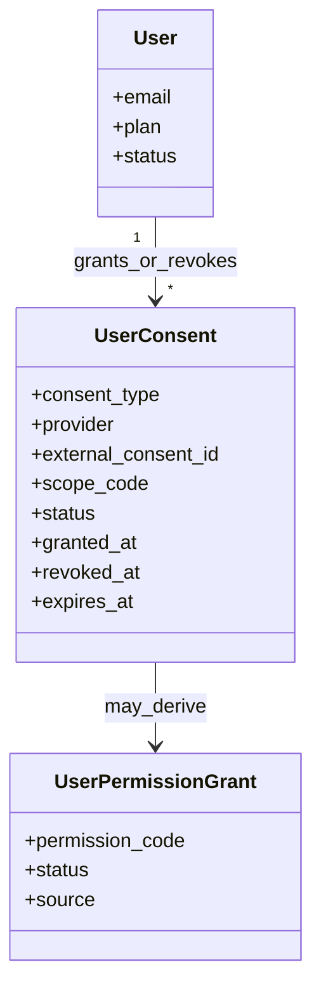

# identity.consents

## Que hace

`identity.consents` modela consentimientos legales y operativos del usuario.

Su trabajo es:

- registrar que datos o capacidades autorizo el usuario
- versionar proveedor, alcance y base legal
- publicar eventos `users.consent.*`
- disparar teardown operativo cuando un consentimiento se revoca

## Por Que Existe

En Vexxo no basta con saber si el plan permite algo.

Tambien hay que saber si el usuario autorizo:

- open banking data
- open banking payments
- OCR documental
- procesamiento de IA
- exportacion de datos
- marketing

Eso tiene implicaciones:

- legales
- operativas
- de permisos derivados
- de integraciones activas

## Vista visual

## Flujo Principal

### Grant de consentimiento

1. la app registra o confirma un consentimiento
2. `grant_consent()` persiste el estado
3. se emite `users.consent.granted.v1`
4. `identity.permissions` deriva permission codes relacionados
5. contextos como `accounts` pueden refrescar proyecciones o disponibilidad

### Revocacion de consentimiento

1. el usuario o un proceso revoca consentimiento
2. `revoke_consent()` actualiza el estado
3. se emite `users.consent.revoked.v1`
4. `event_handlers` dispara teardown operativo
5. `tasks.async_backends` decide si el teardown va por `Cloud Tasks`,
   `sync_inline_for_tests` o `disabled`
6. si corresponde, se deshabilita auto-sync o acceso de proveedor

## Relacion Con Otros Modulos

- `identity.permissions`
  traduce consentimiento a entitlements
- `finance.accounts`
  corta o actualiza integraciones cuando cambia el consentimiento
- `integrations_stub.banks`
  hoy ejecuta el teardown operativo temporal cuando el backend efectivo resuelve
  `sync_inline_for_tests`

## Encaje Con GCP

Este modulo esta preparado para:

- Cloud Run BFF recibiendo grants/revokes
- outbox de identidad publicando eventos
- Cloud Tasks o handlers internos para teardown
- un futuro `integrations_service` dedicado recibiendo esas ordenes

La revocacion no debe quedarse en estado administrativo; debe producir efecto
real sobre integraciones y permisos.

## Casos De Uso

- usuario desconecta open banking
- usuario desactiva permiso de pagos open banking
- usuario retira consentimiento de OCR o IA
- cumplimiento y soporte necesitan trazabilidad del estado legal

## Politicas Del Modulo

- revocar consentimiento debe tener efecto operativo real cuando aplique
- el modulo no debe quedarse en “papel”; debe coordinar teardown
- consentimiento y permiso no son lo mismo, pero deben integrarse

## Estado Actual

Hoy ya persiste grants/revokes, emite eventos y despacha el teardown por la
frontera comun `tasks.async_backends` con `job_type=identity.consents`.

En local/dev:

- el camino oficial es `ASYNC_EXECUTION_MODE_IDENTITY_CONSENTS=sync_inline_for_tests`
- hoy no existe `manage.py run_worker identity.consents`
- eso es deliberado: el flujo ya usa la frontera comun, pero no requiere aun un
  worker durable separado
