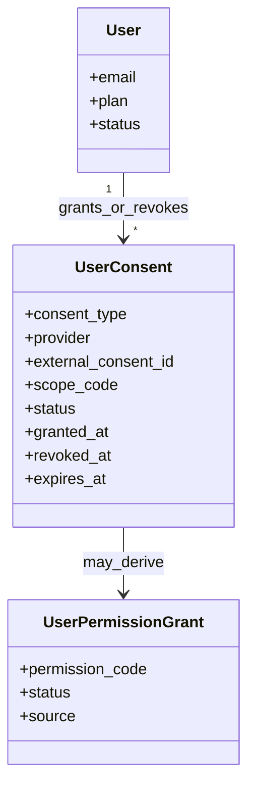
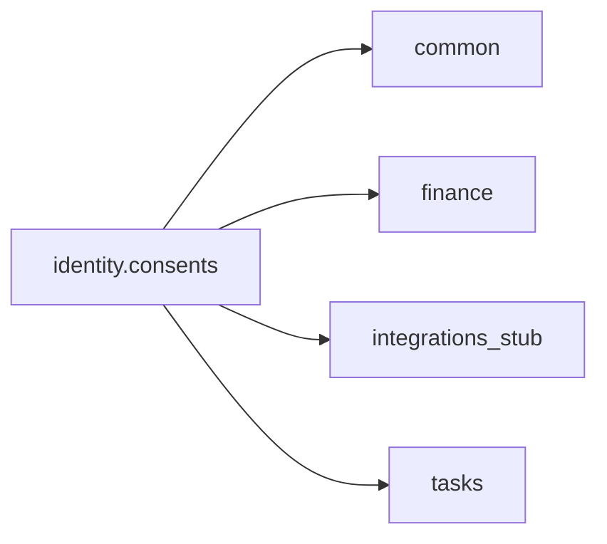

# identity.consents

## Que hace

`identity.consents` modela consentimientos legales y operativos del usuario.

Su trabajo es:

- registrar que datos o capacidades autorizo el usuario
- versionar proveedor, alcance y base legal
- publicar eventos `users.consent.*`
- disparar teardown operativo cuando un consentimiento se revoca

## Por Que Existe

En Vexxo no basta con saber si el plan permite algo.

Tambien hay que saber si el usuario autorizo:

- open banking data
- open banking payments
- OCR documental
- procesamiento de IA
- exportacion de datos
- marketing

Eso tiene implicaciones:

- legales
- operativas
- de permisos derivados
- de integraciones activas

## Vista visual

## Flujo Principal

### Grant de consentimiento

1. la app registra o confirma un consentimiento
2. `grant_consent()` persiste el estado
3. se emite `users.consent.granted.v1`
4. `identity.permissions` deriva permission codes relacionados
5. contextos como `accounts` pueden refrescar proyecciones o disponibilidad

### Revocacion de consentimiento

1. el usuario o un proceso revoca consentimiento
2. `revoke_consent()` actualiza el estado
3. se emite `users.consent.revoked.v1`
4. `event_handlers` dispara teardown operativo
5. en local, `tasks.async_backends` ejecuta el teardown por el adapter inline
6. se revocan conexiones open banking, enlaces y auto-sync idempotentemente

## Relacion Con Otros Modulos

- `identity.permissions`
  traduce consentimiento a entitlements
- `finance.accounts`
  corta o actualiza integraciones cuando cambia el consentimiento
- `integrations_stub.banks`
  hoy ejecuta el teardown operativo temporal cuando el backend efectivo resuelve
  `sync_inline_for_tests`

## Frontera operativa

El dominio no depende de infraestructura cloud. En desarrollo local el outbox
de identidad entrega el evento y el teardown usa el adapter inline. Un
transporte futuro puede cambiar sin modificar el contrato de consentimiento.

La revocacion no debe quedarse en estado administrativo; debe producir efecto
real sobre integraciones y permisos.

## Casos De Uso

- usuario desconecta open banking
- usuario desactiva permiso de pagos open banking
- usuario retira consentimiento de OCR o IA
- cumplimiento y soporte necesitan trazabilidad del estado legal

## Politicas Del Modulo

- revocar consentimiento debe tener efecto operativo real cuando aplique
- el modulo no debe quedarse en “papel”; debe coordinar teardown
- consentimiento y permiso no son lo mismo, pero deben integrarse

## Estado Actual

Hoy ya persiste grants/revokes, emite eventos y despacha el teardown por la
frontera comun `tasks.async_backends` con `job_type=identity.consents`.

En local:

- el camino oficial es `ASYNC_EXECUTION_MODE_IDENTITY_CONSENTS=sync_inline_for_tests`
- hoy no existe `manage.py run_worker identity.consents`
- eso es deliberado: el flujo ya usa la frontera comun, pero no requiere aun un
  worker durable separado

Para las reglas de open finance, consulta
[`docs/OPEN_FINANCE_CONSENT_AND_REVOCATION.md`](../../docs/OPEN_FINANCE_CONSENT_AND_REVOCATION.md).

<!-- backend-source-audit:start -->
## Evidencia del codigo y mapa de dependencias

Inventario estatico reproducible del checkout. Describe declaraciones e imports;
no prueba despliegue, permisos efectivos ni que todos los caminos se ejecuten.
Las rutas son locales a su URLConf: el prefijo publico se consulta en
[`api/v1/routers.py`](../../api/v1/routers.py).

- Archivos Python de implementacion: **13** (excluye tests y migraciones).
- Huella SHA-256 del codigo inventariado: `1c9e505aaef8b56c90ffa8350760892de68206bbaca15e95a88da2980e860168`.
- Familias detectadas: models, serializers, services, views.

### Declaraciones de modelos detectadas

- `UserConsent` en [identity/consents/models/consent.py](models/consent.py).

### Rutas declaradas

| Patron local | Fuente |
| --- | --- |
| `` | [identity/consents/urls.py](urls.py) |
| `consentimientos/ [DRF router]` | [identity/consents/urls.py](urls.py) |

### Diagrama de dependencia estatica

Las flechas representan imports entre paquetes, no eventos ni orden de ejecucion.

Flujos transversales: [flujo actualizado](../../docs/BACKEND_CURRENT_FLOW.md).

Regeneracion: `py -3 scripts/audit_backend_docs.py --write`.
Comprobacion de deriva: `py -3 scripts/audit_backend_docs.py --check`.
<!-- backend-source-audit:end -->
