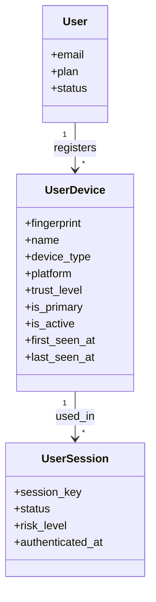
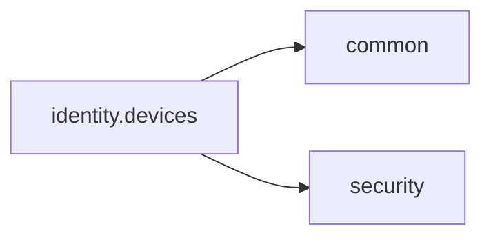

# identity.devices

## Que hace

`identity.devices` registra y administra dispositivos asociados al usuario.

Su responsabilidad actual es:

- registrar o actualizar dispositivos
- marcarlos como confiables
- revocarlos
- exponer listados y resumen de seguridad

## Rol En El Producto

Este modulo sostiene la capa de seguridad operativa del usuario.

De cara al cliente y soporte, responde preguntas como:

- desde que dispositivos entro el usuario
- cuales dispositivos son confiables o sospechosos
- que dispositivo debe revocarse

## Vista visual

## Flujo Principal

1. login o cliente registra un dispositivo
2. el backend crea o actualiza `UserDevice`
3. el usuario o soporte puede:
   - confiar el dispositivo
   - revocarlo
   - consultar un resumen

## Relacion Con Otros Modulos

- `identity.sessions`
  puede asociar sesiones a dispositivos
- `identity.users`
  consume el lifecycle general del usuario
- `identity.eventing`
  puede publicar eventos relacionados a dispositivos

## Encaje Operativo

Es una pieza OLTP sobre PostgreSQL. No necesita otra cola ni servicio local,
pero es importante para:

- auditoria
- deteccion de actividad sospechosa
- futuro MFA o device trust mas fuerte

## Estado Actual

Hoy el API expone:

- registro de dispositivo
- trust
- revoke
- listado
- `summary`
- `suspicious` para staff/admin

El modulo ya es util operativamente aunque aun no sea una plataforma completa
de risk scoring de dispositivos.

## Firma De Dispositivo

El registro acepta una clave publica Ed25519. `signature-challenge` entrega un
nonce que expira en tres minutos y `verify-signature` lo consume una sola vez.
Una firma correcta marca `key_verified`; `platform_verified` queda reservado
para futuros adapters oficiales de Play Integrity y App Attest.

Los adapters oficiales ya existen como una comprobacion separada:
`platform-attestation-challenge` genera evidencia de un solo uso y
`verify-platform-attestation` valida el verdict de Google o la cadena,
nonce, app id, AAGUID y clave de Apple. Solo este flujo marca
`platform_verified`; Ed25519 continua marcando exclusivamente `key_verified`.
Las credenciales y raices quedan vacias en `.env.local.example`.

La verificacion oficial expira segun
`DEVICE_ATTESTATION_VALIDITY_DAYS`. El scheduler degrada evidencias vencidas;
fallos consecutivos marcan el dispositivo como sospechoso y revocan sus
sesiones. `devices_revoke_attestations` permite revocacion masiva con dry-run y
guardrails por proveedor o antiguedad.

La prueba real de Play Integrity exige una app distribuida por Google Play y la
de App Attest exige hardware Apple. Los mocks prueban el lifecycle, pero no
certifican la evidencia de plataforma. Consulta
[Garantias de identidad](../../docs/IDENTITY_SECURITY_ASSURANCE.md).

<!-- backend-source-audit:start -->
## Evidencia del codigo y mapa de dependencias

Inventario estatico reproducible del checkout. Describe declaraciones e imports;
no prueba despliegue, permisos efectivos ni que todos los caminos se ejecuten.
Las rutas son locales a su URLConf: el prefijo publico se consulta en
[`api/v1/routers.py`](../../api/v1/routers.py).

- Archivos Python de implementacion: **15** (excluye tests y migraciones).
- Huella SHA-256 del codigo inventariado: `9104504c865ab2dd309623a1411ce0e0c91864e115687de524ddbad5a0108bcb`.
- Familias detectadas: management, models, serializers, services, views.

### Declaraciones de modelos detectadas

- `DevicePlatformAttestationChallenge` en [identity/devices/models/device.py](models/device.py).
- `DeviceSignatureChallenge` en [identity/devices/models/device.py](models/device.py).
- `UserDevice` en [identity/devices/models/device.py](models/device.py).

### Rutas declaradas

| Patron local | Fuente |
| --- | --- |
| `` | [identity/devices/urls.py](urls.py) |
| `dispositivos/ [DRF router]` | [identity/devices/urls.py](urls.py) |

### Diagrama de dependencia estatica

Las flechas representan imports entre paquetes, no eventos ni orden de ejecucion.

Flujos transversales: [flujo actualizado](../../docs/BACKEND_CURRENT_FLOW.md).

Regeneracion: `py -3 scripts/audit_backend_docs.py --write`.
Comprobacion de deriva: `py -3 scripts/audit_backend_docs.py --check`.
<!-- backend-source-audit:end -->
