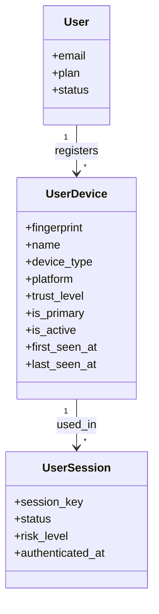

# identity.devices

## Que hace

`identity.devices` registra y administra dispositivos asociados al usuario.

Su responsabilidad actual es:

- registrar o actualizar dispositivos
- marcarlos como confiables
- revocarlos
- exponer listados y resumen de seguridad

## Rol En El Producto

Este modulo sostiene la capa de seguridad operativa del usuario.

De cara al cliente y soporte, responde preguntas como:

- desde que dispositivos entro el usuario
- cuales dispositivos son confiables o sospechosos
- que dispositivo debe revocarse

## Vista visual

## Flujo Principal

1. login o cliente registra un dispositivo
2. el backend crea o actualiza `UserDevice`
3. el usuario o soporte puede:
   - confiar el dispositivo
   - revocarlo
   - consultar un resumen

## Relacion Con Otros Modulos

- `identity.sessions`
  puede asociar sesiones a dispositivos
- `identity.users`
  consume el lifecycle general del usuario
- `identity.eventing`
  puede publicar eventos relacionados a dispositivos

## Encaje Con GCP

Es una pieza OLTP de seguridad sobre Cloud SQL + Cloud Run.

No necesita procesamiento largo, pero es importante para:

- auditoria
- deteccion de actividad sospechosa
- futuro MFA o device trust mas fuerte

## Estado Actual

Hoy el API expone:

- registro de dispositivo
- trust
- revoke
- listado
- `summary`
- `suspicious` para staff/admin

El modulo ya es util operativamente aunque aun no sea una plataforma completa
de risk scoring de dispositivos.
