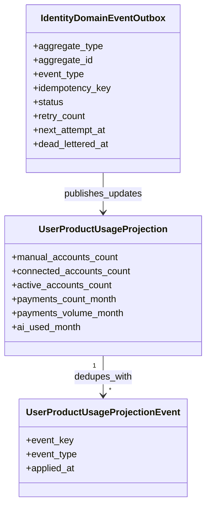
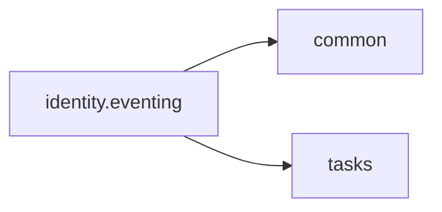

# identity.eventing

## Que hace

Outbox operativo y read models derivados del bounded context de identidad.

Su trabajo es:

- persistir eventos `users.*`, `permissions.*`, `consents.*`, `sessions.*`
- desacoplar escritura transaccional de publicacion al bus
- alojar la proyeccion materializada de uso de producto

## Rol En El Producto

Aunque es un modulo interno, tiene impacto directo en la experiencia del
usuario porque sostiene:

- respuestas rapidas del BFF sin publicar en caliente
- lectura barata y consistente de uso para mobile/web
- coherencia entre plan, permisos, consents y limits del producto

## Por Que Existe

Este modulo evita dos problemas:

- publicar eventos de identidad desde el request path
- recalcular uso del producto leyendo muchas tablas OLTP cada vez

Su funcion es ser capa de entrega y de lectura derivada para identidad.

## Vista visual

## Flujo actual

1. `identity.users.services.event_service.publish_user_event_after_commit()`
   construye el evento y lo encola en `IdentityDomainEventOutbox`.
2. El request web termina sin publicar directamente.
3. Un worker/cron ejecuta:

`python manage.py identity_publish_outbox`

4. Ese worker publica los eventos pendientes/fallidos al bus comun.

### Lectura de uso

1. otros bounded contexts emiten eventos `accounts.*`, `alerts.*`,
   `payments.*` o productores equivalentes
2. la proyeccion `UserProductUsageProjection` se actualiza
3. `identity.users` devuelve usage y capabilities al cliente
4. mobile/web puede renderizar limites, badges y mensajes de upgrade sin
   golpear varias tablas OLTP

## Read models del modulo

### `UserProductUsageProjection`

Snapshot operativo de uso por usuario que mobile/web consulta sin golpear
OLTP en caliente.

### `UserProductUsageProjectionEvent`

Checkpoint persistente de eventos ya aplicados a la proyeccion.

Sirve para:

- evitar dobles aplicaciones de deltas cuando un worker reintenta
- endurecer la evolucion hacia un proyector 100% incremental
- dejar trazabilidad de que `event_key` actualizo el snapshot

No es cache volatil. Es parte de la capa de lectura del producto.

## Casos De Uso

- mostrar a un usuario `free` cuanto uso de IA lleva en el mes
- saber cuantas cuentas conectadas tiene antes de un nuevo intento de sync
- calcular si debe salir un `growth.upgrade_triggered`
- exponer a mobile un snapshot unificado de plan + usage + capacidades

## Relacion con otros modulos

- `common.domain_events`: bus de dominio compartido
- `identity.users`: productor principal de eventos y consumidor de la proyeccion
- `finance.accounts`: emite muchos de los eventos que actualizan usage
- `alerts.alerts`: alimenta uso de IA
- `payments.payment_intents`: alimenta volumen y conteo de pagos
- `payments.payment_intents`: alimenta tambien volumen diario y mensual de
  payouts/dispersions

## Encaje Con GCP

Este modulo esta pensado para:

- Cloud SQL como persistencia del outbox y read models
- Cloud Run workers o management commands para publicar eventos
- Pub/Sub como transporte externo cuando aplique
- consumers de analytics, billing o growth leyendo el stream ya desacoplado

No necesita conexiones largas en el request web; su utilidad esta en sacar
trabajo del path sin perder trazabilidad.

## Politicas Del Modulo

- el request de identidad no debe recalcular uso por consultas pesadas
- los eventos ya aplicados a la proyeccion deben poder deduplicarse
- el outbox de identidad no debe ser reemplazado por listeners ad hoc
- el read model es parte del producto, no un cache descartable

## Esqueleto/futuro

La direccion objetivo es acercarlo aun mas al outbox de `accounts`:

- retries con backoff formal
- dead-letter operativa
- workers dedicados en Cloud Run / Cloud Tasks / Pub/Sub
- trazabilidad mas rica por publisher

Estado actual despues de esta pasada:

- ya tiene `next_attempt_at`
- ya tiene `dead_lettered_at` y `dead_letter_reason`
- ya tiene `request_id`
- ya usa `claim_for_processing()` en worker
- ya puede recuperar locks stale y respetar reintentos

Hoy ya esta fuera del request path; lo siguiente es endurecer todavia mas la
observabilidad y no cambiar el contrato.

<!-- backend-source-audit:start -->
## Evidencia del codigo y mapa de dependencias

Inventario estatico reproducible del checkout. Describe declaraciones e imports;
no prueba despliegue, permisos efectivos ni que todos los caminos se ejecuten.
Las rutas son locales a su URLConf: el prefijo publico se consulta en
[`api/v1/routers.py`](../../api/v1/routers.py).

- Archivos Python de implementacion: **11** (excluye tests y migraciones).
- Huella SHA-256 del codigo inventariado: `438315d8f2a06aa7325650e99d599608567ecc693622a61512f8faf4a17fe8da`.
- Familias detectadas: management, models, serializers, services, views.

### Declaraciones de modelos detectadas

- `IdentityDomainEventOutbox` en [identity/eventing/models.py](models.py).
- `UserProductUsageProjection` en [identity/eventing/models.py](models.py).
- `UserProductUsageProjectionEvent` en [identity/eventing/models.py](models.py).

### Rutas declaradas

| Patron local | Fuente |
| --- | --- |
| `outbox-identidad/ [DRF router]` | [identity/eventing/urls.py](urls.py) |

### Diagrama de dependencia estatica

Las flechas representan imports entre paquetes, no eventos ni orden de ejecucion.

Flujos transversales: [flujo actualizado](../../docs/BACKEND_CURRENT_FLOW.md).

Regeneracion: `py -3 scripts/audit_backend_docs.py --write`.
Comprobacion de deriva: `py -3 scripts/audit_backend_docs.py --check`.
<!-- backend-source-audit:end -->
