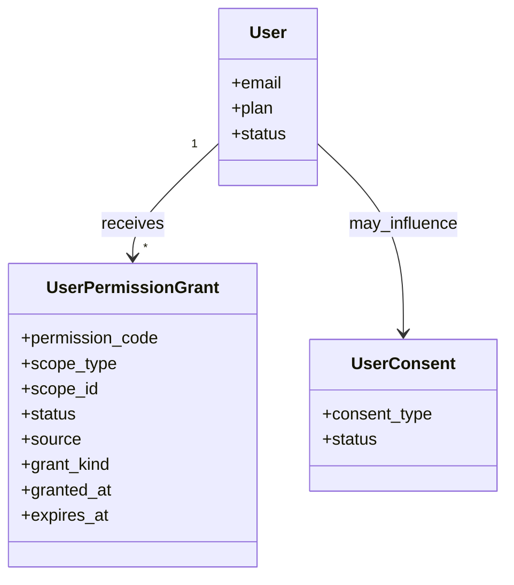

# identity.permissions

## Que hace

`identity.permissions` materializa y resuelve grants efectivos de permisos para
el usuario.

No define el plan del usuario. Eso lo hace `identity.users`.

Su responsabilidad es:

- persistir grants de permiso
- diferenciar grants por origen:
  - plan
  - consentimiento
  - override manual
  - grant manual
- resolver el estado efectivo final por `permission_code`
- publicar eventos `users.permission.*`

## Por Que Existe

Vexxo necesita separar:

- capacidad comercial del plan
- consentimiento legal
- excepciones operativas
- denegaciones explicitas

Si todo eso viviera mezclado dentro de `accounts`, `payments` o `users`, la
politica se volveria inconsistente.

`identity.permissions` funciona como capa de entitlements reutilizable.

## Vista visual

## Flujo Principal

### Grants por plan

1. cambia `User.plan`
2. `identity.permissions.event_handlers` escucha `users.registered` o
   `users.plan.changed`
3. `sync_plan_permissions_for_user()` traduce capabilities de `plan_matrix` a
   permission codes
4. se persisten grants `ENTITLEMENT`
5. se publican eventos `users.permission.granted` o equivalentes

### Grants por consentimiento

1. `identity.consents` emite `users.consent.granted` o `users.consent.revoked`
2. `identity.permissions.event_handlers` sincroniza permisos derivados del
   consentimiento
3. otros contextos consumen esos permission codes o el resumen efectivo

### Override o deny explicito

1. soporte, backoffice o logica de riesgo ajusta un grant
2. `deny_permission()` o `revoke_permission()` cambia estado
3. el permiso efectivo final puede quedar denegado aunque el plan lo permita

## Conceptos Importantes

- `permission_code`
  capacidad booleana reutilizable, por ejemplo:
  - `payments.embedded.enabled`
  - `payments.payouts.enabled`
  - `alerts.smart.enabled`
- `grant_kind`
  prioridad del grant:
  - `OVERRIDE`
  - `MANUAL`
  - `ENTITLEMENT`
- `status`
  estado del grant:
  - `granted`
  - `denied`
  - `revoked`
  - `expired`

La resolucion efectiva respeta precedencia de `grant_kind` y `status`.

## Relacion Con Otros Modulos

- `identity.users`
  aporta `plan_matrix` y capabilities base
- `identity.consents`
  aporta grants legales por consentimiento
- `finance.accounts`, `payments`, `alerts`
  consumen permission codes o capacities derivadas para aplicar guards propios

## Encaje Con GCP

Este modulo es liviano y funciona bien en Cloud Run:

- lectura efectiva de permisos desde OLTP
- sincronizacion derivada por eventos
- publicacion por outbox de identidad

Si mañana hace falta escalar lectura, el resumen efectivo puede proyectarse o
cachearse sin romper el contrato del modulo.

## Casos De Uso

- desbloquear pagos embebidos por plan
- desactivar payouts aunque el plan los permita
- habilitar smart alerts solo en `pro`
- cortar una capacidad por compliance o soporte

## Politicas Del Modulo

- el plan no debe ser la unica fuente de verdad cuando existe deny u override
- el consentimiento no debe vivirse solo como dato legal; debe poder reflejarse
  en permisos efectivos
- la resolucion final debe ser explicable y estable para mobile y soporte

## Estado Actual

Hoy ya resuelve grants por:

- plan
- consentimiento
- override
- grants manuales

y publica eventos `users.permission.*` para el resto del ecosistema.

<!-- backend-source-audit:start -->
## Evidencia del codigo y mapa de dependencias

Inventario estatico reproducible del checkout. Describe declaraciones e imports;
no prueba despliegue, permisos efectivos ni que todos los caminos se ejecuten.
Las rutas son locales a su URLConf: el prefijo publico se consulta en
[`api/v1/routers.py`](../../api/v1/routers.py).

- Archivos Python de implementacion: **12** (excluye tests y migraciones).
- Huella SHA-256 del codigo inventariado: `207f1b14eccdccca0cf394f4d9fdb91bc1321c3ef0c047472624c2d9089e75de`.
- Familias detectadas: models, serializers, services, views.

### Declaraciones de modelos detectadas

- `UserPermissionGrant` en [identity/permissions/models/permission_grant.py](models/permission_grant.py).

### Rutas declaradas

| Patron local | Fuente |
| --- | --- |
| `` | [identity/permissions/urls.py](urls.py) |
| `grants/ [DRF router]` | [identity/permissions/urls.py](urls.py) |

### Diagrama de dependencia estatica

Las flechas representan imports entre paquetes, no eventos ni orden de ejecucion.

Flujos transversales: [flujo actualizado](../../docs/BACKEND_CURRENT_FLOW.md).

Regeneracion: `py -3 scripts/audit_backend_docs.py --write`.
Comprobacion de deriva: `py -3 scripts/audit_backend_docs.py --check`.
<!-- backend-source-audit:end -->
