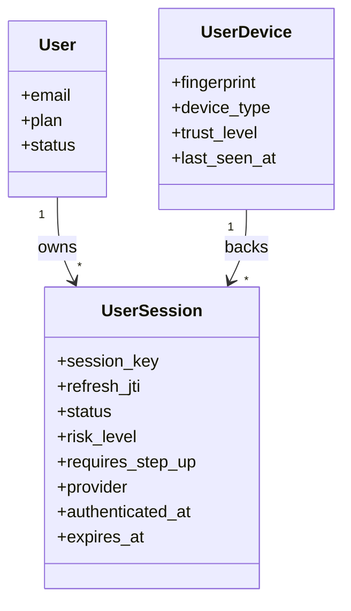

# identity.sessions

## Que hace

`identity.sessions` administra sesiones del usuario como recurso operativo
separado del login puntual.

Su responsabilidad actual es:

- registrar sesiones
- tocarlas/actualizarlas
- revocarlas individualmente
- revocar familias o todas las activas
- exponer resumen de salud de sesiones

## Rol En El Producto

Este modulo da control de seguridad al usuario y a soporte.

De cara al cliente, permite:

- ver sesiones activas
- cerrar otras sesiones
- revocar toda su presencia si detecta riesgo

## Vista visual

## Flujo Principal

1. auth o cliente registra una sesion
2. `UserSession` queda persistida con datos de provider, tipo y expiracion
3. el usuario o soporte puede:
   - revocar una sesion
   - revocar otras
   - revocar una familia
   - consultar resumen

## Relacion Con Otros Modulos

- `identity.devices`
  aporta el dispositivo asociado a la sesion
- `identity.users`
  aporta el usuario y su lifecycle
- `identity.eventing`
  puede publicar eventos `users.session.*`

## Encaje Con GCP

Este modulo funciona bien en Cloud Run como superficie de administracion
operativa.

Si crece en criticidad, puede integrarse mejor con:

- revocacion de tokens
- risk scoring
- auditoria
- alertas de seguridad

## Estado Actual

Hoy el API expone:

- `register_session`
- `revoke`
- `touch`
- `active`
- `revoke_all`
- `revoke_others`
- `revoke_family`
- `summary`

Eso ya lo vuelve una capa de operacion de sesiones, no solo un detalle interno
del login.
