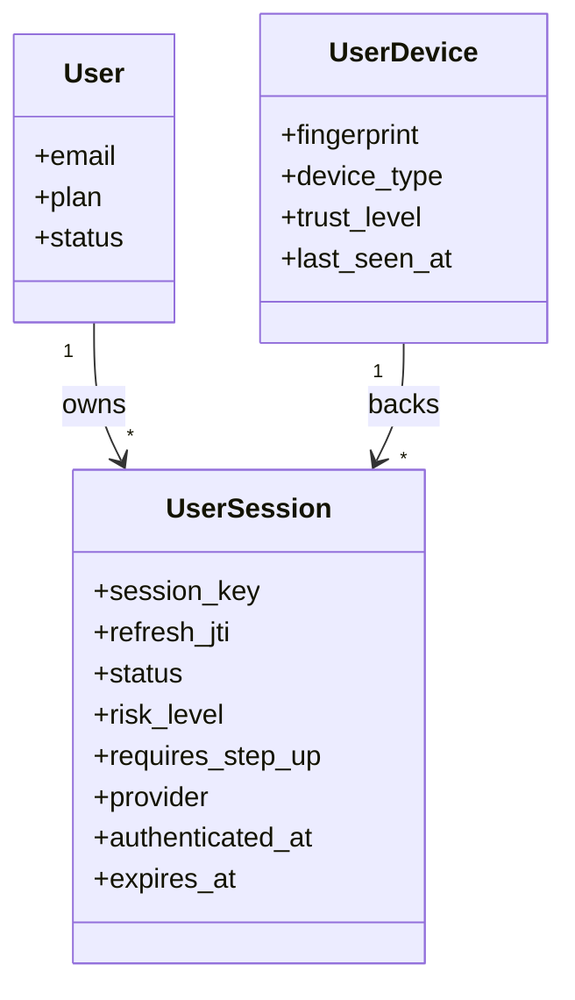
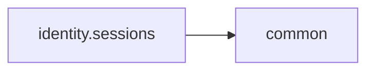

# identity.sessions

## Que hace

`identity.sessions` administra sesiones del usuario como recurso operativo
separado del login puntual.

Su responsabilidad actual es:

- registrar sesiones
- tocarlas/actualizarlas
- revocarlas individualmente
- revocar familias o todas las activas
- soportar `requires_step_up` para dispositivos no confiables
- revocar sesiones riesgosas de forma selectiva
- exponer resumen de salud de sesiones

## Rol En El Producto

Este modulo da control de seguridad al usuario y a soporte.

De cara al cliente, permite:

- ver sesiones activas
- cerrar otras sesiones
- revocar toda su presencia si detecta riesgo

## Vista visual

## Flujo Principal

1. auth o cliente registra una sesion
2. `UserSession` queda persistida con datos de provider, tipo y expiracion
3. el usuario o soporte puede:
   - revocar una sesion
   - revocar otras
   - revocar una familia
   - consultar resumen

## Step-up y riesgo

`identity.sessions` no emite por si mismo el codigo de step-up, pero si define
la semantica de la sesion:

- `requires_step_up=True` si el dispositivo es `unknown`, `suspicious` o la politica lo exige
- `identity.users` emite el challenge y valida el codigo
- al completar step-up, la sesion queda saneada y puede revocar otras sesiones
  activas todavia marcadas como riesgosas

## Relacion Con Otros Modulos

- `identity.devices`
  aporta el dispositivo asociado a la sesion
- `identity.users`
  aporta el usuario y su lifecycle
- `identity.eventing`
  puede publicar eventos `users.session.*`

## Encaje Con GCP

Este modulo funciona bien en Cloud Run como superficie de administracion
operativa.

Si crece en criticidad, puede integrarse mejor con:

- revocacion de tokens
- risk scoring
- auditoria
- alertas de seguridad

## Estado Actual

Hoy el API expone:

- `register_session`
- `revoke`
- `touch`
- `active`
- `revoke_all`
- `revoke_others`
- `revoke_family`
- `summary`

Eso ya lo vuelve una capa de operacion de sesiones, no solo un detalle interno
del login.

<!-- backend-source-audit:start -->
## Evidencia del codigo y mapa de dependencias

Inventario estatico reproducible del checkout. Describe declaraciones e imports;
no prueba despliegue, permisos efectivos ni que todos los caminos se ejecuten.
Las rutas son locales a su URLConf: el prefijo publico se consulta en
[`api/v1/routers.py`](../../api/v1/routers.py).

- Archivos Python de implementacion: **13** (excluye tests y migraciones).
- Huella SHA-256 del codigo inventariado: `46c2b711db13b53418521ea9edddba91a149b14d41df1ea60efc09f19e3c1983`.
- Familias detectadas: models, serializers, services, views.

### Declaraciones de modelos detectadas

- `UserSession` en [identity/sessions/models/session.py](models/session.py).

### Rutas declaradas

| Patron local | Fuente |
| --- | --- |
| `` | [identity/sessions/urls.py](urls.py) |
| `sesiones/ [DRF router]` | [identity/sessions/urls.py](urls.py) |

### Diagrama de dependencia estatica

Las flechas representan imports entre paquetes, no eventos ni orden de ejecucion.

Flujos transversales: [flujo actualizado](../../docs/BACKEND_CURRENT_FLOW.md).

Regeneracion: `py -3 scripts/audit_backend_docs.py --write`.
Comprobacion de deriva: `py -3 scripts/audit_backend_docs.py --check`.
<!-- backend-source-audit:end -->
